# 梯度下降算法

模型训练是以训练损失最小化为目标的参数估计过程。梯度下降及其改进方法利用损失函数的梯度构造参数更新，通过迭代降低模型在训练数据上的预测误差。

本文从经验风险与凸性出发，依次讨论梯度下降、二阶方法、随机梯度、动量与 Nesterov 加速，以及 AdaGrad、RMSProp、AdaDelta、Adam 和学习率调度。通过推导更新规则、分析曲率与采样噪声，说明算法的收敛条件、计算代价和适用边界。[\[1\]](#参考文献1)[\[9\]](#参考文献9)

## 1. 模型训练与优化目标

### 模型参数与损失函数

给定训练数据 $\{(x_i,y_i)\}_{i=1}^{N}$，模型 $f(x_i;\theta)$ 根据输入 $x_i$ 给出预测。$\theta$ 表示模型参数。

损失函数将模型预测与观测值之间的差异量化为标量。以平方误差损失为例：

$$
\ell_i(\theta)=\bigl(f(x_i;\theta)-y_i\bigr)^2,
\qquad
L(\theta)=\frac{1}{N}\sum_{i=1}^{N}\ell_i(\theta).
$$

$\ell_i$ 是一个样本的损失，$L$ 是所有训练样本的平均损失。训练目标是求解损失函数的最小化问题：

$$
\theta^*\in\arg\min_{\theta}L(\theta).
$$

其中，$\arg\min$ 表示使目标函数取得最小值的参数集合。符号 $\in$ 表明最优参数可能不唯一。

损失函数也可定义为样本损失之和。**求和损失与平均损失具有相同的最优解，但梯度相差 $N$ 倍。** 为使两种定义下的常规梯度下降产生相同更新，需要相应缩放学习率。本文将统一采用平均损失。

### 经验风险与泛化风险

平均训练损失也称为经验风险。设样本来自分布 $P(x,y)$，对应的总体风险为

$$
R(\theta)=\mathbb E_{(x,y)\sim P}\bigl[\ell(f(x;\theta),y)\bigr].
$$

优化算法直接降低的是可计算的 $L(\theta)$，而学习任务最终关心的是未知分布上的 $R(\theta)$。有限样本的经验风险只是总体风险的估计，二者的极小点不必重合。因此，**优化误差降低与泛化误差降低是两个不同目标**；提高优化效率不能替代验证集选择、正则化和数据质量控制。[\[9\]](#参考文献9)

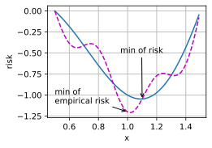

*图 1｜经验风险与总体风险的示意曲线。有限数据对应的最优训练参数不一定是总体风险最小的参数，曲线的纵轴数值仅用于说明这一差别。[\[9\]](#参考文献9)*

优化中通常研究最小化问题；最大化 $F(\theta)$ 等价于最小化 $-F(\theta)$。少数简单目标可以得到解析解，而深层网络一般需要迭代数值方法。算法比较既应考虑达到给定训练精度的成本，也应单独报告最终的泛化表现。

### 迭代训练过程

梯度优化的基本训练流程包括：

1. 确定参数初始值。
2. 根据当前参数计算模型预测与损失。
3. 计算损失函数关于参数的梯度。
4. 根据优化算法更新参数，并重复上述过程。

反向传播用于高效计算梯度，优化器根据梯度构造更新，参数初始化则确定迭代起点。三者共同影响训练效率与最终结果。

主要符号定义如下：

| 记号 | 含义 |
|---|---|
| $\theta_t$ | 第 $t$ 次更新前的参数，初始值为 $\theta_0$ |
| $g_t$ | 当前用于更新的梯度，可以来自全部样本或一个小批量 |
| $\alpha,\alpha_t$ | 固定或随迭代变化的学习率 |
| $B_t,b$ | 当前批次的样本集合及其大小 |
| $m_t$ | 梯度的历史加权平均 |
| $\beta$ | 动量系数，取 $0\leq\beta<1$ |
| $v_t$ | Adam 中梯度平方的历史加权平均 |

### 训练超参数

模型参数通过损失最小化进行估计，包括权重、偏置等。训练超参数规定优化过程的配置，包括优化器、学习率、批量大小、动量系数与训练周期数。

超参数选择通常通过比较不同配置的验证集表现完成，独立测试集用于评价最终选定模型的泛化性能。

梯度采样方式与参数更新机制是两个不同层面：SGD 采用样本子集估计梯度，动量与 Adam 则规定如何利用当前及历史梯度。因此，动量和 Nesterov 均可使用随机梯度，Adam 也可使用全梯度。

后文用 $F$ 表示一般分析目标，$L$ 保留为平均训练损失，$R$ 表示总体风险；$M$ 表示光滑常数或最大曲率，$\mu$ 表示最小正曲率，避免与损失符号混淆。所有向量平方、平方根和分式在自适应更新中均按坐标计算。

## 2. 凸性与约束优化

### 凸集与凸函数

集合 $\mathcal C$ 为凸集，是指其中任意两点之间的整条线段仍属于该集合：

$$
x,y\in\mathcal C,\quad \lambda\in[0,1]
\quad\Longrightarrow\quad
\lambda x+(1-\lambda)y\in\mathcal C.
$$

整个欧氏空间、半空间、仿射子空间以及 $p\geq1$ 时的范数球都是凸集。例如，若 $Ax=Ay=b$，则 $A(\lambda x+(1-\lambda)y)=b$，所以 $\{x:Ax=b\}$ 是凸集。

*图 2｜左侧集合中的某些点之间的线段会离开集合，因此非凸；后两个集合满足线段条件。[\[9\]](#参考文献9)*

凸集的任意交集仍然是凸集：交集中的两点及其连线同时属于每一个原集合。但是，并集未必凸，因为来自不同集合的两点之间可能有一段空隙。

*图 3｜两个凸集的交集仍保留线段条件。[\[9\]](#参考文献9)*

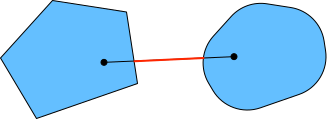

*图 4｜两个凸集的并集可以是非凸的；这并不意味着所有并集都非凸。[\[9\]](#参考文献9)*

在凸定义域 $\mathcal C$ 上，函数 $F$ 为凸函数，是指

$$
F(\lambda x+(1-\lambda)y)
\leq\lambda F(x)+(1-\lambda)F(y).
$$

其几何意义是：函数图像位于连接两点的弦下方。若对不同的两点和 $0<\lambda<1$ 总取严格不等号，则称为严格凸。

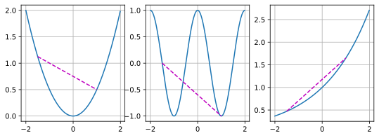

*图 5｜抛物线与指数函数满足凸性；余弦函数在所示定义域上不满足凸性。[\[9\]](#参考文献9)*

非负加权和、逐点最大值都保持凸性，例如 $\max(F_1,F_2)$ 在两函数均凸时仍然凸；逐点最小值则不一定凸。深层网络关于参数的损失一般非凸，但凸问题便于揭示算法机制、建立收敛界，不能把这些保证直接移植到任意网络。

### Jensen 不等式

将两点的凸组合推广到多个点，可得

$$
F\!\left(\sum_i a_ix_i\right)\leq\sum_i a_iF(x_i),
\qquad a_i\geq0,\quad\sum_i a_i=1.
$$

反复将多项组合拆成两点组合即可证明；在相应期望存在时，其概率形式为

$$
F(\mathbb E[X])\leq\mathbb E[F(X)].
$$

这个不等式说明，对于凸目标，平均参数的目标值不超过各参数目标值的平均。后文将用它把 SGD 迭代过程的平均误差界转化为平均参数的收敛界。[\[9\]](#参考文献9)

另一个应用是隐变量概率模型。固定观测 $x$，令 $p(x)=\mathbb E_{Y\sim p(Y)}[p(x\mid Y)]$。由于 $-\log u$ 在 $u>0$ 上凸，

$$
-\log p(x)
\leq\mathbb E_Y[-\log p(x\mid Y)].
$$

因此，边缘负对数似然可由较容易处理的条件负对数似然期望作上界。

### 局部最优与全局最优

凸函数的任何局部最小值都是全局最小值。设 $x^*$ 是局部最小点，但存在 $y$ 使 $F(y)<F(x^*)$。对足够小的 $s>0$，点 $x_s=(1-s)x^*+sy$ 位于 $x^*$ 的邻域，并满足

$$
F(x_s)\leq(1-s)F(x^*)+sF(y)<F(x^*),
$$

这与局部最小性矛盾。

凸性不保证最小点存在或唯一。例如，$F(x)=\max(|x|-1,0)$ 在整个 $[-1,1]$ 上取得最小值；$F(x)=e^x$ 的下确界是 $0$，但在 $\mathbb R$ 上没有达到它的有限参数。严格凸性保证**至多**有一个最小点，存在性仍需另外讨论。[\[9\]](#参考文献9)

### 下水平集与一阶条件

凸函数的下水平集 $\mathcal S_c=\{x\in\mathcal C:F(x)\leq c\}$ 是凸集。因为对其中的 $x,y$，

$$
F(\lambda x+(1-\lambda)y)
\leq\lambda F(x)+(1-\lambda)F(y)\leq c.
$$

这使凸不等式约束能够构造凸可行域。

对于可微凸函数，凸性的等价一阶条件是

$$
F(y)\geq F(x)+\nabla F(x)^\top(y-x).
$$

即任一点的切平面都是函数的全局下界。若在无约束问题中 $\nabla F(x^*)=0$，便可直接推出 $F(y)\geq F(x^*)$。一般非凸函数只具有局部 Taylor 近似，没有这样的全局下界。

### 二阶判别与方向限制

对于开凸域上的二次连续可微函数，凸性等价于处处 Hessian 半正定：

$$
\nabla^2F(x)\succeq0
\quad\Longleftrightarrow\quad
d^\top\nabla^2F(x)d\geq0\quad\text{对任意方向 }d.
$$

一维情形下，凸性给出 $F(x+h)+F(x-h)-2F(x)\geq0$，除以 $h^2$ 后令 $h\to0$，得到 $F''(x)\geq0$。反过来，$F''\geq0$ 意味着 $F'$ 单调不减。对 $a<x<b$，由中值定理有

$$
\frac{F(x)-F(a)}{x-a}
\leq\frac{F(b)-F(x)}{b-x},
$$

整理后正是弦位于图像上方的凸性不等式。

多维情形可以限制到任意直线 $h(s)=F(x+sd)$。函数在整个凸域上凸，当且仅当每条直线上的限制函数都凸，而

$$
h''(s)=d^\top\nabla^2F(x+sd)d.
$$

于是多维判别归结为一维判别。若定义域位于低维仿射空间，只需考察该空间允许的方向。[\[9\]](#参考文献9)

例如 $F(x)=\frac12\|x\|_2^2$ 的 Hessian 为单位矩阵。分类中常见的 $F(z)=\log\sum_i e^{z_i}$ 也为凸函数：若 $p=\operatorname{softmax}(z)$，则

$$
\nabla^2F(z)=\operatorname{diag}(p)-pp^\top,
\qquad
d^\top\nabla^2F(z)d
=\sum_i p_id_i^2-\left(\sum_i p_id_i\right)^2\geq0.
$$

右侧是按概率 $p$ 计算的方差。这说明 softmax 交叉熵关于 logits 的凸性，但 logits 若由深层网络产生，损失关于全部网络参数仍可能非凸。

### 拉格朗日函数与惩罚项

约束优化问题可写为

$$
\min_\theta F(\theta)
\quad\text{满足}\quad c_i(\theta)\leq0.
$$

若目标与各约束函数均凸，则可行域是凸集。引入非负乘数 $\lambda_i$，定义拉格朗日函数

$$
\mathcal L(\theta,\lambda)
=F(\theta)+\sum_i\lambda_ic_i(\theta),
\qquad\lambda_i\geq0.
$$

对参数求最小、对乘数求最大，将可行性纳入优化：若某项约束被违反，即 $c_i(\theta)>0$，增大对应乘数会使目标无界增长；可行点则不会因此产生正的无限惩罚。在适当约束资格条件下，例如凸问题中的严格可行性条件，最优解可用鞍点及 KKT 条件刻画：

$$
\begin{aligned}
\nabla F(\theta^*)+\sum_i\lambda_i^*\nabla c_i(\theta^*)&=0,\\
c_i(\theta^*)&\leq0,\qquad\lambda_i^*\geq0,\\
\lambda_i^*c_i(\theta^*)&=0.
\end{aligned}
$$

最后一式是互补松弛：未触及的约束对应零乘数，起作用的约束可能提供抵消目标梯度的作用。这里的“鞍点”指对两组变量一降一升的极小极大结构，不应与无约束损失中的普通鞍点混为一谈。[\[9\]](#参考文献9)

固定惩罚系数得到另一种做法。例如约束 $\|w\|_2^2\leq r^2$ 的拉格朗日形式，略去与 $w$ 无关的常数后，包含 $\lambda\|w\|_2^2/2$，即 L2 正则化。系数控制拟合与权重大小的平衡，但任意固定系数不保证精确满足预先指定的所有约束。一般违约惩罚也可用 $\mu\sum_i\max(0,c_i(\theta))^2$，避免把“惩罚违反约束”与任意线性项混同。

### 投影与梯度裁剪

对于非空闭凸集 $\mathcal C$，欧氏投影定义为

$$
\Pi_{\mathcal C}(z)
=\arg\min_{x\in\mathcal C}\frac12\|x-z\|_2^2.
$$

它选择可行域中距离给定点 $z$ 最近的点，且该点唯一。投影梯度下降先执行无约束更新，再投影回可行域：

$$
\theta_{t+1}=\Pi_{\mathcal C}(\theta_t-\alpha_tg_t).
$$

*图 6｜可行域内的点保持不变，外部点映射到最近的可行点。圆球投影保持径向方向，L1 球的投影一般不保持该方向，并可能产生零坐标。[\[9\]](#参考文献9)*

对于 $\mathcal C=\{z:\|z\|_2\leq r\}$，

$$
\Pi_{\mathcal C}(z)=
\begin{cases}
z,&\|z\|_2\leq r,\\
r z/\|z\|_2,&\|z\|_2>r.
\end{cases}
$$

对梯度应用这一运算，就得到范数裁剪 $g\leftarrow g\min(1,r/\|g\|_2)$，零梯度保持不变。裁剪限制的是更新所使用的梯度，参数投影限制的是参数本身，二者不是同一个约束。

闭凸集投影具有非扩张性：$\|\Pi_{\mathcal C}(x)-\Pi_{\mathcal C}(y)\|_2\leq\|x-y\|_2$。特别地，可行最优点 $\theta^*$ 的投影仍是它本身，因此投影不会增大到它的距离；这一性质也允许把后文的 SGD 距离分析推广到投影更新。[\[9\]](#参考文献9)

## 3. 常规梯度下降

### 梯度的定义与几何意义

损失函数关于某一参数的偏导数，描述其他参数固定时，损失随该参数变化的局部变化率。

- 偏导数为正：参数的微小增大会导致损失局部增大，减小该参数构成下降方向。
- 偏导数为负：参数的微小增大会导致损失局部减小，增大该参数构成下降方向。
- 偏导数接近零：损失对该参数的局部一阶变化不敏感。

梯度是由各参数偏导数组成的向量。对于两参数模型，有

$$
\nabla L(\theta)=
\begin{bmatrix}
\dfrac{\partial L}{\partial\theta_0}\\[4pt]
\dfrac{\partial L}{\partial\theta_1}
\end{bmatrix}.
$$

在梯度非零的位置，以欧氏距离衡量等长的微小参数位移时，梯度方向使损失的一阶增量最大，负梯度方向使其最小。因此，负梯度是局部最陡下降方向，但该性质不意味着它直接指向全局最优解。

### 参数更新规则

常规梯度下降（Gradient Descent，GD）使用全部训练样本计算损失梯度，并按照以下规则更新参数：

$$
g_t=\nabla L(\theta_t),
\qquad
\boxed{\theta_{t+1}=\theta_t-\alpha g_t.}
$$

其中，参数增量为负梯度与学习率的乘积，学习率决定该方向上的更新幅度。

例如，若当前 $\theta_t=(1,2)$，梯度 $g_t=(4,-2)$，学习率 $\alpha=0.1$，则

$$
\theta_{t+1}=(1,2)-0.1(4,-2)=(0.6,2.2).
$$

本次更新使第一个参数减小、第二个参数增大，变化方向由相应偏导数的符号决定。各偏导数均应在同一组当前参数处计算，再同步更新全部参数。

### 局部下降原理

在一维情况下，损失函数在当前参数附近的一阶近似为：

$$
L(\theta+\Delta\theta)\approx L(\theta)+L'(\theta)\Delta\theta.
$$

代入 $\Delta\theta=-\alpha L'(\theta)$，得到

$$
L(\theta-\alpha L'(\theta))
\approx L(\theta)-\alpha\bigl(L'(\theta)\bigr)^2.
$$

当 $\alpha>0$ 且导数非零时，该一阶近似给出负的损失增量，为负梯度更新提供了局部依据。

**上述结论要求更新幅度足够小，使局部近似保持有效。** 学习率过大时，高阶项的影响可能不可忽略，实际损失因而可能增加。

### 光滑性与下降保证

对多维参数，在适当光滑条件下，一阶 Taylor 展开为

$$
L(\theta+\Delta)=L(\theta)+\nabla L(\theta)^\top\Delta
+O(\|\Delta\|_2^2).
$$

代入 $\Delta=-\alpha\nabla L(\theta)$，一阶变化为 $-\alpha\|\nabla L(\theta)\|_2^2$。若梯度满足 Lipschitz 条件

$$
\|\nabla L(x)-\nabla L(y)\|_2\leq M\|x-y\|_2,
$$

则可进一步控制余项，得到下降引理

$$
L(\theta-\alpha g)
\leq L(\theta)-\alpha\left(1-\frac{M\alpha}{2}\right)\|g\|_2^2,
\qquad g=\nabla L(\theta).
$$

因此 $0<\alpha<2/M$ 是精确全梯度下降的充分步长条件。这里 $M$ 表示梯度变化的上界，以区别于目标函数 $L$；该结论要求更新路径位于所考虑的光滑区域，也不直接适用于含采样误差的随机梯度。[\[9\]](#参考文献9)

### 学习率与更新稳定性

学习率决定参数增量的尺度，并影响迭代速度与稳定性：

| 学习率 | 可能出现的情况 |
|---|---|
| 过小 | 参数更新幅度较小，优化进展缓慢 |
| 适当 | 在稳定性与优化速度之间取得平衡 |
| 过大 | 可能产生过冲、振荡或发散 |

以 $L(\theta)=\theta^2$ 为例，梯度为 $2\theta$，更新变成

$$
\theta_{t+1}=(1-2\alpha)\theta_t.
$$

从 $\theta_0=1$ 出发：

- $\alpha=0.1$：$1\to0.8\to0.64\to\cdots$，参数单调趋近于零。
- $\alpha=0.75$：$1\to-0.5\to0.25\to\cdots$，参数符号交替，振幅逐渐减小。
- $\alpha=1.1$：$1\to-1.2\to1.44\to\cdots$，参数符号交替，振幅逐渐增大。

对于该二次函数，参数误差在每次迭代中乘以 $1-2\alpha$。若要求任意非零初值的误差幅值逐步减小，则需要

$$
|1-2\alpha|<1
\quad\Longleftrightarrow\quad
0<\alpha<1.
$$

这给出了学习率稳定范围的一个直接推导。更一般地，若目标为 $L(\theta)=a\theta^2/2$、$a>0$，相同分析得到 $0<\alpha<2/a$；曲率 $a$ 越大，稳定学习率的上界越小。

这说明了学习率对该二次函数的影响，其稳定范围依赖于具体目标函数，不能直接推广至其他问题。

学习率与实际位移长度是不同概念：即使 $\alpha$ 固定，梯度幅值仍会随迭代变化，因此参数位移长度通常并不固定。

### 线搜索方法

线搜索在确定负梯度方向后，通过评估该方向上不同步长对应的损失来选择更新幅度。精确线搜索可写为：

$$
\alpha_t=\arg\min_{\alpha\geq0}L(\theta_t-\alpha g_t).
$$

该过程将当前迭代的步长选择转化为一维优化问题，得到的是既定方向上的最优步长。

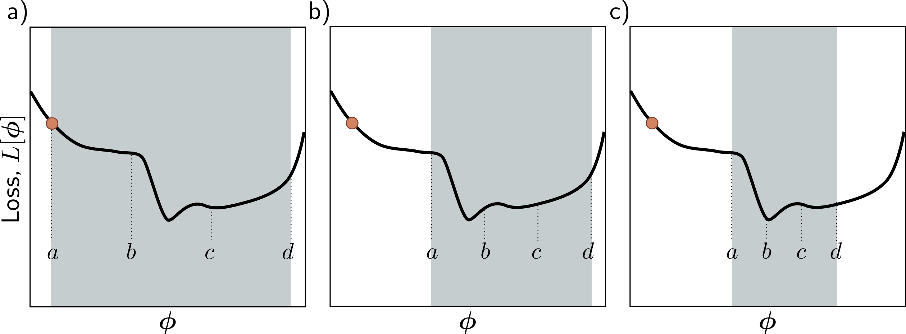

*图 7｜通过比较区间内若干位置的损失，逐步缩小搜索区间。图示的区间排除规则需要搜索区间内函数单峰等条件。[\[1\]](#参考文献1)*

线搜索利用目标函数值选择步长，但需要额外的损失评估。大规模训练通常采用预设学习率及其调度，以控制单次更新的计算成本。

若沿搜索方向的函数 $\varphi(a)=L(\theta-ag)$ 凸且可微，则 $\varphi'(a)=-g^\top\nabla L(\theta-ag)$ 单调不减。在已知导数变号的区间内，可以对 $\varphi'(a)=0$ 做二分，每次将区间长度减半。不使用导数时，则可在单峰假设下采用黄金分割等区间搜索；不能对任意多峰函数直接套用单峰区间排除规则。[\[9\]](#参考文献9)

## 4. 典型模型与优化困难

### 线性回归模型

一维线性回归模型为

$$
\hat y_i=\theta_0+\theta_1x_i,
\qquad
L(\theta)=\frac1N\sum_{i=1}^{N}(\theta_0+\theta_1x_i-y_i)^2.
$$

$\theta_0$ 是截距，$\theta_1$ 是斜率。记预测误差为 $r_i=\theta_0+\theta_1x_i-y_i$，则单样本损失是 $r_i^2$。

对截距求导时，$\partial r_i/\partial\theta_0=1$，所以 $\partial(r_i^2)/\partial\theta_0=2r_i$。对斜率求导时，多出因子 $x_i$。对全部样本求平均，得到

$$
\frac{\partial L}{\partial\theta_0}=\frac2N\sum_i r_i,
\qquad
\frac{\partial L}{\partial\theta_1}=\frac2N\sum_i x_ir_i.
$$

截距梯度由残差的平均值决定，反映整体预测偏差；斜率梯度由输入与残差乘积的平均值决定，反映拟合斜率的调整方向。

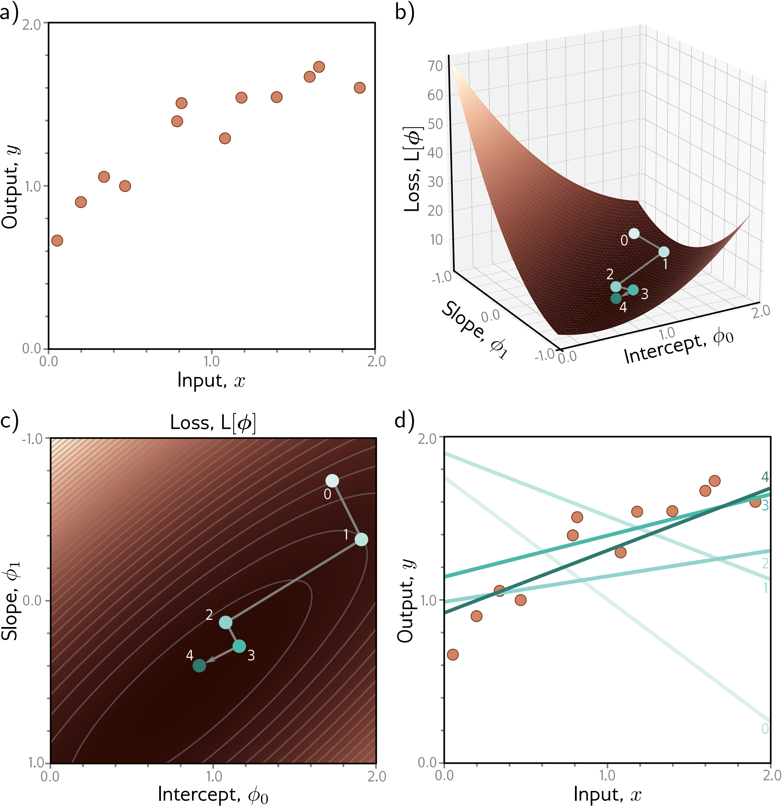

*图 8｜数据空间中的拟合直线与参数空间中的优化轨迹对应同一训练过程。每次参数更新均对应一条新的预测直线。[\[1\]](#参考文献1)*

该平方损失关于两个参数是凸函数，因此局部最小值也是全局最小值。对于这一带截距的线性模型，当输入 $x_i$ 不全相同时，最优参数唯一。

若所有输入均为常数 $c$，模型预测仅由组合 $\theta_0+c\theta_1$ 决定，多组参数可以产生相同预测。因此，凸性本身不保证最优参数唯一。

### 曲率与 Hessian 矩阵

梯度描述损失的一阶变化，二阶导数描述梯度的局部变化。损失函数关于参数的二阶偏导数组成 Hessian 矩阵：

$$
H_{jk}=\frac{\partial^2L}{\partial\theta_j\partial\theta_k}.
$$

在一维中，$L''>0$ 对应正曲率，$L''<0$ 对应负曲率。在多维中，不同方向可以具有不同符号的曲率；这有助于解释鞍点附近同时存在上升与下降方向的现象。

在线性回归例子中，再对梯度求一次导数可得

$$
H=\frac2N
\begin{bmatrix}
N&\sum_i x_i\\
\sum_i x_i&\sum_i x_i^2
\end{bmatrix}.
$$

该矩阵与参数取值无关，表明二次损失的曲率不随参数位置变化。输入不全相同时，参数在各方向上的曲率均为正；输入完全相同时，则存在不改变预测的平坦参数方向。

牛顿法利用 Hessian 的曲率信息构造更新，但其完整矩阵的存储与处理成本可能较高。一百万个参数对应一个 $10^6\times10^6$ 的矩阵，共有 $10^{12}$ 个元素。后文介绍的 Adam 则仅维护两组与参数等长的历史向量。[\[1\]](#参考文献1)

一阶梯度方法所需的状态规模通常较小，因而适合高维参数优化。一般非线性问题中的牛顿法仍可能需要步长控制，其更新也不必然收敛至极小点。

### Gabor 模型

非线性模型的损失函数可能具有多个局部最小值。以两参数 Gabor 模型为例：

$$
f(x;\theta)=\sin z\cdot e^{-z^2/32},
\qquad z=\theta_0+0.06\theta_1x,\quad\theta_1>0.
$$

正弦项描述振荡，指数项构成随距离衰减的振幅包络。固定 $\theta_1$ 时，改变 $\theta_0$ 对应波形的水平平移；增大 $\theta_1$ 则压缩横向尺度，并可能改变包络中心的位置。

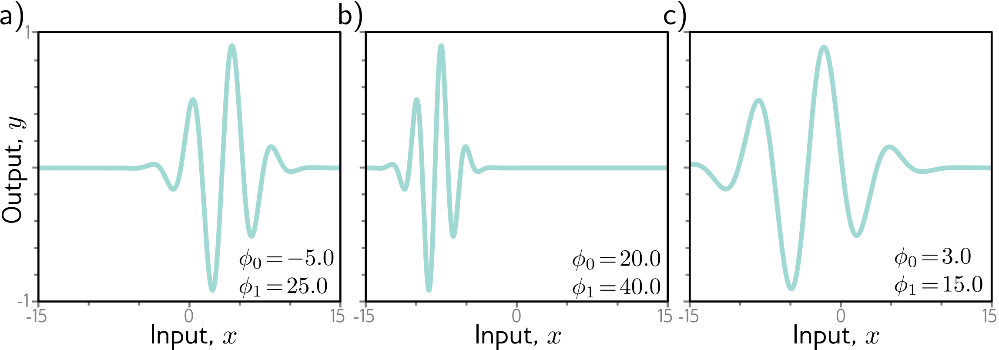

*图 9｜参数变化对 Gabor 波形的位置与横向尺度产生影响。[\[1\]](#参考文献1)*

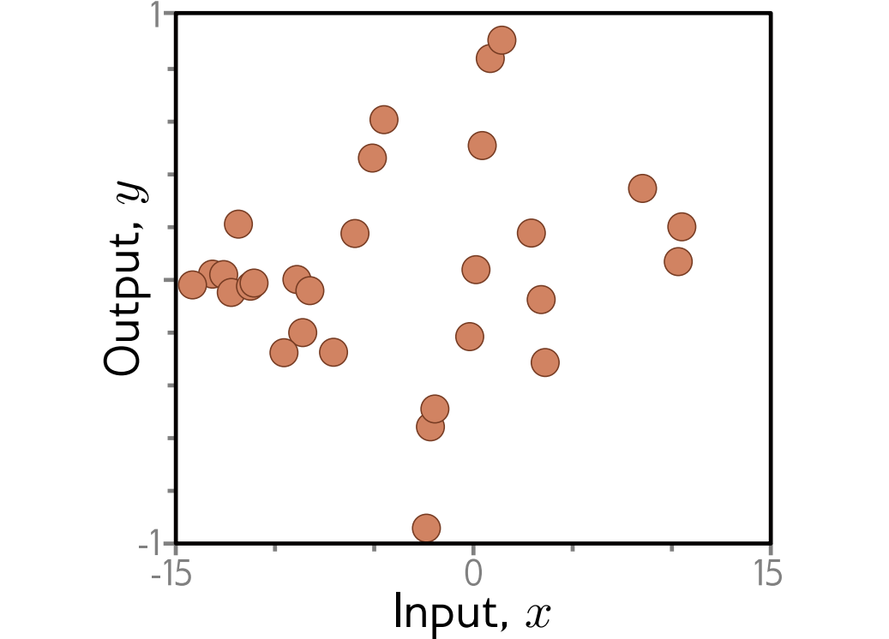

*图 10｜含噪观测分布在生成波形附近，参数估计通过最小化损失改善模型对观测数据的拟合。[\[1\]](#参考文献1)*

采用平均平方误差时，根据链式法则，损失梯度由预测残差与模型参数导数的乘积构成：

$$
\frac{\partial L}{\partial\theta_j}
=\frac2N\sum_i\bigl(f(x_i;\theta)-y_i\bigr)
\frac{\partial f(x_i;\theta)}{\partial\theta_j}.
$$

对该模型，中间变量 $z$ 对应的导数为

$$
\frac{df}{dz}=e^{-z^2/32}\left(\cos z-\frac z{16}\sin z\right),
$$

结合 $\partial z/\partial\theta_0=1$、$\partial z/\partial\theta_1=0.06x$，即可得到两个参数的损失梯度。其参数更新仍遵循梯度下降规则，但非线性参数依赖使损失曲面更加复杂。

### 局部最小值与鞍点

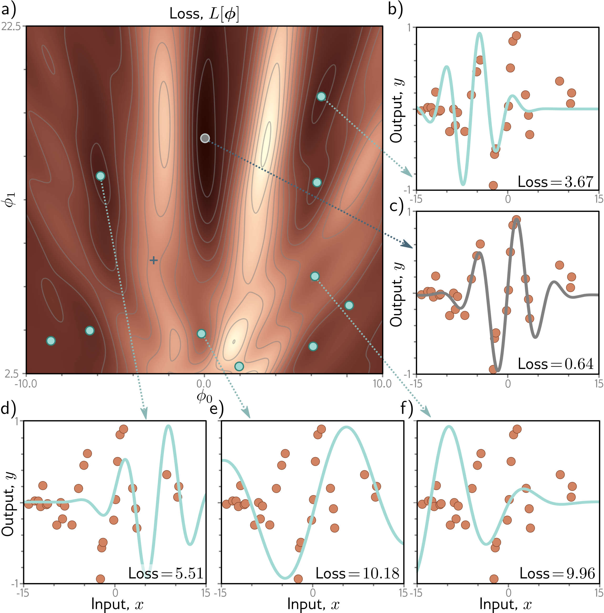

*图 11｜非凸损失具有多个局部极小点，各极小点对应不同的拟合波形；叉号标记鞍点。[\[1\]](#参考文献1)*

相关概念定义如下：

| 概念 | 含义 |
|---|---|
| 全局最小值 | 损失函数在整个参数定义域内取得的最小值 |
| 局部最小值 | 损失函数在某点的邻域内取得的最小值，未必是全局最小值 |
| 鞍点 | 梯度为零，但沿某些方向损失增大，沿另一些方向损失减小 |

对于光滑损失，内部局部极小点必须满足梯度为零，但梯度为零并非局部极小的充分条件。例如 $L(a,b)=a^2-b^2$ 在原点梯度为零，沿 $a$ 方向上升、沿 $b$ 方向下降，因此原点是鞍点。

若纯 GD 恰好位于梯度为零的驻点，则参数增量为零，后续迭代保持不变。若参数位于局部极小点附近，较大步长可能使其离开该邻域，也可能导致发散。因此，增大学习率不能保证获得更优解。

低维问题可以采用多起点优化或搜索参数组合。随着参数维度增加，穷尽搜索的计算成本迅速增长，高维训练通常依赖迭代方法获得可接受的低损失解。

### 退化驻点与梯度消失

在二次连续可微函数的驻点处，Hessian 正定意味着严格局部极小，负定意味着严格局部极大，同时包含正负特征值则意味着鞍点。若存在零特征值且没有正负混合，二阶信息可能不足，需要考察高阶项。例如 $x^3$ 在原点的一、二阶导数均为零，但原点既不是局部极小也不是局部极大；$x^4$ 在原点却取得最小值。

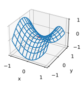

*图 12｜$F(x,y)=x^2-y^2$ 在原点有一个上升方向和一个下降方向，梯度为零不代表最小值。[\[9\]](#参考文献9)*

高维非凸问题有许多方向，驻点附近更容易出现混合曲率，但不能仅凭维数断言所有驻点都是鞍点，也不能假设 Hessian 特征值彼此独立。随机扰动可能帮助离开不稳定的驻点邻域，其作用取决于噪声方向与目标地形。

梯度很小还可能源于激活饱和，而非接近最优点。例如

$$
F(x)=\tanh x,\qquad F'(x)=1-\tanh^2x,
\qquad F'(4)\approx0.00134.
$$

从 $x=4$ 出发，即使仍有明显降低函数的方向，普通梯度更新也可能很慢。深层网络中的链式求导进一步可能累乘多个小导数，导致梯度消失。合理的初始化、参数尺度与非饱和激活有助于缓和该问题，但单纯提高学习率可能破坏其他方向的稳定性。[\[9\]](#参考文献9)

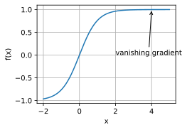

*图 13｜双曲正切在正向饱和区变化缓慢，梯度很小；这与已经达到有限最优参数不是同一回事。[\[9\]](#参考文献9)*

网络还具有参数对称性。例如交换隐藏层单元的顺序，并同步交换相邻层的对应权重，预测函数不变。具有 $d$ 个可区分隐藏单元的网络一般存在 $d!$ 种置换表示；若部分单元完全相同，独立参数表示的数量可能更少。这说明不同参数解可以表示同一函数，不能仅按极小点数量衡量问题难度。

### 停止准则与模型评价

常用停止准则包括梯度范数低于阈值、损失变化低于阈值，以及达到预定计算预算。由于鞍点附近也可能具有较小梯度，这些准则不能单独构成全局最优性的证明。

训练损失与泛化性能是不同的评价对象。较低训练损失不必然对应更好的未见数据表现，模型选择还应依据验证集评价。

## 5. 二阶方法与预条件

### 牛顿方向的推导

在当前位置对目标作二阶近似：

$$
L(\theta+\Delta)
\approx L(\theta)+g^\top\Delta+\frac12\Delta^\top H\Delta,
\quad g=\nabla L(\theta),\quad H=\nabla^2L(\theta).
$$

若 $H$ 正定，近似目标有唯一最小值。令关于 $\Delta$ 的梯度为零，得到

$$
H\Delta=-g,\qquad
\theta_{t+1}=\theta_t-H_t^{-1}g_t.
$$

公式中的逆矩阵表示线性方程的解，实际计算并不要求显式构造逆。与 GD 的统一缩放不同，牛顿法按曲率调节方向和幅度。对于正定二次函数，二阶展开没有余项，因此完整牛顿步可从任意初值一步到达唯一最小点。[\[9\]](#参考文献9)

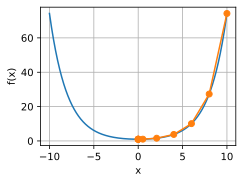

*图 14｜在双曲余弦函数上，牛顿法根据当前位置的曲率调整步幅，并在接近最优点时快速收敛。[\[9\]](#参考文献9)*

### 非凸情形与阻尼

如果 Hessian 不定，方程 $H\Delta=-g$ 只给出二阶近似的驻点，未必给出下降方向。一维中 $\Delta=-L'/L''$，当 $L''<0$ 时可能沿着增加损失的方向更新；若 $L''$ 接近零，位移还可能很大。

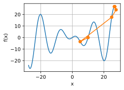

*图 15｜未经修正的牛顿更新可能远离较好的低损失区域。使用二阶信息本身并不保证下降。[\[9\]](#参考文献9)*

可考虑阻尼牛顿步 $\Delta=-\alpha H^{-1}g$，并用线搜索选择 $\alpha$。不过，如果原方向已经是上升方向，仅缩小正学习率不能把它变成下降方向，还需要修正曲率矩阵，例如选择使 $H+\mu I$ 正定的 $\mu$，或对特征值取绝对值并设置正的下界。在一维中，这对应以 $|L''|+\epsilon$ 等正数缩放梯度。[\[9\]](#参考文献9)

### 牛顿法的局部二次收敛

考虑一维最小点 $x^*$，满足 $F'(x^*)=0$。记 $e_t=x_t-x^*$，假设其邻域内 $F$ 三次连续可微，且 $F''\geq m>0$。在 $x_t$ 处展开 $F'(x^*)$：

$$
0=F'(x_t)-e_tF''(x_t)+\frac12e_t^2F'''(\xi_t),
$$

其中 $\xi_t$ 位于 $x_t$ 与 $x^*$ 之间。代入牛顿更新，得到

$$
e_{t+1}=e_t-\frac{F'(x_t)}{F''(x_t)}
=\frac{F'''(\xi_t)}{2F''(x_t)}e_t^2.
$$

若比值绝对值有界，则 $|e_{t+1}|\leq C|e_t|^2$。这是**局部二次收敛**：在足够接近最优点且后续迭代留在该邻域时，误差以平方关系减小。相对地，$|e_{t+1}|\leq q|e_t|$、$0<q<1$ 称为线性收敛，虽然误差随迭代次数呈几何衰减。局部二次收敛不等于从任意初值都能全局收敛。[\[9\]](#参考文献9)

### 预条件与坐标尺度

一般的预条件更新为

$$
\theta_{t+1}=\theta_t-\alpha_tP_tg_t.
$$

当 $P_t$ 对称正定时，$g_t^\top(-P_tg_t)<0$ 对非零梯度成立，因此它仍给出下降方向。牛顿法在正定 Hessian 下相当于取 $P_t=H_t^{-1}$；对角近似则取 $P_t=\operatorname{diag}(H_t)^{-1}$，前提是相应对角元素为正且不接近零。

不同坐标采用不同量纲或单位，例如一个以毫米、另一个以公里计量，会导致同一学习率产生严重失衡。预条件可解释为重新缩放参数空间，协调各方向的有效步长。完整 Hessian 有 $O(d^2)$ 个元素，稠密求解通常需要 $O(d^3)$ 运算；对角状态只需 $O(d)$ 存储，但丢失了坐标之间的耦合。高维问题也可用 Hessian–向量积等方式避免显式存储完整矩阵，二阶方法的成本并非都必须达到这一稠密上界。

对角近似在曲率方向与坐标轴对齐时尤其直观；旋转坐标后，非对角耦合可能成为主要困难。后面的 AdaGrad、RMSProp 和 Adam 使用梯度统计构造对角缩放，属于廉价的预条件思路，并不需要实际计算 Hessian。[\[9\]](#参考文献9)

## 6. 随机梯度下降

### 小批量梯度估计

全批 GD 的每次参数更新均依赖全部训练样本。数据规模较大时，单次梯度计算的成本较高。

随机梯度下降（Stochastic Gradient Descent，SGD）使用随机选取的单样本或小批量构造梯度估计：

$$
g_t=\frac1b\sum_{i\in B_t}\nabla\ell_i(\theta_t),
\qquad
\boxed{\theta_{t+1}=\theta_t-\alpha g_t.}
$$

SGD 保留了 GD 的参数更新形式，并以样本子集的梯度估计替代全梯度。[\[1\]](#参考文献1)

| 使用的数据 | 名称 |
|---|---|
| 全部 $N$ 个样本 | 全批量梯度下降，即这里的常规 GD |
| 一个样本 | 严格意义上的 SGD |
| $b$ 个样本，$1<b<N$ | 小批量梯度下降，通常也简称 SGD |

SGD 的随机性主要来自训练样本的随机选取，无需额外向梯度添加人工噪声。

### 采样噪声与无偏性

不同样本的损失梯度可能在方向和幅值上存在差异。使用样本子集计算梯度时，所得估计因批次组成而变化。

例如，一维参数处有四个样本，它们的梯度分别为 $2,4,-1,3$，全梯度是平均值 $2$。取前两个样本，批次梯度为 $3$；取后两个，批次梯度为 $1$；只取第三个，梯度甚至是 $-1$，方向与全梯度相反。

在固定参数处，如果从完整数据集均匀随机采样，批次平均梯度的期望等于全梯度：

$$
\mathbb E[g_t]=\nabla L(\theta_t).
$$

这一性质称为梯度估计的无偏性：单次估计可以偏离全梯度，但其期望与全梯度一致。每轮随机重排后依次取批次是另一种常见采样方式；由于参数与剩余样本集合在轮内持续变化，不能直接将上述无偏性结论应用于每次条件更新。

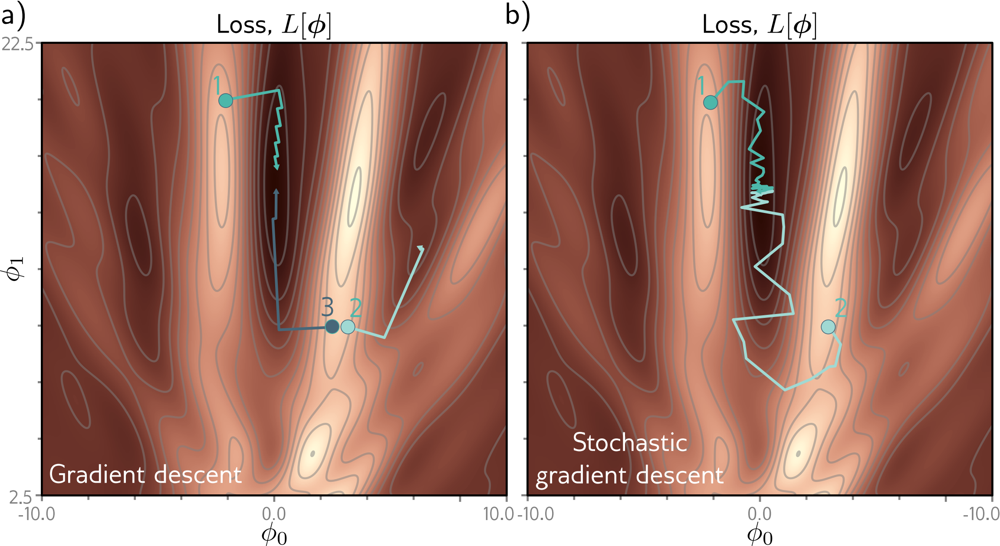

*图 16｜GD 的迭代轨迹依赖初始化；SGD 的采样波动可能使参数在不同局部极小点的吸引区域之间转移。[\[1\]](#参考文献1)*

### 批次损失

另一种等价描述是：SGD 在每次迭代中，对当前批次定义的损失执行一次梯度更新。

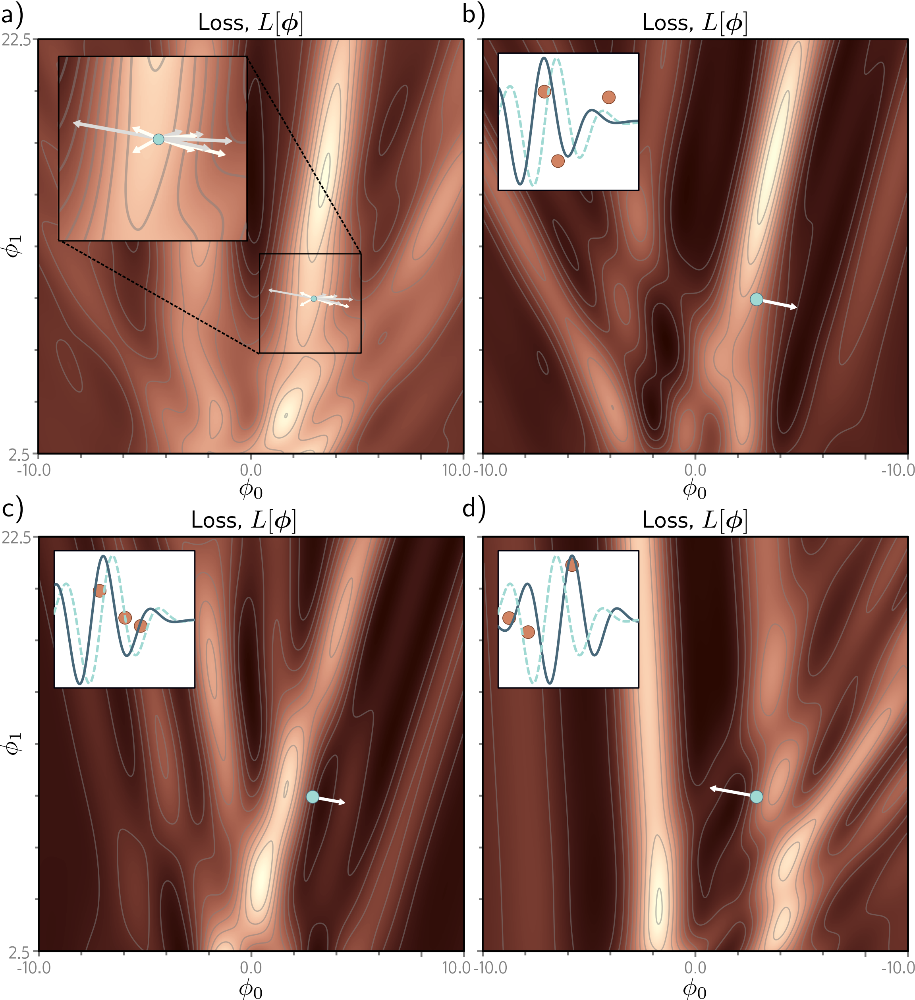

*图 17｜不同批次在同一参数处定义不同的损失与梯度。降低当前批次损失的更新，可能使总体训练损失暂时增加。[\[1\]](#参考文献1)*

因此，SGD 的总体训练损失可能出现非单调变化，单步损失增加不必然表示计算错误。此外，过大的学习率也可能使当前批次损失增加。

### 批量大小与训练周期

一次参数更新称为一次迭代（iteration）；完整遍历训练数据一次称为一个周期（epoch）。

例如，数据集有 100 个样本，每批 20 个，不重复地使用完所有样本需要 5 次更新。因此 1000 次更新对应 $1000/5=200$ 个 epoch。

较小批量降低单次更新所需的样本量，但梯度估计的波动通常更大；较大批量通常提高估计稳定性，同时增加单次处理的数据量。因此，优化效率的比较应同时考虑迭代次数、样本处理量和实际计算成本。

在固定参数处，若从完整数据集独立、有放回地均匀抽样，且某一坐标的单样本梯度方差为 $\sigma^2$，则根据独立随机变量的方差可加性，$b$ 个样本的平均梯度方差为单样本方差之和除以 $b^2$，即

$$
\operatorname{Var}(g_{t,j})=\frac{\sigma^2}{b}.
$$

因此，梯度标准差按 $1/\sqrt b$ 缩小：批量大小增加为原来的 4 倍，标准差在这些假设下变为原来的二分之一。该关系解释了批量平均的降噪作用，但不直接描述随机重排或样本相关条件下的精确方差。[\[1\]](#参考文献1)

### 有限数据与随机重排

若单样本梯度的计算成本视作一个单位，全批量 GD 每次更新需要 $O(N)$ 成本，单样本 SGD 为 $O(1)$，小批量更新为 $O(b)$。这里的复杂度针对数据量，仍隐含一次模型前向与反向计算的成本。[\[9\]](#参考文献9)

有限训练集也可以看作一个经验分布

$$
\widehat P_N=\frac1N\sum_{i=1}^{N}\delta_{(x_i,y_i)}.
$$

从它独立采样得到的梯度，在给定当前参数时是**经验风险梯度**的无偏估计；从真实总体分布得到独立新样本，才对应总体风险的随机梯度。这两类目标应在收敛分析中区分。

有放回地抽取 $N$ 次并不等于遍历全部数据。对某个固定样本，它至少被抽中一次与恰好被抽中一次的概率分别是

$$
P(K_i\geq1)=1-\left(1-\frac1N\right)^N\longrightarrow1-e^{-1}\approx0.632,
$$

$$
P(K_i=1)=\left(1-\frac1N\right)^{N-1}\longrightarrow e^{-1}\approx0.368.
$$

因此，抽样次数等于数据集大小时，平均只覆盖约 $63.2\%$ 的不同样本。每个 epoch 随机重排再无放回遍历，可以确保该轮覆盖全部样本，但它的逐步条件分布与独立采样不同，不能原样套用独立无偏梯度的证明。[\[9\]](#参考文献9)

在固定参数处，若从 $N$ 个梯度中均匀无放回抽取 $b$ 个，并将总体坐标方差定义为 $\sigma_j^2=N^{-1}\sum_i(h_{i,j}-\bar h_j)^2$，则

$$
\operatorname{Var}(g_j)=\frac{N-b}{N-1}\frac{\sigma_j^2}{b},\qquad N>1.
$$

当 $b=N$ 时方差为零。它描述固定位置上的均匀抽样，不等于随机重排训练中所有条件方差的通式。

若把数据集的每个样本复制一遍，平均损失及其全梯度不变，但全梯度计算成本增加。独立均匀采样的单步梯度分布不变；固定批量下，每个 epoch 的更新次数却增加。因此，以 epoch、更新次数或处理样本数为预算时，重复数据会导致不同的比较结果。

### 小批量的计算效率

小批量同时解决统计估计和计算利用率两个问题。单样本更新可能较快减少单位样本对应的优化误差，却容易产生大量低吞吐的矩阵–向量运算；全批量更新充分聚合数据，但要等待全部样本处理后才能调整参数。小批量在两者之间折中。[\[9\]](#参考文献9)

以 $A=BC$ 为例，可以逐元素计算 $A_{ij}=\sum_k B_{ik}C_{kj}$，也可以逐列计算 $A_{:,j}=BC_{:,j}$，或者采用矩阵分块：

$$
A_{I,J}=\sum_K B_{I,K}C_{K,J}.
$$

这些表达式在数学上相同，数据搬运与调度成本却不同。逐元素计算反复访问行列；逐列计算可复用一个向量；分块乘法将适量数据保留在缓存中反复使用，降低主存访问。寄存器、各级缓存与主存的容量、延迟和带宽不同，计算单元的峰值算力不代表数据总能及时供给。

批量操作还可以摊薄算子调度开销，利用向量化与设备并行。在多设备训练中，全局批量通常由各设备批量相加；增加设备并不意味着可以忽略批量变化对更新次数和梯度统计的影响。

因此，批量选择至少需要同时考虑三点：$b$ 增大时梯度标准差通常按 $b^{-1/2}$ 缩小，而样本计算量增加；达到设备较好利用率后，继续增大批量的吞吐收益可能递减；显存容量限制了可用批量。降低波动与提高吞吐均有边际收益，不能只凭某一项指标选择批量。

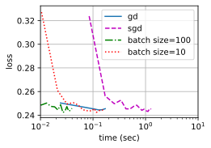

*图 18｜在所给线性回归实验中，小批量在运行时间与损失下降之间取得较好折中。横轴为实际时间，不能把该环境下的曲线排序视作所有设备和任务的固定规律。[\[9\]](#参考文献9)*

样本特征的中心化和尺度标准化也会影响曲率，从而影响比较结果。采用 BatchNorm 时，批量还决定均值与方差估计中的随机性；增大批量可能改变这部分噪声带来的正则化效果。因此，批量既是计算配置，也是统计与优化配置。

### 收敛特性

SGD 通过降低单次梯度计算成本提高参数更新频率。采样噪声还可能促进参数离开部分局部极小点或鞍点的邻域。

这些性质不构成全局收敛保证，较大的采样噪声也未必改善优化或泛化性能。

接近低损失解时，全梯度接近零可能来自样本梯度之间的抵消，而非各样本梯度均接近零。例如两个样本的梯度分别为 $+1$ 和 $-1$，全梯度为零，单样本更新却仍在移动。因此，固定学习率下的 SGD 可能在解的邻域内持续波动。

### 固定学习率下的噪声平衡

设一维二次目标 $F(\theta)=a\theta^2/2$，随机梯度为 $g_t=a\theta_t+\xi_t$，其中噪声均值为零、方差为 $\sigma^2$，且独立于当前参数。则

$$
\theta_{t+1}=(1-\alpha a)\theta_t-\alpha\xi_t,
$$

$$
\operatorname{Var}(\theta_{t+1})
=(1-\alpha a)^2\operatorname{Var}(\theta_t)+\alpha^2\sigma^2.
$$

当 $0<\alpha a<2$ 时，长期方差为

$$
\frac{\alpha^2\sigma^2}{1-(1-\alpha a)^2}
=\frac{\alpha\sigma^2}{a(2-\alpha a)}.
$$

这说明固定学习率可以使均值接近最优点，但在持续噪声下仍留下波动。若各样本在共同最优点上的梯度都消失，则噪声可能随收敛减小，不能把这个固定噪声结论无条件推广到所有 SGD 问题。

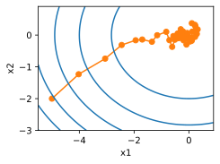

*图 19｜随机梯度在较低损失区域仍可能引起持续位移。减小步长、降低梯度方差和适当平均迭代都是缓和波动的不同途径。[\[9\]](#参考文献9)*

向梯度加入零均值噪声也可以对应一个随机损失模型。例如 $F(\theta)=\theta_1^2+2\theta_2^2$，令随机损失为 $(\theta_1-Z_1)^2+2(\theta_2-Z_2)^2$，$Z_1,Z_2$ 均为零均值，则梯度为 $(2\theta_1-2Z_1,4\theta_2-4Z_2)$，其期望等于 $\nabla F$。噪声协方差由 $Z_1,Z_2$ 的尺度决定，不能在改变二次项系数后仍忽略噪声缩放。

### 凸目标上的收敛证明

考虑凸目标 $F(\theta)=\mathbb E_\xi[\ell(\theta;\xi)]$，假设最小点 $\theta^*$ 存在。令 $\mathcal F_t$ 表示第 $t$ 次更新前的全部历史，并假设

$$
\mathbb E[g_t\mid\mathcal F_t]=\nabla F(\theta_t),
\qquad
\mathbb E[\|g_t\|_2^2\mid\mathcal F_t]\leq G^2.
$$

同时设初始距离 $\|\theta_0-\theta^*\|_2\leq D$，学习率为预先确定的正数 $\alpha_t$。这些是假设条件，不是任意神经网络自动满足的性质。[\[9\]](#参考文献9)

首先展开一步更新后的距离：

$$
\begin{aligned}
\|\theta_{t+1}-\theta^*\|_2^2
&=\|\theta_t-\alpha_tg_t-\theta^*\|_2^2\\
&=\|\theta_t-\theta^*\|_2^2
-2\alpha_t\langle g_t,\theta_t-\theta^*\rangle
+\alpha_t^2\|g_t\|_2^2.
\end{aligned}
$$

凸性的一阶条件给出

$$
\langle\nabla F(\theta_t),\theta_t-\theta^*\rangle
\geq F(\theta_t)-F(\theta^*).
$$

取条件期望、利用无偏性和二阶矩上界，再取全部期望，得到

$$
2\alpha_t\bigl(\mathbb E[F(\theta_t)]-F^*\bigr)
\leq\mathbb E\|\theta_t-\theta^*\|_2^2
-\mathbb E\|\theta_{t+1}-\theta^*\|_2^2+\alpha_t^2G^2,
$$

其中 $F^*=F(\theta^*)$。对 $t=0,\ldots,T-1$ 求和，中间距离项相消，并舍去末尾非正项：

$$
2\sum_{t=0}^{T-1}\alpha_t\bigl(\mathbb E[F(\theta_t)]-F^*\bigr)
\leq D^2+G^2\sum_{t=0}^{T-1}\alpha_t^2.
$$

定义按学习率加权的平均参数

$$
\bar\theta_T
=\frac{\sum_{t=0}^{T-1}\alpha_t\theta_t}
{\sum_{t=0}^{T-1}\alpha_t}.
$$

由 Jensen 不等式，$F(\bar\theta_T)$ 不超过相应的加权函数值平均，因此

$$
\boxed{
\mathbb E[F(\bar\theta_T)]-F^*
\leq\frac{D^2+G^2\sum_{t=0}^{T-1}\alpha_t^2}
{2\sum_{t=0}^{T-1}\alpha_t}.}
$$

注意求和中的 $F(\theta_t)$ 随 $t$ 改变，不能直接移到求和符号外；最终界约束的是**平均参数的期望目标差**，不是最后一个参数的误差，也不是参数期望与标量最优风险之差。[\[9\]](#参考文献9)

### 收敛速率与步长选择

若预先给定总步数 $T$，取固定步长 $\alpha=D/(G\sqrt T)$，则上述界变为

$$
\mathbb E[F(\bar\theta_T)]-F^*\leq\frac{DG}{\sqrt T}.
$$

这给出一般凸随机优化中 $O(T^{-1/2})$ 的期望目标差界。这里步长在一次给定预算的训练内固定，但随着所选择的总预算 $T$ 增大而减小。

若不知道训练时长，可采用递减步长。将 $\alpha_t=c/\sqrt{t+1}$ 代入同一个加权平均界，利用 $\sum\alpha_t=O(\sqrt T)$ 与 $\sum\alpha_t^2=O(\log T)$，可得到 $O(\log T/\sqrt T)$ 的上界。它与前述有限预算固定步长的推导不是同一个结论。

常见随机逼近条件是 $\sum_t\alpha_t=\infty$、$\sum_t\alpha_t^2<\infty$：累计更新能力不应过早耗尽，而累计噪声影响要得到控制。例如 $\alpha_t=c/(t+1)^p$、$1/2<p\leq1$ 满足这两项；完整收敛结论仍需目标、噪声与迭代有界性等条件。$p=1/2$ 不满足第二项，但可用于上述有限时间误差分析。

指数衰减的学习率总和有限，因此可能在到达较好解之前耗尽有效步长。它仍然可以作为有限训练预算下的策略，不能仅由这一点断言所有使用指数衰减的训练都会失败。

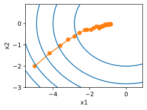

*图 20｜在该示例中，指数衰减使波动较快减小，但参数提前停留在距最优点仍较远的位置。[\[9\]](#参考文献9)*

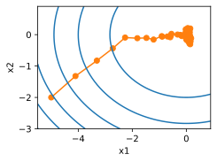

*图 21｜较缓慢的多项式衰减保留了后续移动能力。轨迹展示步长与噪声的折中，不能替代收敛假设。[\[9\]](#参考文献9)*

非凸问题中，一般更适合研究梯度范数、到达驻点的复杂度以及局部性质；凸目标的全局最优差界不能直接作为深层网络的全局收敛保证。

### 方差缩减与步长控制

方差缩减方法进一步改进梯度估计。例如，SVRG 结合参考参数处的全梯度与随机梯度差，减少随机更新的波动；其主要改进对象是梯度估计，而非逐坐标更新尺度。[\[1\]](#参考文献1)

学习率调度改变更新尺度，方差缩减改变梯度估计，二者可以结合。具体衰减、预热与余弦策略在末节集中讨论。

## 7. 动量法

### 曲率差异与迭代振荡

当损失函数在不同方向上的曲率差异较大时，梯度下降可能在高曲率方向上反复振荡，同时在低曲率方向上缓慢推进。这种现象常见于具有狭长等高线的损失曲面。[\[2\]](#参考文献2)

例如损失 $L(a,b)=10a^2+b^2$ 的梯度为 $(20a,2b)$。当 $a,b$ 大小接近时，$a$ 方向的梯度明显更大。选择较小学习率有利于高曲率方向的稳定性，却可能使低曲率方向收敛缓慢；增大学习率则可能破坏高曲率方向的稳定性。

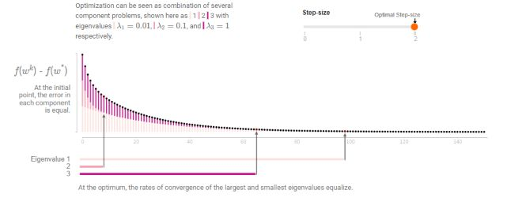

*图 22｜不同方向的曲率差异导致迭代速度不均衡，统一学习率需要在收敛速度与振荡控制之间权衡。[\[2\]](#参考文献2)*

### 梯度历史的加权平均

动量法（Momentum）将当前梯度与历史梯度信息结合，以降低更新方向对单次梯度变化的敏感性。采用指数加权平均时，其更新规则为：

$$
\boxed{
\begin{aligned}
m_{t+1}&=\beta m_t+(1-\beta)g_t,\\
\theta_{t+1}&=\theta_t-\alpha m_{t+1}.
\end{aligned}}
$$

通常初始化为 $m_0=0$。更新后的 $m_{t+1}$ 由权重为 $\beta$ 的历史平均和权重为 $(1-\beta)$ 的当前梯度组成。[\[1\]](#参考文献1)

例如，取 $\beta=0.9$，历史平均与当前梯度的权重分别为 90% 和 10%。若历史平均为 $2$、当前梯度为 $4$，则更新后的平均为 $0.9\times2+0.1\times4=2.2$。

动量系数越接近 1，历史信息衰减越慢，平滑作用通常越强，但对梯度方向变化的响应也可能存在更大滞后。$\beta=0$ 时，$m_{t+1}=g_t$，更新退化为 GD 或 SGD。

### 历史权重的递推展开

在零初始化下，展开前几次递推可得：

$$
\begin{aligned}
m_1&=(1-\beta)g_0,\\
m_2&=(1-\beta)(\beta g_0+g_1),\\
m_3&=(1-\beta)(\beta^2g_0+\beta g_1+g_2).
\end{aligned}
$$

一般地，

$$
m_{t+1}=(1-\beta)\sum_{j=0}^{t}\beta^{t-j}g_j.
$$

历史梯度的权重随其距当前迭代的时间间隔按 $\beta$ 的幂次衰减，因此该统计量称为**指数移动平均**。近期梯度具有较高权重，较早梯度的影响逐步减弱。

### 更新效率

在振荡方向上，梯度的正负分量在加权平均中部分抵消；在梯度方向较一致的分量上，历史贡献得到持续保留。由此，更新方向能够更充分地反映多次迭代中的一致信息。

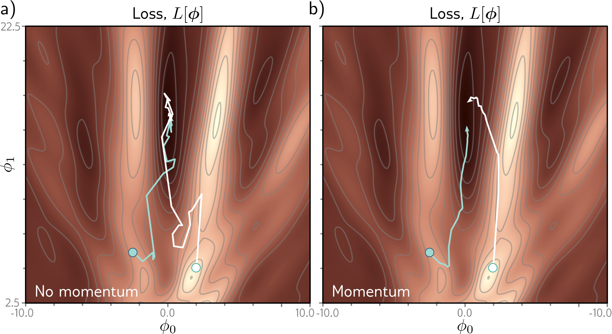

*图 23｜历史梯度的加权平均平滑了更新方向，可减少轨迹中的高频方向变化。[\[1\]](#参考文献1)*

动量通过利用连续多次迭代的方向信息改善更新效率。当小批量梯度波动较大时，加权平均可减轻单次异常梯度对更新方向的影响。

在上述加权平均形式下，若梯度始终为常量 $g$，则 $m_{t+1}=(1-\beta^{t+1})g$，并逐渐趋近于 $g$。因此，动量的加速作用不能一般地归因于平均梯度幅值超过当前梯度，而应结合方向持续性与参数化方式分析。

### 动量的两种参数化

另一种常见参数化不对当前梯度乘以 $(1-\beta)$：

$$
u_{t+1}=\beta u_t+g_t,
\qquad
\theta_{t+1}=\theta_t-\eta u_{t+1}.
$$

在固定动量系数和零初始化下，两种历史状态满足 $m_t=(1-\beta)u_t$。两种参数化产生相同更新的学习率对应关系为 $\eta=\alpha(1-\beta)$。

### 记忆长度与统计平滑

历史权重的衰减尺度可由三个不同量描述。对 $0<\beta<1$，非归一化权重之和为 $1/(1-\beta)$，常被用作近似记忆长度；半衰期则由 $\beta^h=1/2$ 决定：

$$
h_{1/2}=\frac{\log(1/2)}{\log\beta}.
$$

当 $\beta=0.9$ 时，近似记忆长度为 $10$ 步，半衰期约为 $6.58$ 步，两者不同。零初始化时，有限历史的归一化权重总和为 $1-\beta^{t+1}$，只在长期极限下趋近于 $1$。[\[9\]](#参考文献9)

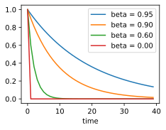

*图 24｜图中给出非归一化权重 $\beta^k$。较大的动量系数保留更久的历史，但也增加对方向变化的响应滞后。[\[9\]](#参考文献9)*

若在固定位置附近把同一坐标的梯度近似为具有相同均值、方差 $\sigma^2$ 且跨时间独立的序列，则长期归一化平均的方差为

$$
\operatorname{Var}(m)
=(1-\beta)^2\sigma^2\sum_{k=0}^{\infty}\beta^{2k}
=\sigma^2\frac{1-\beta}{1+\beta}.
$$

按独立样本平均的方差定义，其等效样本数为 $(1+\beta)/(1-\beta)$，与权重和 $1/(1-\beta)$ 也不同。实际训练的梯度在不同参数处计算，并具有时间相关性，因此动量只是利用历史获得平滑信息，并不等同于在当前位置重新计算一个更大的独立批量。

对于不归一化的动量状态 $u_{t+1}=\beta u_t+g_t$，若梯度近似恒定，则 $u\approx g/(1-\beta)$，有效更新尺度约为 $\eta/(1-\beta)$。因此改变 $\beta$ 时，通常也需要重新考虑学习率。该放大关系不适用于把当前梯度乘以 $1-\beta$ 的归一化状态而仍保持同一名义学习率的比较。

### 惯性效应与稳定性

当参数接近极小点时，历史方向可能与当前局部梯度不再一致，惯性项因而可能导致过冲。过大的学习率或动量系数会进一步影响迭代稳定性。

动量更新不保证损失逐步单调下降，其效果依赖目标函数与超参数。Nesterov 方法通过在惯性预测位置计算梯度，对历史方向引起的位移进行修正。

### 二次目标的特征方向

设

$$
F(\theta)=\frac12\theta^\top Q\theta+c^\top\theta+b_0,
\qquad Q=Q^\top\succ0.
$$

由 $Q\theta^*+c=0$ 得到 $\theta^*=-Q^{-1}c$，配方后

$$
F(\theta)=\frac12(\theta-\theta^*)^\top Q(\theta-\theta^*)+F^*,
\qquad F^*=b_0-\frac12c^\top Q^{-1}c.
$$

令 $Q=U\Lambda U^\top$，$U$ 为正交矩阵，$\Lambda=\operatorname{diag}(\lambda_1,\ldots,\lambda_d)$，并令 $z=U^\top(\theta-\theta^*)$。则

$$
F(\theta)-F^*=\frac12\sum_j\lambda_jz_j^2.
$$

正交变换保持欧氏距离，把问题拆成互不耦合的标量二次函数。GD 在第 $j$ 个特征方向满足

$$
z_{t+1,j}=(1-\alpha\lambda_j)z_{t,j}.
$$

因此，所有方向稳定收敛要求 $0<\alpha<2/\lambda_{\max}$。若 $0<\alpha\lambda_j<1$，该方向单调收缩；等于 $1$ 时一步归零；介于 $1$ 与 $2$ 时振荡收缩；等于 $2$ 时一般形成不衰减的符号交替，超过 $2$ 才会振幅发散。[\[9\]](#参考文献9)

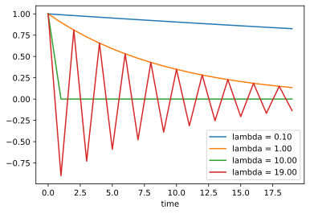

*图 25｜相同学习率下，不同曲率产生缓慢单调收敛、一步归零或振荡收敛。参数符号交替并不等于发散。[\[9\]](#参考文献9)*

令 $\mu=\lambda_{\min}>0$、$M=\lambda_{\max}$，条件数为 $\kappa=M/\mu$。GD 的最坏方向收缩因子是 $q=\max_j|1-\alpha\lambda_j|$；在只知道曲率范围的情形，取 $\alpha=2/(M+\mu)$ 得到 $q=(\kappa-1)/(\kappa+1)$。条件数很大时 $q$ 接近 $1$，这正是狭长谷底中的缓慢收敛。

### 动量的状态矩阵与稳定区间

为了直接分析，采用前述不归一化参数化 $u_{t+1}=\beta u_t+\lambda z_t$、$z_{t+1}=z_t-\eta u_{t+1}$。在每个曲率为 $\lambda>0$ 的特征方向，有

$$
\begin{bmatrix}u_{t+1}\\z_{t+1}\end{bmatrix}
=\underbrace{\begin{bmatrix}
\beta&\lambda\\
-\eta\beta&1-\eta\lambda
\end{bmatrix}}_{A_\lambda}
\begin{bmatrix}u_t\\z_t\end{bmatrix}.
$$

经过 $t$ 步后的状态由 $A_\lambda^t$ 决定。等价的二阶递推为

$$
z_{t+1}=(1+\beta-\eta\lambda)z_t-\beta z_{t-1},
$$

相应特征方程与根为

$$
r^2-(1+\beta-\eta\lambda)r+\beta=0,
$$

$$
r_{\pm}=\frac{1+\beta-\eta\lambda
\pm\sqrt{(1+\beta-\eta\lambda)^2-4\beta}}{2}.
$$

所有初始状态收敛到零，当且仅当两个根的模均小于 $1$。实二阶多项式的单位圆稳定条件为 $1-\beta>0$、$\eta\lambda>0$、$2+2\beta-\eta\lambda>0$。对于 $0\leq\beta<1$，于是得到

$$
\boxed{0<\eta\lambda<2(1+\beta).}
$$

这比 GD 的 $0<\eta\lambda<2$ 更宽，但不意味着对任意非凸目标都能使用更大学习率。在归一化参数化中，必须代入 $\eta=\alpha(1-\beta)$，不能直接比较两个不同定义的名义学习率。[\[9\]](#参考文献9)

当判别式为负，两个根互为共轭且模为 $\sqrt\beta$，产生振荡衰减；实根对应另一类衰减模式。根的模控制渐近速度，重根还可能带来 $t r^t$ 一类因子。因而较大的 $\beta$ 一方面增加记忆与稳定步长范围，另一方面可能延长过渡振荡，不能脱离曲率和学习率单独判断。

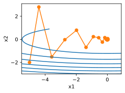

*图 26｜对 $0.1x_1^2+2x_2^2$，适当动量可以在同向梯度上积累位移，并使振荡逐步减弱。[\[9\]](#参考文献9)*

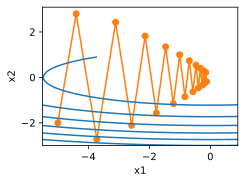

*图 27｜改变动量系数会改变衰减与振荡模式；有限步数内的表现取决于整组超参数，而不是“有动量”这一条件本身。[\[9\]](#参考文献9)*

对于随机梯度，状态方程还包含噪声输入。上述稳定区间分析的是固定二次目标上的确定性齐次系统，不能直接当作噪声环境中的零误差收敛证明。动量需要额外保存一个与参数同维的状态向量，状态存储为 $O(d)$。

## 8. Nesterov 加速动量

### 前瞻梯度机制

Nesterov 加速梯度（NAG）在保留惯性项的同时，将梯度评估位置由当前参数移至前瞻参数：[\[3\]](#参考文献3)

- 普通动量：在当前参数处计算梯度，将其与惯性项合成参数增量。
- Nesterov 动量：根据惯性项构造前瞻参数，在该位置计算梯度并修正参数增量。

前瞻参数是用于评估梯度的辅助变量。每次迭代仍产生一次最终参数更新，前瞻与梯度修正共同构成该更新。

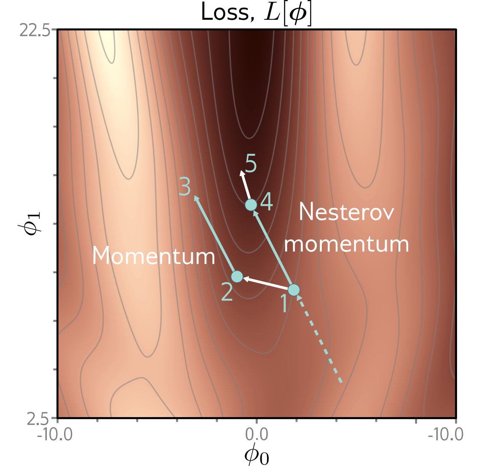

*图 28｜普通动量在当前参数处评估梯度，Nesterov 方法在惯性预测位置评估梯度并修正位移。[\[1\]](#参考文献1)*

### 参数更新规则

令 $s_t$ 表示上一次参数位移，初始化 $s_0=0$，并以 $\eta$ 表示该参数化下的学习率。NAG 的更新规则为

$$
\boxed{
\begin{aligned}
\widetilde\theta_t&=\theta_t+\beta s_t,\\
s_{t+1}&=\beta s_t-\eta\nabla L(\widetilde\theta_t),\\
\theta_{t+1}&=\theta_t+s_{t+1}.
\end{aligned}}
$$

第一式由惯性项构造前瞻参数，第二式利用前瞻梯度修正位移，第三式完成参数更新。在随机梯度情形下，可将全梯度替换为当前批次在前瞻参数处的梯度估计。

与上一节的加权平均写法对应，取 $s_t=-\alpha m_t$、$\eta=\alpha(1-\beta)$，同一更新也可以写成

$$
\begin{aligned}
\widetilde\theta_t&=\theta_t-\alpha\beta m_t,\\
m_{t+1}&=\beta m_t+(1-\beta)\nabla L(\widetilde\theta_t),\\
\theta_{t+1}&=\theta_t-\alpha m_{t+1}.
\end{aligned}
$$

前瞻位置中的 $\beta$ 与本次迭代保留的历史权重一致。上述两组公式使用不同状态变量表示同一更新机制。

### 一维更新示例

设 $L(\theta)=\theta^2/2$，当前 $\theta_t=1$，上一步位移 $s_t=-0.5$，动量系数 $\beta=0.9$，学习率 $\eta=0.1$。

普通动量在当前位置取梯度 $L'(1)=1$，得到 $s_{t+1}=-0.45-0.1=-0.55$，新位置为 $0.45$。

NAG 先预测位置 $1-0.45=0.55$，在这里取梯度 $0.55$，得到 $s_{t+1}=-0.45-0.055=-0.505$，新位置为 $0.495$。

由于前瞻位置的梯度幅值较小，NAG 在本例中的梯度修正幅度也较小。本次普通动量的结果更接近最优点，因而不能由前瞻机制推出逐步最优性。

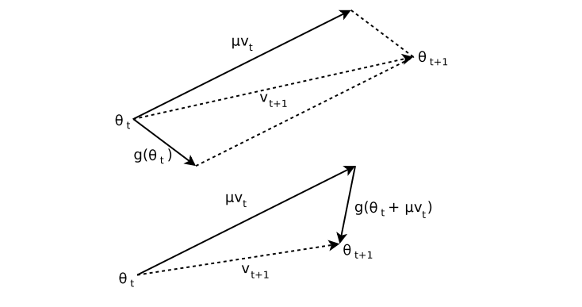

*图 29｜惯性位移与梯度修正的分解展示了普通动量和 Nesterov 方法的梯度评估位置差异。[\[3\]](#参考文献3)*

### 加速性质与适用范围

在满足相应光滑性、凸性条件并采用适当参数设置时，Nesterov 方法具有优于常规梯度下降的收敛速率保证。其基本机制是利用前瞻位置的梯度修正惯性位移。

对于非凸神经网络，上述理论结果不能直接解释为普遍的训练加速保证。实际表现仍受学习率、采样噪声与初始化等因素影响。

## 9. AdaGrad

### 稀疏特征与逐坐标步长

统一学习率调度按全局时间衰减，但不同参数获得信息的速度可能不同。例如，语言模型中常见词相关参数频繁得到非零梯度，罕见词相关参数可能在训练后期才获得足够观测。如果所有坐标都按全局步数降低学习率，罕见特征可能尚未充分学习就只剩很小的步长。[\[9\]](#参考文献9)

一种直观方案是按坐标出现次数 $n_j(t)$ 选择步长 $\alpha_{t,j}=\alpha_0/\sqrt{n_j(t)+c}$。AdaGrad 用历史梯度平方和代替离散计数：它不仅反映更新出现的频率，还反映梯度的幅值，因而无需人为规定“出现一次有效更新”的阈值。

### 条件数与尺度变换

对前述正定二次目标，最小点为 $\theta^*=-Q^{-1}c$。若线性项变为 $c+\delta c$，则

$$
\delta\theta^*=-Q^{-1}\delta c,
\qquad
\delta z_j^*=-\frac{(U^\top\delta c)_j}{\lambda_j}.
$$

正交旋转保持扰动的欧氏范数，但小特征值方向的最优参数可以对同样大小的线性项扰动更敏感。条件数 $\kappa=\lambda_{\max}/\lambda_{\min}$ 描述这种相对尺度失衡，最小特征值还决定绝对敏感度。[\[9\]](#参考文献9)

如果知道完整谱分解，可用 $z=\Lambda^{1/2}U^\top(\theta-\theta^*)$ 把二次项化为 $\|z\|_2^2/2$。这相当于把狭长椭球变成球，但计算完整特征系统的成本很高。

较便宜的办法是使用 $D_Q=\operatorname{diag}(Q)$，在对角元素为正时变换为

$$
\widetilde Q=D_Q^{-1/2}QD_Q^{-1/2},
\qquad
\widetilde Q_{ij}=\frac{Q_{ij}}{\sqrt{Q_{ii}Q_{jj}}},
\qquad\widetilde Q_{ii}=1.
$$

它消除了对角尺度差异，但保留了非对角耦合。若 $Q$ 本来就是对角矩阵，变换后恰为单位矩阵；若主轴相对坐标轴旋转，效果可能明显减弱，不能把对角元素相同视为条件数必然接近 $1$。

在二次目标的特征坐标中，梯度满足 $g_j=\lambda_jz_j$。梯度大小同时包含曲率和到最优点的距离；随机梯度还包含采样波动。因此，平方梯度只能作为调整坐标尺度的低成本统计信号，**并不等于 Hessian 对角线或梯度方差**。这也是自适应梯度法与真正牛顿法的区别。

### 累积平方梯度

初始化 $a_0=0$，AdaGrad 的更新为

$$
\begin{aligned}
a_{t+1}&=a_t+g_t\odot g_t,\\
\theta_{t+1}&=\theta_t
-\frac{\alpha}{\sqrt{a_{t+1}+\epsilon}}\odot g_t.
\end{aligned}
$$

平方、平方根和除法均按坐标执行，$\epsilon>0$ 用于避免除零。第 $j$ 个坐标的有效学习率为

$$
\alpha_{t,j}
=\frac{\alpha}{\sqrt{\sum_{k=0}^{t}g_{k,j}^2+\epsilon}}.
$$

频繁出现较大梯度的坐标累计量较大，学习率下降较快；较少更新的坐标累计量较小，保留较大的相对学习率。只要基础学习率固定，各坐标的缩放系数不会随时间增大。[\[9\]](#参考文献9)

如果某坐标的平均平方梯度长期趋于正数，则 $a_{t,j}$ 约按 $t$ 增长，对应 $O(t^{-1/2})$ 的有效步长。但在无噪声情况下，若梯度平方和收敛，累计量可以趋于有限值；不能把线性增长看作所有问题的必然行为。

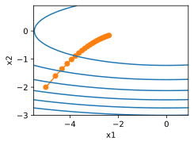

*图 30｜AdaGrad 缓和了坐标尺度不均衡，但累计平方梯度使后期步长不断受历史影响，在该示例中推进逐渐变慢。[\[9\]](#参考文献9)*

AdaGrad 只需保存一个 $O(d)$ 的累积向量，额外运算通常小于梯度计算本身。在稀疏问题中，持续积累历史有明确意义；在长期、非平稳或非凸训练中，过早的大梯度可能长期压低步长，这推动了使用有限记忆的改进方法。

## 10. RMSProp

### 从累计量到移动统计

AdaGrad 的问题来自长期累计，而不是逐坐标适应本身。将累计量除以迭代次数，可以得到历史平均平方梯度，但它仍然记住全部过去，对梯度统计的变化反应缓慢。RMSProp 改用指数移动平均，让较早的信息逐渐淡出。[\[9\]](#参考文献9)

初始化 $a_0=0$，取 $0\leq\gamma<1$：

$$
\begin{aligned}
a_{t+1}&=\gamma a_t+(1-\gamma)g_t^2,\\
\theta_{t+1}&=\theta_t
-\frac{\alpha_t}{\sqrt{a_{t+1}+\epsilon}}\odot g_t.
\end{aligned}
$$

这里 $\alpha_t$ 控制全局更新尺度，$a_{t+1}$ 控制各坐标的相对缩放。因此，学习率调度与历史平方梯度的累计增长不再绑定，但有效步长仍会随当前梯度统计而改变。

### 历史权重与边界情形

展开递推可得

$$
a_{t+1}=(1-\gamma)\sum_{k=0}^{t}\gamma^{t-k}g_k^2.
$$

每一项都必须是平方梯度；有限历史的权重和为 $1-\gamma^{t+1}$，长期趋近于 $1$。近似记忆长度为 $1/(1-\gamma)$，半衰期为 $\log(1/2)/\log\gamma$，并非 $\gamma^{-1}$。参数越接近 $1$，尺度估计越平滑，但适应新的梯度分布也越慢。

若取 $\gamma=1$ 且零初始化，$a_t$ 始终为零，参数更新退化为 $-\alpha_tg_t/\sqrt\epsilon$，并不会变成 AdaGrad。这说明保留率取值必须与递推中的当前权重一起理解。

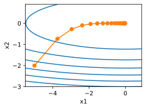

*图 31｜RMSProp 用近期平方梯度调节尺度，避免 AdaGrad 中由全历史累积造成的持续收缩。它仍然需要合适的基础学习率。[\[9\]](#参考文献9)*

RMSProp 与动量都使用指数平均，但平均对象与作用位置不同：动量平均梯度并改变方向，RMSProp 平均梯度平方并改变尺度。对角缩放同样依赖坐标表示，不能消除所有旋转后的耦合。

### 稳定项的位置

这里采用 $\sqrt{a+\epsilon}$，而后文 Adam 采用 $\sqrt a+\epsilon$。两者在 $a$ 很小时的下界分别为 $\sqrt\epsilon$ 与 $\epsilon$，相同数值的稳定项并不等价。$\epsilon$ 除了防止除零，还会影响小梯度区域的实际更新；其位置和量级应连同公式一起说明。

## 11. AdaDelta

### 用历史位移校准更新

AdaDelta 同样避免全历史累计，并进一步利用参数更新自身的尺度校准下一步。它维护两组状态：平方梯度的指数平均 $a_t$，以及平方位移的指数平均 $d_t$。这些都是平方量的统计，**不是梯度或参数的二阶导数**。[\[9\]](#参考文献9)

初始化 $a_0=d_0=0$，取 $0\leq\rho<1$，定义

$$
\begin{aligned}
a_{t+1}&=\rho a_t+(1-\rho)g_t^2,\\
\Delta\theta_t&=-\frac{\sqrt{d_t+\epsilon}}
{\sqrt{a_{t+1}+\epsilon}}\odot g_t,\\
\theta_{t+1}&=\theta_t+\Delta\theta_t,\\
d_{t+1}&=\rho d_t+(1-\rho)(\Delta\theta_t)^2.
\end{aligned}
$$

更新的分子使用截至前一步的位移统计，分母使用加入当前梯度后的统计；随后再把本次位移加入 $d_{t+1}$。这个顺序避免了用尚未确定的当前位移定义它自身。

### 量纲与初始更新

忽略稳定项时，$\sqrt{d_t}$ 具有参数的量纲，$\sqrt{a_{t+1}}$ 具有梯度的量纲，二者之比再乘梯度，得到参数位移。这解释了为什么可以用已有位移的尺度代替一个独立指定的全局学习率。

该基本形式没有显式的全局学习率参数，并不意味着学习率为零或完全不需要超参数。衰减系数 $\rho$ 与稳定项 $\epsilon$ 仍影响行为；有些变体还在位移前增加额外乘数。在零初始化下，如果同时去掉 $\epsilon$，非零梯度也会因为分子为零而无法启动，因此稳定项不仅承担避免除零的作用。

AdaDelta 需要两个 $O(d)$ 状态向量。$\rho$ 的记忆长度与半衰期按指数平均的同一公式计算；$\rho=0.9$ 对应约 $10$ 步的记忆尺度，并不意味着“10 个半衰期”。它通过反馈历史位移调节步幅，但没有对任意目标的自动收敛保证。[\[9\]](#参考文献9)

## 12. Adam 自适应优化

### 参数梯度的尺度差异

GD 和普通动量通常对全部参数使用统一学习率。当不同坐标的梯度尺度差异较大时，统一缩放可能使部分坐标更新过大、另一些坐标进展缓慢。

Adam 将梯度的历史平均与逐坐标尺度调整相结合，根据各参数的梯度统计量确定更新幅度。[\[1\]](#参考文献1)[\[4\]](#参考文献4)

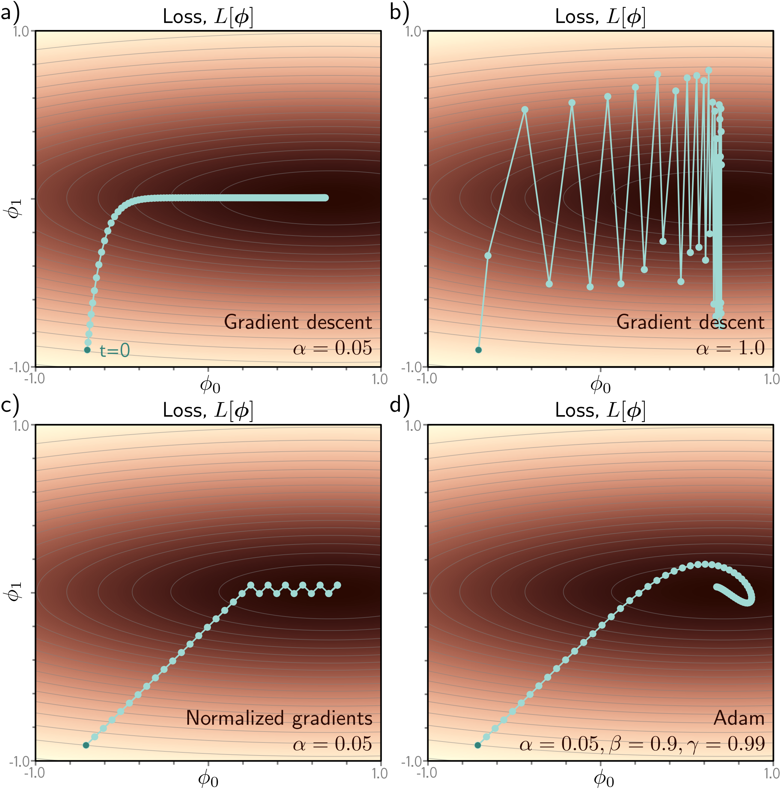

*图 32｜统一学习率在低曲率方向的收敛速度与高曲率方向的稳定性之间存在权衡；逐坐标缩放可缓和这一问题。[\[1\]](#参考文献1)*

### 逐坐标梯度归一化

一种基本的尺度调整方法是将各坐标梯度除以其绝对值。由 $\sqrt{g_j^2}=|g_j|$，得到

$$
\theta_{t+1,j}=\theta_{t,j}
-\alpha\frac{g_{t,j}}{\sqrt{g_{t,j}^2}+\epsilon}.
$$

其中 $j$ 表示参数坐标，$\epsilon$ 是防止除零的小正数。忽略 $\epsilon$ 时，正梯度变成 $+1$，负梯度变成 $-1$，每个非零梯度方向的移动距离都约为 $\alpha$。

该归一化减轻了大幅值梯度对参数位移的主导作用，同时弱化了梯度的幅值信息。接近极小点时，非零梯度仍可能产生近似固定长度的坐标更新，导致参数在极小点附近振荡。

Adam 进一步对梯度及其平方进行历史平均，以平滑更新方向及其归一化尺度。

### 一阶矩与二阶矩估计

Adam 维护梯度与平方梯度的两组指数移动平均，初始化为 $m_0=v_0=0$：

$$
\begin{aligned}
m_{t+1}&=\beta_1m_t+(1-\beta_1)g_t,\\
v_{t+1}&=\beta_2v_t+(1-\beta_2)g_t^2.
\end{aligned}
$$

其中，$0\leq\beta_1,\beta_2<1$ 为两组平均的衰减系数。平方以及后续的平方根、除法均按坐标执行。[\[4\]](#参考文献4)

| 统计量 | 统计对象 | 主要作用 |
|---|---|---|
| $m$ | 梯度的历史加权平均 | 保留较持续的方向，减轻方向波动 |
| $v$ | 梯度平方的历史加权平均 | 估计各坐标最近的梯度幅度 |

平方运算保留幅值并消除符号差异。例如，$+2$ 和 $-2$ 对 $m$ 的贡献可能抵消，而对 $v$ 的贡献均来自平方值 $4$。因此，较小的 $m$ 与较大的 $v$ 可以对应幅值较大、方向频繁变化的梯度序列。

$m$ 称为一阶矩估计，$v$ 称为二阶原点矩估计。二阶原点矩基于梯度平方，**不等同于损失函数的二阶导数**，也不直接等于梯度方差。在更新中，$m$ 主要提供方向信息，$v$ 主要提供幅值尺度。

### 零初始化的偏差校正

零初始化使两组指数平均在训练初期包含较大的初值权重。

例如，首个梯度为 $2$、$\beta_1=0.9$ 时，$m_1=0.1\times2=0.2$。该值小于已观测梯度，是因为零初值仍占 90% 的权重。

如果梯度一直等于 $g$，展开后有

$$
m_{t+1}=(1-\beta_1^{t+1})g.
$$

除以 $1-\beta_1^{t+1}$ 可归一化已观测梯度的权重，补偿零初始化的影响。相应的校正统计量为

$$
\hat m_{t+1}=\frac{m_{t+1}}{1-\beta_1^{t+1}},
\qquad
\hat v_{t+1}=\frac{v_{t+1}}{1-\beta_2^{t+1}}.
$$

随着更新次数增加，$\beta_1^{t+1}$ 和 $\beta_2^{t+1}$ 越来越小，校正因子逐渐接近 1。这种校正处理的是零初始化造成的权重不足，并不消除小批量采样噪声。

### 完整更新规则

结合梯度估计、矩估计、偏差校正与参数更新，Adam 的完整迭代为：

$$
\boxed{
\begin{aligned}
g_t&=\frac1b\sum_{i\in B_t}\nabla\ell_i(\theta_t),\\
m_{t+1}&=\beta_1m_t+(1-\beta_1)g_t,\\
v_{t+1}&=\beta_2v_t+(1-\beta_2)g_t^2,\\
\hat m_{t+1}&=\frac{m_{t+1}}{1-\beta_1^{t+1}},\\
\hat v_{t+1}&=\frac{v_{t+1}}{1-\beta_2^{t+1}},\\
\theta_{t+1}&=\theta_t-\alpha
\frac{\hat m_{t+1}}{\sqrt{\hat v_{t+1}}+\epsilon}.
\end{aligned}}
$$

更新式的分子由校正后的一阶矩决定方向，分母利用二阶矩的平方根进行尺度归一化。某坐标长期梯度幅值较大时，其分母通常相应增大，从而降低更新对梯度绝对尺度的敏感性。[\[4\]](#参考文献4)

常见初始超参数为 $\beta_1=0.9$、$\beta_2=0.999$、$\epsilon=10^{-8}$，学习率可从 $0.001$ 量级开始评估。其适用性仍需依据具体任务与验证结果确定。

### 两步更新示例

考虑单个参数，初始 $m_0=v_0=0$，第一步梯度 $g_0=2$，取 $\beta_1=0.9$、$\beta_2=0.999$：

$$
m_1=0.2,\quad v_1=0.004,
\qquad\hat m_1=2,\quad\hat v_1=4.
$$

忽略 $\epsilon$，更新为 $\theta_1=\theta_0-\alpha\times2/\sqrt4=\theta_0-\alpha$。

若第二步梯度变为 $g_1=-2$，则

$$
m_2=-0.02,\quad v_2=0.007996,
\qquad\hat m_2\approx-0.1053,\quad\hat v_2=4.
$$

第二次参数增量约为 $0.0526\alpha$。当前梯度虽已反向，但历史梯度在一阶矩中部分抵消，使反向更新幅度显著减小。

该示例说明了一阶矩方向平滑与二阶矩尺度归一化在更新中的共同作用。

### 批次梯度的平方运算

在小批量训练中，标准 Adam 的二阶矩以聚合后的批次平均梯度 $g_t$ 的平方为输入。该统计对象区别于单样本梯度平方的批次平均。

例如两个样本的梯度分别为 $+1$ 和 $-1$：平均梯度是 $0$，平方也是 $0$；但先平方再平均，会得到 $1$。两种运算描述不同的统计量，不能交换顺序。[\[4\]](#参考文献4)

### 时间尺度与适应程度

Adam 的两组统计具有不同时间尺度。$\beta_1=0.9$ 对应约 $10$ 步的梯度方向记忆，$\beta_2=0.999$ 对应约 $1000$ 步的平方梯度记忆。因此，方向可以较快响应变化，而尺度估计相对平缓。[\[9\]](#参考文献9)

在梯度一、二阶矩不随时间改变的理想情形，偏差校正后的统计分别对这些矩无偏。实际优化中参数持续变化，校正首先解决的是有限历史权重未归一化的问题，并不使它成为当前分布下自动无偏的瞬时估计。

较大的 $\epsilon$ 会弱化逐坐标适应：若 $\epsilon$ 主导分母，更新近似为 $-(\alpha/\epsilon)\hat m$。因此，稳定项不仅是数值细节，也是影响自适应强度的参数；不同公式位置下的数值不能直接比较。

### Yogi 的尺度更新

Adam 的平方梯度更新可以改写为

$$
v_{t+1}=v_t+(1-\beta_2)(g_t^2-v_t).
$$

若某坐标长期收到很小或零梯度，$v_t$ 会持续衰减，从而使该坐标的有效学习率增大。稀疏且突变的梯度可能使这种遗忘与后续更新相互作用。Adam 的不收敛问题不宜简单归结为“二阶矩爆炸”，关键还在于有效步长随时间如何变化。[\[5\]](#参考文献5)[\[9\]](#参考文献9)

Yogi 保留一阶矩的更新，将尺度状态改为

$$
v_{t+1}=v_t+(1-\beta_2)g_t^2
\odot\operatorname{sign}(g_t^2-v_t).
$$

差值只决定增减方向，变化幅度由当前平方梯度决定。当 $g_{t,j}=0$ 时，该坐标的尺度状态不变；当 $v_{t,j}\gg g_{t,j}^2$ 时，它以较小的加性量减小，而不会直接按旧状态的固定比例缩小。这样可以控制有效学习率过快增大的情况。[\[9\]](#参考文献9)[\[10\]](#参考文献10)

参数更新仍使用一阶矩除以尺度平方根。Yogi 的 $v_t$ 已不再是普通指数平均，不能直接把其偏差性质等同于 Adam 的二阶矩估计。初始尺度可依据初始参数处较大批次的单样本梯度平方平均估计，以缓和训练初期的尺度不足；这与“批次平均梯度再平方”是不同的统计操作。[\[10\]](#参考文献10)

增大批量可以降低随机梯度方差，在特定光滑性、噪声和参数条件下有助于自适应方法接近驻点；Yogi 也不因此获得任意非凸目标的全局最优保证。其状态存储与逐坐标更新复杂度仍为 $O(d)$。

### 超参数与性能评价

Adam 的自适应性体现在逐坐标缩放随梯度统计量变化。全局学习率、批量大小与训练时长仍属于需要设定的超参数。

Adam 可能出现振荡，且不具有一般的全局最优保证。训练中可结合学习率衰减；也可在初期从较小学习率逐渐增加至目标值，即学习率预热（warmup），以缓和初始更新。[\[9\]](#参考文献9)

当 $\beta_1=\beta_2=0$ 时，Adam 的参数增量为 $-\alpha g_t/(|g_t|+\epsilon)$，仍包含逐坐标归一化。因此，该参数设置下的 Adam 不等价于增量为 $-\alpha g_t$ 的普通 SGD。

SGD 与 Adam 的性能比较应分别考察优化速度、最终训练损失与测试泛化性能。这些指标不必具有相同排序；训练预算、超参数搜索范围及搜索投入也会影响比较结果。[\[8\]](#参考文献8)

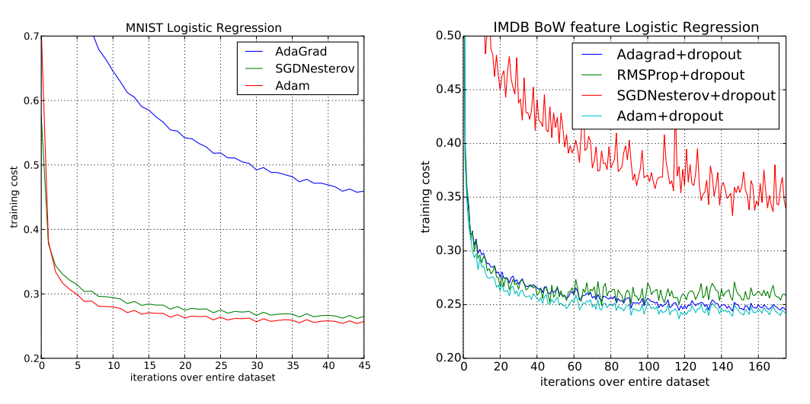

*图 33｜相同任务下不同优化器的训练损失曲线。横轴表示数据遍历次数；训练损失较低不必然对应更优的测试性能。[\[4\]](#参考文献4)*

### Adam 的相关变体

RAdam 调整 Adam 早期自适应更新中的方差，Nadam 将 Nesterov 思想与 Adam 结合。它们修改的对象不同，性能需要在明确的任务和训练条件下比较。[\[1\]](#参考文献1)[\[7\]](#参考文献7)

其中，AdamW 主要处理参数衰减与自适应缩放之间的关系。对于普通 SGD，将 $\lambda\|\theta\|^2/2$ 加入损失后，有

$$
\theta_{t+1}=\theta_t-\alpha(g_t+\lambda\theta_t)
=(1-\alpha\lambda)\theta_t-\alpha g_t.
$$

即 $L_2$ 惩罚可表示为参数的乘法收缩。对于 Adam，若将 $\lambda\theta_t$ 加入梯度，该项会同时进入一阶矩、二阶矩及自适应缩放，因此通常不等价于直接收缩参数。AdamW 将衰减与梯度更新分离，其常见形式为

$$
\theta_{t+1}=(1-\alpha\lambda)\theta_t
-\alpha\frac{\hat m_{t+1}}{\sqrt{\hat v_{t+1}}+\epsilon},
$$

其中矩估计仅使用数据损失梯度，$\lambda$ 为衰减系数。这一区别涉及正则化与优化更新的组合方式，不构成普遍的性能优势保证。[\[6\]](#参考文献6)

SWATS 则采用阶段性切换策略：先使用 Adam 获得初期优化进展，再切换至 SGD。该策略与前述更新公式的修改不同，其效果同样依赖任务与超参数设置。[\[1\]](#参考文献1)

## 13. 学习率调度

### 调度与更新机制

优化器规定如何利用梯度与历史状态，调度器规定全局学习率如何随训练进程变化。动量或 Adam 的逐坐标适应不能替代全局步长选择。较大步长可能加快初期移动，却放大后期噪声或造成不稳定；较小步长提高局部调整精度，却可能过早限制后续探索。[\[9\]](#参考文献9)

以下以 $t$ 表示调度时间，它可以是参数更新次数，也可以是 epoch，但一套调度内必须保持一致。同一条按 epoch 设置的曲线，在不同批量大小下会对应不同的参数更新次数。

### 多项式衰减

常见形式为

$$
\alpha_t=\alpha_0(1+ct)^{-p},\qquad c,p>0.
$$

$c$ 控制变化的时间尺度，$p$ 控制长期衰减速度。$p=1/2$ 对应平方根倒数衰减。它比指数衰减保留更长的尾部更新能力，但具体的收敛结论必须区分有限时间误差界、长期随机逼近条件和是否采用平均参数，不能统一归结为“越慢越好”。

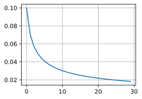

*图 34｜多项式衰减在后期仍保留非零步长；具体幅度由初值与衰减参数共同决定。[\[9\]](#参考文献9)*

### 指数衰减与下界

逐次乘以固定因子 $q\in(0,1)$ 得到

$$
\alpha_{t+1}=q\alpha_t,
\qquad\alpha_t=\alpha_0q^t.
$$

它与 $\alpha_0e^{-ct}$ 等价，其中 $q=e^{-c}$。为避免有限训练期间步长过小，可设置下界

$$
\alpha_{t+1}=\max(\alpha_{\min},q\alpha_t).
$$

正下界保留了持续更新，但在持续随机噪声下也可能保留非零波动。下界设置服务于有限训练目标，而非自动满足步长趋零的渐近理论。[\[9\]](#参考文献9)

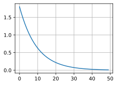

*图 35｜反复乘以固定因子使学习率按指数下降，可在预设下界处截断。[\[9\]](#参考文献9)*

### 分段常数与进展触发

给定里程碑 $s_1<s_2<\cdots$ 和缩小比例 $q$，可以令

$$
\alpha_t=\alpha_0q^{\,\#\{k:s_k\leq t\}}.
$$

例如在第 $5,10,20$ 个 epoch 各乘以 $1/2$，学习率依次变为初值的 $1/2,1/4,1/8$。也可以根据验证指标连续若干次没有改善来触发降低，而非预先固定时间。测试集应留作最终评价，不宜反复用来触发训练决策。

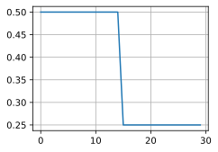

*图 36｜学习率在区间内保持不变，在预定时刻下降。该图示例只有一个下降时刻，并不对应正文列举的全部里程碑。[\[9\]](#参考文献9)*

其直觉是先让当前尺度下的优化取得进展，再缩小步长以减弱参数波动。进展停滞并不证明已经达到驻点，也可能来自噪声、尺度失衡或表达能力限制。

### 余弦退火

设 $T$ 为退火时长，初始与最终学习率分别为 $\alpha_0$ 和 $\alpha_{\min}$：

$$
\alpha_t=\alpha_{\min}
+\frac{\alpha_0-\alpha_{\min}}{2}
\left(1+\cos\frac{\pi t}{T}\right),\qquad0\leq t\leq T.
$$

在两端导数为零，开始时较缓慢下降，中间下降较快，最后平缓接近目标下界。若不使用重启，$t>T$ 后应保持 $\alpha_{\min}$，而非无条件继续代入余弦使学习率再次上升。[\[9\]](#参考文献9)

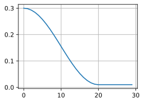

*图 37｜学习率平滑下降到目标下界，并在指定时长之后保持不变。[\[9\]](#参考文献9)*

### 学习率预热

随机初始化后的梯度尺度、历史矩估计和不同网络部分的适应程度可能尚未稳定。预热先使用较小学习率，再逐步增大到正式训练的起始值。例如，用 $T_w$ 步线性预热：

$$
\alpha_t=\alpha_{\mathrm{start}}
+\frac{t}{T_w}(\alpha_{\mathrm{peak}}-\alpha_{\mathrm{start}}),
\qquad0\leq t\leq T_w.
$$

随后以 $t-T_w$ 作为衰减阶段的时间。例如，预热后接余弦调度时，在余弦公式中使用剩余时长 $T-T_w$，可使两段在 $\alpha_{\mathrm{peak}}$ 处连续衔接。

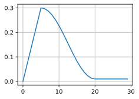

*图 38｜初期逐渐增加更新尺度，随后平滑衰减。预热可以与多种调度结合，时长需要依据训练稳定性和预算选择。[\[9\]](#参考文献9)*

预热旨在限制初期过大位移，并不保证任意网络都不会发散。预热过长又可能占用过多训练预算。它与 Adam 的偏差校正作用不同：前者改变步长，后者归一化零初始化统计的历史权重。

### 调度与泛化

相同训练损失下，不同优化器与调度可能得到不同参数和泛化表现。学习率衰减改变路径和随机波动，但不能直接解释为“参数一定更接近零”，也不等同于 L2 正则化或提前停止。

周期性学习率和重启使步长重复升降，用于在不同阶段改变探索尺度；训练路径中的参数平均则尝试综合多个迭代位置的信息。二者可以结合，但参数平均在非凸网络中不具有前述凸目标 Jensen 界的普遍保证，也不同于预测集成。调度效果应在统一的数据划分、计算预算和超参数搜索条件下评价。[\[8\]](#参考文献8)[\[9\]](#参考文献9)

## 参考资料

### 参考文献1

Simon J. D. Prince. [Understanding Deep Learning](https://udlbook.github.io/udlbook/). 第 6 章“训练模型”，pp. 73–88。

### 参考文献2

Gabriel Goh. [Why Momentum Really Works](https://distill.pub/2017/momentum/). Distill, 2017.

### 参考文献3

Ilya Sutskever et al. [On the Importance of Initialization and Momentum in Deep Learning](https://proceedings.mlr.press/v28/sutskever13.html). ICML, 2013.

### 参考文献4

Diederik P. Kingma, Jimmy Ba. [Adam: A Method for Stochastic Optimization](https://arxiv.org/abs/1412.6980). ICLR, 2015.

### 参考文献5

Sashank J. Reddi, Satyen Kale, Sanjiv Kumar. [On the Convergence of Adam and Beyond](https://openreview.net/pdf?id=ryQu7f-RZ). ICLR, 2018.

### 参考文献6

Ilya Loshchilov, Frank Hutter. [Decoupled Weight Decay Regularization](https://arxiv.org/abs/1711.05101). ICLR, 2019.

### 参考文献7

Liyuan Liu et al. [On the Variance of the Adaptive Learning Rate and Beyond](https://arxiv.org/abs/1908.03265). ICLR, 2020.

### 参考文献8

Dami Choi et al. [On Empirical Comparisons of Optimizers for Deep Learning](https://arxiv.org/abs/1910.05446). 2020.

### 参考文献9

《动手学深度学习》中文第二版，[第 11 章：优化算法](https://zh.d2l.ai/chapter_optimization/index.html)（PyTorch 版）。

### 参考文献10

Manzil Zaheer et al. [Adaptive Methods for Nonconvex Optimization](https://proceedings.neurips.cc/paper/2018/hash/90365351ccc7437a1309dc64e4db32a3-Abstract.html). NeurIPS, 2018.
