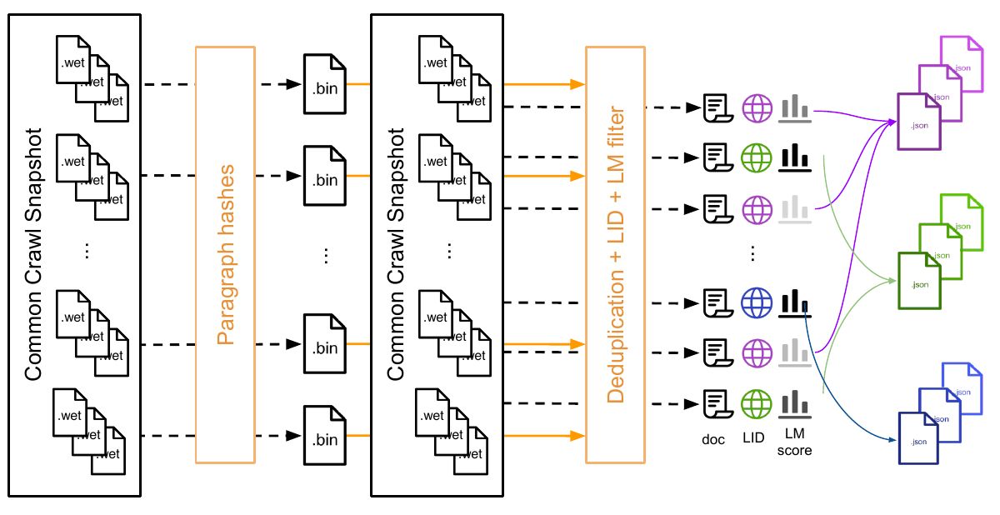
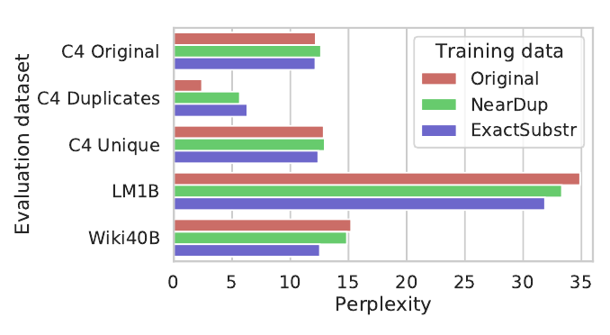
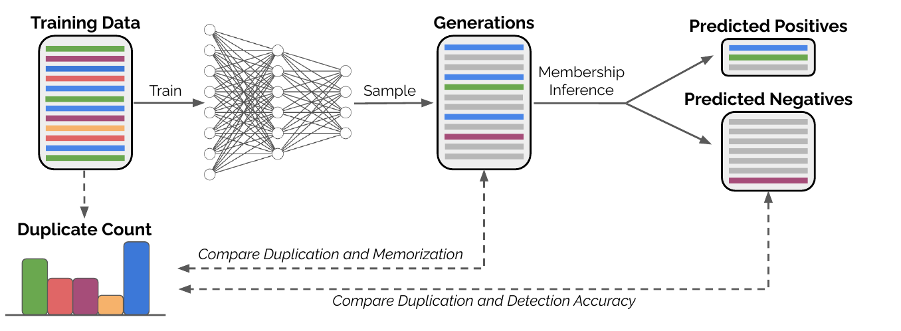
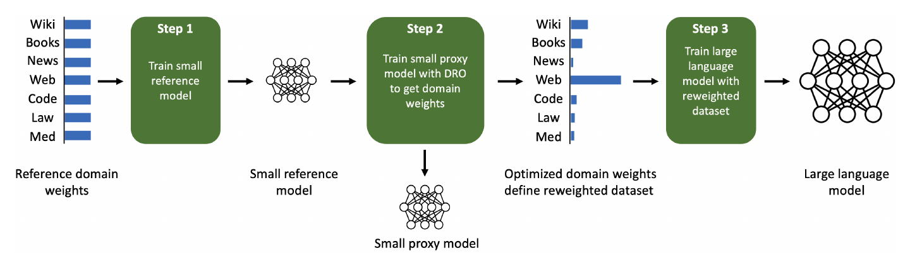
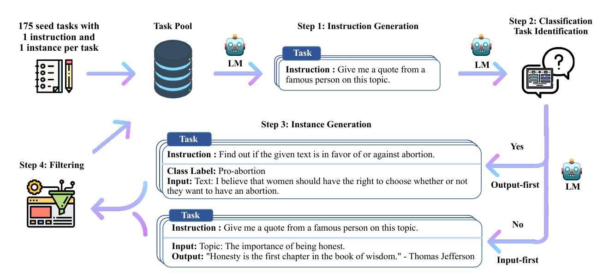
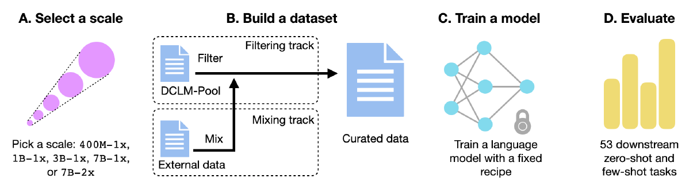
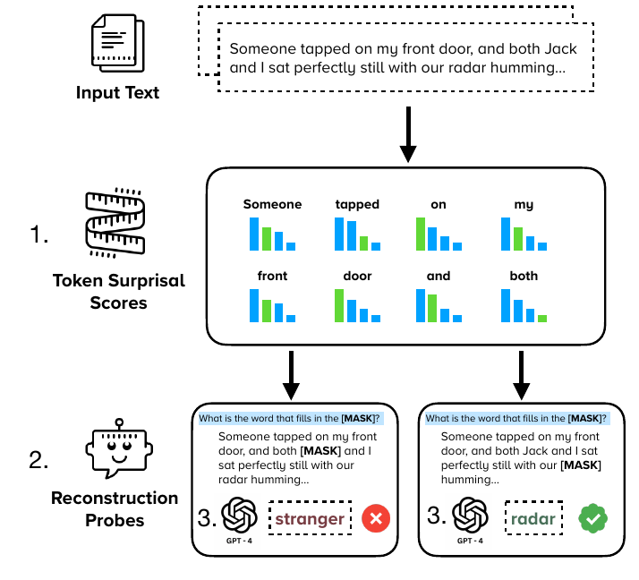

# LLM中的数据工程

Lee 等人在 C4 语料中发现，一段只有 61 个英文单词的文本出现了六万多次。如果均匀抽取训练位置，这段话就有六万多份机会进入训练批次。如果它还出现在验证集里，模型背下它所带来的损失下降，又会被计入验证成绩。同一个数据问题，同时改变了模型学什么，也改变了我们怎样判断它学得好不好。 [〔1〕](#ref-1)

设一段长度为 $T$ 的文本 $x$ 在训练语料中有 $m_x$ 个副本，$\ell_t(x)=-\log p_\theta(x_t\mid x_{<t})$。在每个 token 权重相同、文档边界处理相同的条件下，训练目标可以写成

$$
\mathcal L(\theta)=
\frac{\sum_x m_x\sum_{t=1}^{|x|}\ell_t(x)}
{\sum_x m_x|x|}.
$$

其中，正文抽取决定 $x$ 里有哪些文字，去重改变 $m_x$，分词改变 $|x|$，按领域采样又会改变不同 $x$ 进入批次的概率。

## 一、获取训练文档

Common Crawl 提供的三种数据存储格式：WARC、WAT 和 WET。WARC 保存原始网页抓取记录，包括 HTTP 响应、原始 HTML 等信息，可以重新解析网页与响应内容；WAT 保存从 WARC 中提取的元数据，通常采用 JSON 格式组织；WET 保存抽取后的纯文本，同时保留 URL 等基本记录信息。研究正文抽取算法时需要回到 WARC；研究既有纯文本上的语言过滤时，可以像 CCNet 一样从 WET 开始。 [〔2〕](#ref-2) [〔3〕](#ref-3)

### 1. 训练记录

| 层次 | 建议记录 | 之后能回答的问题 |
|---|---|---|
| 来源 | 抓取快照、记录标识、URL、抓取时间、已知的来源与使用条件 | 这段文本来自哪一次抓取？需要撤回时到哪里定位？ |
| 正文 | 抽取版本、正文、段落边界、原始与规范化指纹 | 两条记录是原文相同，还是清洗以后才相同？ |
| 筛选 | 语言分数、质量分数、过滤原因、重复簇和保留代表 | 被删掉的是正文、模板，还是少数语言样本？ |
| 训练 | 数据版本、划分、采样域、分词器版本、有效 token 数 | 可以用同一配方重建哪些训练批次？ |

表中是面向复现的记录建议。URL 标识网页位置，同一位置可以随时间换稿；内容指纹标识某种文本表示，同一内容又可以对应多个 URL。保留两种标识，才能在合并转载稿后继续追踪其来源。

### 2. CCNet 

*Wenzek 等，原论文图 1。从左往右看，跨页段落去重发生在语言识别之前；右端把同一种语言的语料按参考语言模型打分。* [〔3〕](#ref-3)

1. **分片。** CCNet 按快照处理 WET，把网页记录分片。不同分片之间可能存在重复数据，因此只在单个分片内部建立索引会漏掉跨分片重复。扩大索引范围会同时增加可发现的重复和内存开销。
2. **计算段落指纹。** CCNet 先把段落转成小写，统一数字，再去掉标点和重音。它取规范化文本 SHA-1 摘要的前 64 位，作为比较键。每个分片先单独写出键表，再用选定分片的键表查重。这样，只改日期的页脚也能匹配。
3. **语言识别**。删除重复页脚后，再让分类器读取剩余文本。原文比较了两种处理顺序，对一些低资源语言，先去重可以找回原先被其他语言模板掩盖的页面，有助于提高语言识别的准确性。
4. **质量评分。** CCNet 使用 Wikipedia 作为参考语料，利用 SentencePiece 进行分词，并训练基于 Kneser-Ney 平滑的 5-gram 语言模型，并计算每个token的困惑度，分为 head、middle、tail 三档。CCNet 给出了 48 种语言的参考语言模型。 [〔3〕](#ref-3)

## 二、语言识别与质量评分

### 1. fastText 

把文档 $d$ 切成单个词，得到单词特征 $G_1(d)$；切成相邻词对，得到相邻词对特征$G_2(d)$，合并得到特征序列$G(d)$。假设哈希桶数量为$B$，每个特征 $g$ 经哈希得到桶号 $h(g)=hash(g) mod B$。定义一个可学习的嵌入矩阵$E\in\mathbb R^{B\times D}$，从中取出对应的向量。把这些向量求平均，就得到整篇文档的表示 $u(d)$。分类层给每个标签算一个分数，再用 softmax 将分数转成概率。

$$
u(d)=\frac{1}{|G(d)|}\sum_{g\in G(d)}E_{h(g)},\qquad
p(y\mid d)=\operatorname{softmax}(Wu(d)+b)_y .
$$

- **特征。** 词组特征能区分某些局部词序。字符 n-gram 还能捕捉拼写和词缀。哈希限制了特征表大小，也允许不同特征落到同一桶。[〔4〕](#ref-4)
- **语言标签** CCNet 的 fastText 识别器用字符 n-gram 表示文本，把 176 种语言放在一棵分类树的叶子上。每个分叉都估计走向某个子节点的概率。沿根到叶的路径相乘，就得到该语言的分数。CCNet 取最高分对应的语言，分数超过 0.5 才收录该页。 [〔3〕](#ref-3) [〔5〕](#ref-5)
- **误差。** 混有双语引文的长文、只有几个词的短文、代码夹注释的文档都可能得低分。调高阈值会改变留下的语言和文本类型。可以为每种主要语言分别抽取阈值两侧的样本，记录误收、误删的类型。

### 2. CCNet 的困惑度

CCNet 在每种有参考数据的语言上，用 Wikipedia 训练 SentencePiece 分词器和五元语言模型。设参考模型为 $q$，一段正文得到 $T$ 个 token，忽略开头不足四个词的记号差异，有

$$
H_q(d)=-\frac1T\sum_{t=1}^T\log q(x_t\mid x_{t-4:t-1}),
\qquad \mathrm{PPL}_q(d)=\exp H_q(d).
$$

五元模型每次最多读前四个 token，预测第五个。真实 token 的预测概率越低，该位置的负对数损失越大。先对各位置的损失取平均，再取指数，就得到整段的困惑度。取平均可以把长短不同的文本放到每 token 的尺度上比较。

CCNet 在每种语言内分别划分三档。困惑度最低的一档是 head，其用词和局部搭配最符合参考模型的预期。方言对话和专业手册可能落入 tail，因为 Wikipedia 很少使用其中的表达。 [〔3〕](#ref-3)

### 3. 规则、参考模型和分类器

| 信号 | 实际测量的量 | 误差 |
|---|---|---|
| 空文本、重复行比例、长度等规则 | 可直接计算的文本属性 | 表格、诗歌、代码也可能重复或过短 |
| CCNet 的语言模型 | 参考模型给文本分配的平均对数概率 | 参考域之外的优质内容得分偏低 |
| DCLM 的监督过滤器 | 与选定正、负样本的统计相似程度 | 正样本的题材和表达方式会进入筛选标准 |

DataComp-LM（DCLM）用带标签的样本训练网页过滤器。论文比较的一种配方分三步。

1. 从 OpenHermes 2.5 和 ExplainLikeImFive 社区的高评分帖子取正样本。从研究团队复现的 RefinedWeb 语料中随机抽取负样本。负标签只说明抽样来源，其中也会有好文章。

   1. 用这些标签训练 fastText，再给候选网页计算正类分数。对于候选网页，按分数排序后，可以按照固定比例筛选。论文比较了前保留 10%、15% 和 20%，其中，保留前 10% 的下游表现更好。

2. 更换正样本，分类器偏好的文风和题材也会变化。设正样本的数据分布为$p_+(d)=p(d\mid y=1)$，负样本的数据分布为$p_-(d)=p(d\mid y=0)$​，假设训练时正负样本数量相同，则理想分类器满足
   $$
   { p(y=1\mid d)= \frac{p_+(d)}{p_+(d)+p_-(d)} }，即{
   \frac{p(y=1\mid d)}{1-p(y=1\mid d)}
   =\frac{p_+(d)}{p_-(d)}
   }
   $$
   $\frac{p_+(d)}{p_-(d)}$称为密度比。因此，当我们更换正样本时，相当于更换了$p_+(d)$，分类器学习到的评分函数也会发生变化。 [〔6〕](#ref-6)

## 三、训练集的去重

首先确定要查找的重复单位。一份协议被三百篇不同文章引用，按整篇哈希会得到三百个不同指纹；如果只把其中一份协议改了几个词，逐段精确匹配又可能漏掉它。粒度决定了后面数据结构所能作出的判断。 [〔1〕](#ref-1)

| 目标 | 表示与索引 | 命中之后的处理 |
|---|---|---|
| 相同文档或段落 | 规范化后的字节串、指纹和精确索引 | 核对相等，保留一份正文及其来源映射 |
| 文档中重复的长片段 | token 或字节序列，后缀数组 | 定位片段边界，合并重叠区间后处理 |
| 有局部修改的近重复文档 | shingle 集合、MinHash 签名与 LSH 桶 | 复核候选对，决定分簇与代表文档 |

### 1. Bloom filter 

假设要判断段落键是否进入过全局索引。Bloom filter 用 $m$ 个初始为 0 的位和 $k$ 个哈希函数表示已经插入的键。插入一个键时，将对应的 $k$ 个位置置 1；查询时，只要读到一个 0，就能确定它没被插入过。全部为 1 时，这些位可能是不同旧键共同置上的。 [〔7〕](#ref-7) [〔8〕](#ref-8)

一次均匀哈希避开指定位的概率是 $1-1/m$。插入 $n$ 个键，每个键写 $k$ 次，共写 $kn$ 次。若各次写入近似独立，该位仍为 0 的概率就是 $P_0$。查询一个新键时，只有它指向的 $k$ 个位置恰好全为 1，才会误报。于是

$$
P_0=\left(1-\frac1m\right)^{kn}\approx e^{-kn/m},
\qquad f\approx (1-e^{-kn/m})^k.
$$

给定 $m/n$，最优哈希数近似为 $k^\star=(m/n)\ln2$。目标误报率为 1% 时，每个键约需 $-\ln(0.01)/(\ln2)^2\approx9.6$ 位，取 7 个哈希函数。这些就是容量规划值。

### 2. ExactSubstr 

后缀指从某个位置一直到文本结尾的序列。Lee 等为每个起点建索引，再按后缀的字典序排列这些起点。后缀数组只需存起点，实际比较时回到原文取字符。两个后缀即使来自不同文章，只要开头共享一段文字，就会和具有相同前缀的后缀排在一起。 [〔1〕](#ref-1)

1. **找重复。** 按排序后的起点 $s_i$ 和 $s_{i+1}$ 读取两个后缀。从头逐个比较，直到第一次不同。连续相同的长度就是最长公共前缀长度（LCP）。若它至少为 $L$，两个起点就共享一段达到阈值的文本。
2. **合并区间。** 一段长度为 $L+1$ 的重复文本，从第二个位置起仍有 $L$ 个单位相同。因此同一处重复可能命中多次。把命中映射回文档，再合并互相覆盖的区间，才知道实际重复了多少文字。
3. **处理正文。** 决定哪一处作为保留副本，并在文档边界截断匹配。调低 $L$ 会找回更短的复制片段，也会命中更多常见短语。

### 3. MinHash 与 LSH 

将连续 $w$ 个词或字符组成一个 shingle。一篇文档用 shingle 集合 $A$ 表示，两篇文档的 Jaccard 相似度为 $s=|A\cap B|/|A\cup B|$。少量改字只会影响附近的 shingle。枚举 $N$ 份文档的全部文档对却需要 $N(N-1)/2$ 次比较。 [〔10〕](#ref-10)

**第一步，压缩集合。** 在理想随机排列 $\pi$ 下，记 $h_\pi(A)=\min_{a\in A}\pi(a)$。两个集合的最小元素相同，当且仅当并集里排第一的元素落在交集中。因此

$$
\Pr[h_\pi(A)=h_\pi(B)]=s,\qquad
\hat s=\frac1k\sum_{i=1}^k\mathbf1[h_i(A)=h_i(B)].
$$

所有文档使用同一组 $k$ 个哈希函数。每个函数给集合中的每个元素打一个哈希值，只保留最小值。按函数顺序排好这 $k$ 个最小值，就得到文档签名。比较两份文档时，对应位置相等的比例就是 $\hat s$。

**第二步，缩小候选范围。** 把签名切成 $b$ 组，每组 $r$ 行，共 $k=br$ 行。用组号和组内的整段签名作为桶键，只比较至少有一组同桶的文档。对相似度为 $s$ 的文档对，一组全相等的概率是 $s^r$。若各行独立，并忽略额外的桶碰撞，全部 $b$ 组都错过的概率就是 $(1-s^r)^b$。因此

$$
P(\text{候选}\mid s)=1-(1-s^r)^b.
$$

例如 $b=16,r=8$，相似度为 0.8 的文档对约有 95% 的机会进入候选，相似度为 0.5 的文档对约有 6% 的机会进入候选。

**第三步，复核与分簇。** 对候选计算实际集合相似度，按阈值连边。若用连通分量建簇，$A$ 接近 $B$、$B$ 接近 $C$ 即可把三者连在一起，$A$ 和 $C$ 的相似度仍可能较低。保留最长正文、最早来源或质量分数最高的代表，会留下不同版本。Lee 等的 NearDup 和 ExactSubstr 分别覆盖了整篇近似与局部精确这两类重复。 [〔1〕](#ref-1) [〔10〕](#ref-10)

**与 Bloom filter 的区别。** Bloom 回答一个给定键是否可能出现过；MinHash 估计两个集合的交并比；LSH 为可能相似的文档对建立候选索引。

## 四、验证集的去重

*Lee 等，原论文图 2。横轴为困惑度。先对照 C4 Duplicates 和 C4 Unique，再在同一行比较不同训练语料的模型，两个比较回答的是不同问题。* [〔1〕](#ref-1)

- **训练效率。** Lee 等报告，在其实验设定下，去重模型生成已记忆文本的频率约降到原来的十分之一，达到相同或更好的精度所需训练步数也更少。
- **验证集污染。** 原验证集中与训练语料更有可能有重叠的样本。移除训练副本之后，这个子集的困惑度可能上升。要解释结果，至少分别报告原验证集、已识别重叠子集和清洁子集上的成绩。
- **划分顺序。** 对自行构建的语料，先确定重复簇，再以簇为单位分训练集和验证集。对外部已有的固定评测集，应把它当成保留集，用题干、参考答案或长片段去检查训练候选，记录被移除的重叠及匹配口径。应同时检查合成和指令微调数据。

*Kandpal 等，原论文图 2。左侧数训练副本，中间数模型生成中的匹配，右侧才评价隐私判别。三个计数的分母不同。* [〔11〕](#ref-11)

**重复与记忆。** Kandpal 等观察到，在所研究的模型与生成设置中，训练中出现 10 次的序列，平均生成频率约为只出现 1 次的序列的 1,000 倍。因此，去重可以减少高频内容带来的暴露。 [〔11〕](#ref-11)

## 五、训练配比

设领域 $j$ 在清洗后有 $N_j$ 个可用 token，总训练预算为 $B$，希望分给它的 token 比例为 $\alpha_j$。则它获得的预算和平均暴露次数分别为

$$
B_j=B\alpha_j,\qquad e_j=\frac{B\alpha_j}{N_j},
\qquad \sum_j\alpha_j=1.
$$

如果一个领域原有 20 亿 token，过滤后只剩 10 亿，仍给它 40 亿 token 预算，平均暴露次数就从 2 次升为 4 次。因此，需要考虑剩余预算分给了谁，以及 $\alpha_j$ 是按文档、序列还是有效训练 token 执行。

### 1. DoReMi 

*Xie 等，原论文图 1。第二步在小模型上确定领域权重，第三步才把这组权重用于大模型训练。* [〔12〕](#ref-12)

1. **设定参照。** 用初始领域配比训练一个小参考模型，然后固定它的参数。另一个小模型充当代理模型，参数会继续更新。每轮按域均匀抽样，让两个模型预测同一批 token。
2. **计算差距。** 对每个真实 token，用代理模型的损失减去参考模型的损失。正值表示代理模型对正确 token 给出的概率更低。先把负值截成 0，再在域内的位置 $I_j$ 上求平均。这样，已经追上的位置就不会抵消仍落后的位置。忽略小幅平滑，更新式为

$$
\Delta_j=\frac1{|I_j|}\sum_{t\in I_j}
\max\{0,\ell_{\rm proxy,t}-\ell_{\rm ref,t}\},
\qquad
\alpha'_j=\frac{\alpha_j e^{\eta\Delta_j}}
{\sum_i\alpha_i e^{\eta\Delta_i}}.
$$

3. **更新权重。** $\eta$ 控制调整幅度。差距 $\Delta_j$ 越大，旧权重乘上的因子就越大。分母把各域权重重新归一化。代理模型用这些权重计算训练目标，下一轮再测各域的差距。
4. **训练目标模型。** 对各轮权重取平均，再按所得配比为大模型抽取训练数据。小模型传给大模型的是各域的采样比例。 [〔12〕](#ref-12)

在 The Pile 的实验里，作者用 2.8 亿参数代理模型为 80 亿参数模型选配比。与沿用 The Pile 默认权重的基线相比，下游少样本任务的平均准确率提高了 6.5 个百分点，达到基线准确率所需的目标模型训练步数约为原来的 $1/2.6$。 [〔12〕](#ref-12)

**与文档质量过滤的区别。** CCNet 给文本打分，DoReMi 为整个领域分配预算。可以先在域内去重和分档，再学习域与域的配比。两次实验若同时改变了域内筛选和域间配比，就很难将收益归给其中某一步。

### 2. 分词与装箱

- **重数 token。** UTF-8 字节数、字符数、文档数与 token 数分别使用不同单位。确定分词器和版本后应重新统计各域 $N_j$，训练时再用实际参与损失计算的 token 核对目标配比。
- **文档边界。** 将短文档拼入同一条定长序列能减少填充。加入结束标记、是否允许下篇关注上篇、哪些位置计入损失，是三个独立选择。
- **分开报账。** 同时报告清洗后独有 token、实际训练 token 和 padding 或屏蔽位置。否则，即使两次运行处理了相同数量的定长序列，有效监督量也可能不同。

## 六、合成数据

*Wang 等，原论文图 2。先产生任务指令，再为指令生成输入输出实例。通过过滤的任务回到任务池，影响下一轮采样。* [〔13〕](#ref-13)

**Self-Instruct**

1. **写新指令。** 从 175 个手写任务起步。每轮从任务池抽取已有指令作为提示，让模型提出新的任务要求。
2. **生成实例。** 对普通生成任务，先构造输入，再给出回答。对分类任务，先列出可能的类别，再为各类生成相应的输入。这样，样本就较少集中在几个常见类别上。
3. **筛选与回流。** 新指令与每条已有指令的 ROUGE-L 相似度都低于 0.7，才通过这一项检查。ROUGE-L 根据最长公共子序列衡量措辞重合度。通过筛选的指令进入任务池，后续轮次可以抽到它。筛过的指令、输入和回答组成微调样本，答案正确性仍需单独核查。 [〔13〕](#ref-13)

**科学数据的来源。** Jack Hidary 在世界经济论坛的署名文章里区分了自动化实验和计算模拟。自动化仪器带来新的观测；模拟器则在给定参数、边界条件和模型假设下产生数值结果。二者都能扩大数据覆盖，但模拟结果的精度取决于模拟器和有效范围。 [〔14〕](#ref-14)

| 数据的产生 | 可独立核对的部分 | 保留的来源信息 |
|---|---|---|
| 教师模型生成指令和回答 | 任务是否重复、答案是否通过测试或人工复核 | 教师与提示版本、种子任务族、生成批次 |
| 求解器或模拟器生成数值标签 | 守恒关系、已知解析解、与独立实测的误差 | 参数、单位、模拟器版本、有效范围 |
| 仪器或人工实验产生观测 | 校准记录、重复实验、测量不确定性 | 实验条件、仪器、时间和观测标识 |

若把一条测量记录改写成十种问答，按问答随机划分训练与测试，测试集可能只测到模型认出了同一个数值。以原始实验、种子任务或模拟参数族作为划分单位，再留出独立的实验条件，可以更直接地检验泛化。报告合成量时，也应区分独立来源数与派生文本数。

## 七、验证数据工作

### 1. 用受控训练比较数据配方

*Li 等，原论文图 2。从左到右依次选实验规模、构建数据集、训练模型、评估模型。* [〔6〕](#ref-6)

DCLM 在同一规模下固定训练与评估配方。沿用这种设计，可以从同一份网页快照出发，只改变一条过滤规则。两组使用相同的模型、分词器和训练 token 预算。最后从三个角度比较结果。 [〔6〕](#ref-6)

| 比较 | 指标 | 解释时的对照 |
|---|---|---|
| 数据发生了什么变化 | 文档和 token 留存率、各域占比、重复簇大小、跨集匹配率 | 每一阶段的输入量；按语言、域、长度分层 |
| 模型是否学得更好 | 清洁验证集损失、各任务成绩、稀有领域表现 | 相同训练预算、相同评测版本、逐任务差值 |
| 改善花了多少成本 | 清洗计算量、索引峰值内存、训练时间 | 达到同一成绩的总成本，或同一预算下的成绩 |

### 2. 黑盒模型留下的训练数据印记

*Ravichander 等，原论文图 1。先由外部信号估计位置的可预测性，再比较目标模型对遮挡内容的还原。* [〔15〕](#ref-15)

1. **选位置。** 在公开候选文本中，外部参考模型给真实 token 分配概率 $q(x_t\mid x_{<t})$。概率越低，惊讶度 $I_t=-\log q(x_t\mid x_{<t})$ 越高。补全常见搭配本来就容易，准确补回一个难猜的词更有辨识力。
2. **测重建率。** 遮住选中的内容，保留周围文字，让目标模型补全。把准确还原的次数除以测试次数，就得到重建率。 [〔15〕](#ref-15)

同一内容可能经转载、引用或多个数据集流入模型；同类上下文的推断也可能给出正确答案。因此应把重建结果解释为模型熟悉特定文本的证据，结合匹配的对照文本、公开时间和训练侧来源记录判断。它回答的是数据来源审计问题；而DCLM 回答的是给定配方训练出的模型表现如何。

### 3. 少量投毒与语料治理

PC Gamer 报道的“250 份文档”来自 Anthropic 等团队的受控预训练研究。在测试的 6 亿至 130 亿参数模型上，研究者观察到少量污染文档可以诱导特定条件下的无意义输出。 [〔16〕](#ref-16) [〔17〕](#ref-17)

对数据工程而言，这个结果改变了验收方式。全局平均困惑度会稀释低频失效，而去重只检查文本相等或相似。对一次新增数据，可以保留来源和批次记录，比较加入前后的行为测试；若出现局部退化，再回溯哪些新批次覆盖了相关输入。能够定位和撤下某个数据版本，比单独知道整个语料“清洗过”更有用。

## 结语

回到开头那段重复六万多次的文本。精确匹配能找出它的位置，近重复检索能补上改写的副本，采样记录能说明处理之后它实际进入了多少次训练。最后，清洁验证集告诉我们模型面对新文本时学得怎样，生成与审计实验则检验旧文本留下了多强的印记。

## 参考文献

1. Katherine Lee 等，2022。[Deduplicating Training Data Makes Language Models Better](https://arxiv.org/abs/2107.06499)。 [↩1](#cite-1-1) [↩2](#cite-1-2) [↩3](#cite-1-3) [↩4](#cite-1-4) [↩5](#cite-1-5)

2. Common Crawl。[Get Started：WARC、WAT 与 WET 三种格式](https://commoncrawl.org/get-started)。 [↩1](#cite-2-1)

3. Guillaume Wenzek 等，2019。[CCNet: Extracting High Quality Monolingual Datasets from Web Crawl Data](https://arxiv.org/abs/1911.00359)。 [↩1](#cite-3-1) [↩2](#cite-3-2) [↩3](#cite-3-3) [↩4](#cite-3-4) [↩5](#cite-3-5)

4. CS336 中文共建课程，第 11 章。[fastText 简易分类器（中文代码）](https://github.com/1iyouzhen/CS336-Chinese-co-construction/blob/f495fa0efe380dd4638ddfca5166d71344879f72/docs/zh/chapter11/FastText.py)。 [↩1](#cite-4-1)

5. fastText 项目。[Language identification](https://fasttext.cc/docs/en/language-identification.html)；[Text classification 教程](https://fasttext.cc/docs/en/supervised-tutorial.html)。 [↩1](#cite-5-1)

6. Jeffrey Li 等，2024。[DataComp-LM: In Search of the Next Generation of Training Sets for Language Models](https://arxiv.org/abs/2406.11794)。 [↩1](#cite-6-1) [↩2](#cite-6-2) [↩3](#cite-6-3)

7. Burton H. Bloom，1970。[Space/Time Trade-offs in Hash Coding with Allowable Errors](https://doi.org/10.1145/362686.362692)。 [↩1](#cite-7-1)

8. Wikipedia。[Bloom filter：算法、误报概率与空间开销](https://en.wikipedia.org/wiki/Bloom_filter)。 [↩1](#cite-8-1)

9. CS336 中文共建课程，第 11 章。[Bloom Filter 简化实现（中文代码）](https://github.com/1iyouzhen/CS336-Chinese-co-construction/blob/f495fa0efe380dd4638ddfca5166d71344879f72/docs/zh/chapter11/bloom%20Filter%E7%AE%80%E5%8C%96%E5%AE%9E%E7%8E%B0)。 [↩1](#cite-9-1)

10. Jure Leskovec、Anand Rajaraman、Jeffrey D. Ullman，*Mining of Massive Datasets*。[第 3 章 Finding Similar Items](http://infolab.stanford.edu/~ullman/mmds/ch3n.pdf)；[出版社目录](https://www.cambridge.org/core/books/mining-of-massive-datasets/C1B37BA2CBB8361B94FDD1C6F4E47922/listing)。 [↩1](#cite-10-1) [↩2](#cite-10-2)

11. Nikhil Kandpal、Eric Wallace、Colin Raffel，2022。[Deduplicating Training Data Mitigates Privacy Risks in Language Models](https://arxiv.org/abs/2202.06539)。 [↩1](#cite-11-1) [↩2](#cite-11-2)

12. Sang Michael Xie 等，2023。[DoReMi: Optimizing Data Mixtures Speeds Up Language Model Pretraining](https://arxiv.org/abs/2305.10429)。 [↩1](#cite-12-1) [↩2](#cite-12-2) [↩3](#cite-12-3)

13. Yizhong Wang 等，2022。[Self-Instruct: Aligning Language Models with Self-Generated Instructions](https://arxiv.org/abs/2212.10560)。 [↩1](#cite-13-1) [↩2](#cite-13-2)

14. Jack Hidary，2025。世界经济论坛合作伙伴署名文章。[We're running low on data to train AI. The good news is there's a fix for that](https://www.weforum.org/stories/2025/12/data-ai-training-synthetic/)。 [↩1](#cite-14-1)

15. Abhilasha Ravichander 等，2025。[Information-Guided Identification of Training Data Imprint in (Proprietary) Large Language Models](https://arxiv.org/abs/2503.12072)。 [↩1](#cite-15-1) [↩2](#cite-15-2)

16. PC Gamer，2025。[关于 250 份污染文档实验的报道](https://www.pcgamer.com/software/ai/anthropic-reveals-that-as-few-as-250-malicious-documents-are-all-it-takes-to-poison-an-llms-training-data-regardless-of-model-size/)。 [↩1](#cite-16-1)

17. Alexandra Souly 等，2025。[Poisoning Attacks on LLMs Require a Near-constant Number of Poison Samples](https://arxiv.org/abs/2510.07192)；[研究团队说明](https://www.anthropic.com/research/small-samples-poison)。 [↩1](#cite-17-1)
