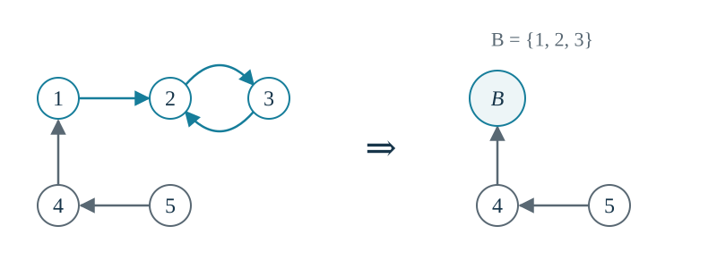

## 3.1 离散情形

对事件 $E,F$，当 $\mathbb{P}(F)>0$ 时，条件概率定义为

$$
\mathbb{P}(E\mid F)=\frac{\mathbb{P}(E\cap F)}{\mathbb{P}(F)}.
$$

若 $X,Y$ 为离散随机变量，则对所有满足 $p_Y(y)=\mathbb{P}(Y=y)>0$ 的 $y$，定义

> [!important]
> **条件概率质量函数与条件分布函数**
>
> $$
> p_{X\mid Y}(x\mid y)=\mathbb{P}(X=x\mid Y=y)
>     =\frac{\mathbb{P}(X=x,Y=y)}{\mathbb{P}(Y=y)}
>     =\frac{p_{X,Y}(x,y)}{p_Y(y)}.
> $$
>
> $$
> F_{X\mid Y}(a\mid y)=\mathbb{P}(X\le a\mid Y=y)
>     =\sum_{x\le a}p_{X\mid Y}(x\mid y).
> $$

固定 $y$ 后，$p_{X\mid Y}(\cdot\mid y)$ 是关于 $x$ 的概率质量函数，因此非负且满足 $\sum_xp_{X\mid Y}(x\mid y)=1$。

**条件期望。**在给定 $Y=y$ 后，使用条件分布重新加权：

$$
\boxed{\mathbb E[X\mid Y=y]=\sum_x x\,p_{X\mid Y}(x\mid y)}.
$$

有限条件期望要求 $\sum_x|x|p_{X\mid Y}(x\mid y)<\infty$。更一般地，

$$
\mathbb E[h(X)\mid Y=y]=\sum_x h(x)p_{X\mid Y}(x\mid y).
$$

条件期望保留线性性质；例如在相应条件期望有限时，

$$
\mathbb E\left[\sum_{i=1}^n X_i\,\middle|\,Y=y\right]
  =\sum_{i=1}^n\mathbb E[X_i\mid Y=y].
$$

若 $X,Y$ 独立，则 $p_{X,Y}(x,y)=p_X(x)p_Y(y)$，因而 $p_{X\mid Y}(x\mid y)=p_X(x)$。此时给定 $Y$ 不改变 $X$ 的分布，条件期望也与无条件期望相同（若其存在）。

**独立二项变量。**设

$$
X_1\sim\operatorname{Bin}(n_1,p),\qquad
  X_2\sim\operatorname{Bin}(n_2,p),\qquad 0<p<1,
$$

且 $X_1,X_2$ 独立，$n_1,n_2$ 为正整数。两者成功概率相同，但试验次数可以不同。令 $S=X_1+X_2$，则 $S\sim\operatorname{Bin}(n_1+n_2,p)$。

给定 $S=m$，事件 $\{X_1=k,S=m\}$ 等价于 $\{X_1=k,X_2=m-k\}$。因此

$$
\begin{aligned}
\mathbb{P}(X_1=k\mid S=m)
   & =\frac{\mathbb{P}(X_1=k,X_2=m-k)}{\mathbb{P}(S=m)}     \\
   & =\frac{\mathbb{P}(X_1=k)\mathbb{P}(X_2=m-k)}{\mathbb{P}(S=m)} \\
   & =\frac{\binom{n_1}{k}p^k(1-p)^{n_1-k}
  \binom{n_2}{m-k}p^{m-k}(1-p)^{n_2-m+k}}
  {\binom{n_1+n_2}{m}p^m(1-p)^{n_1+n_2-m}}.
\end{aligned}
$$

将相同的 $p$ 与 $1-p$ 的幂约去，得到

> [!important]
> **条件分布为超几何分布**
>
> $$
> \boxed{\mathbb{P}(X_1=k\mid X_1+X_2=m)
>       =\frac{\binom{n_1}{k}\binom{n_2}{m-k}}{\binom{n_1+n_2}{m}}}.
> $$
>
> 其中 $0\le m\le n_1+n_2$，且
>
> $$
> \max(0,m-n_2)\le k\le\min(n_1,m),\qquad k\text{ 为整数}.
> $$

在所有 $n_1+n_2$ 次试验中，已知总共有 $m$ 次成功；这些成功位置在所有大小为 $m$ 的位置集合中等可能分布。$X_1$ 统计其中落在前 $n_1$ 个位置的个数，所以呈超几何分布。由此也有

$$
\mathbb E[X_1\mid S=m]=m\frac{n_1}{n_1+n_2}.
$$

**独立泊松变量给定总和。**若 $X\sim\operatorname{Pois}(\lambda_1)$、$Y\sim\operatorname{Pois}(\lambda_2)$ 独立，$\lambda_1,\lambda_2>0$，则 $X+Y\sim\operatorname{Pois}(\lambda_1+\lambda_2)$。对非负整数 $m$，同样计算得

$$
\mathbb{P}(X=k\mid X+Y=m)
  =\binom mk\left(\frac{\lambda_1}{\lambda_1+\lambda_2}\right)^k
  \left(\frac{\lambda_2}{\lambda_1+\lambda_2}\right)^{m-k},\quad k=0,\ldots,m.
$$

故该条件分布为 $\operatorname{Bin}\bigl(m,\lambda_1/(\lambda_1+\lambda_2)\bigr)$，条件期望为 $m\lambda_1/(\lambda_1+\lambda_2)$。

## 3.2 连续情形

若 $X,Y$ 具有联合密度 $f_{X,Y}$，对满足 $f_Y(y)>0$ 的 $y$，定义

> [!important]
> **条件概率密度函数**
>
> $$
> \boxed{f_{X\mid Y}(x\mid y)=\frac{f_{X,Y}(x,y)}{f_Y(y)}},\qquad
>     f_Y(y)=\int_{-\infty}^{\infty}f_{X,Y}(x,y)\,dx.
> $$
>
> 固定 $y$ 后，$f_{X\mid Y}(\cdot\mid y)$ 关于 $x$ 非负，且积分等于 1。

连续情形通常有 $\mathbb{P}(Y=y)=0$，所以这里不是直接用两个事件概率相除。若密度在相应点连续，对很小的 $\Delta x,\Delta y>0$，有

$$
\begin{aligned}
& \mathbb{P}(x<X\le x+\Delta x\mid y<Y\le y+\Delta y)                     \\
   & \qquad\approx\frac{f_{X,Y}(x,y)\Delta x\Delta y}{f_Y(y)\Delta y}
  =f_{X\mid Y}(x\mid y)\Delta x.
\end{aligned}
$$

**条件分布与条件期望。**固定 $y$ 后，计算方式与通常的密度相同：

$$
F_{X\mid Y}(a\mid y)=\int_{-\infty}^a f_{X\mid Y}(x\mid y)\,dx,
  \qquad
  \mathbb E[X\mid Y=y]=\int_{-\infty}^{\infty}x f_{X\mid Y}(x\mid y)\,dx.
$$

更一般地，将上式中的 $x$ 换为 $h(x)$，即可求 $\mathbb E[h(X)\mid Y=y]$，条件是相应绝对值积分有限。若 $X,Y$ 独立，则条件密度等于边缘密度。

**$t$ 分布的构造。**令 $Z\sim\mathcal N(0,1)$、$Y\sim\chi_n^2$ 独立，$n$ 为正整数，定义

$$
T=\frac{Z}{\sqrt{Y/n}}=\sqrt{\frac nY}\,Z.
$$

给定 $Y=y>0$ 时，$T$ 只是标准正态变量乘以常数 $\sqrt{n/y}$，所以

$$
T\mid(Y=y)\sim\mathcal N\left(0,\frac ny\right),\qquad
  f_{T\mid Y}(t\mid y)=\sqrt{\frac{y}{2\pi n}}\exp\left(-\frac{t^2y}{2n}\right).
$$

为对 $y$ 积分得到 $T$ 的密度，先推导卡方变量 $Y$ 的密度。

**卡方密度。**令 $U=Z^2$，其中 $Z\sim\mathcal N(0,1)$。对 $u>0$，

$$
F_U(u)=\mathbb{P}(-\sqrt u\le Z\le\sqrt u)
  =\Phi(\sqrt u)-\Phi(-\sqrt u).
$$

记标准正态密度为 $\varphi$，对 $u$ 求导，

$$
f_U(u)=\frac{\varphi(\sqrt u)+\varphi(-\sqrt u)}{2\sqrt u}
  =\frac1{\sqrt{2\pi}}u^{-1/2}e^{-u/2},\qquad u>0.
$$

在 $u<0$ 时密度为 0；单个点 $u=0$ 的密度取值不影响分布。

对 $a>0$，定义密度族

$$
g_a(y)=\frac{y^{a-1}e^{-y/2}}{2^a\Gamma(a)},\qquad y>0,
  \qquad \Gamma(a)=\int_0^\infty v^{a-1}e^{-v}\,dv.
$$

其余位置密度取 0。由 $v=z^2$ 的代换与高斯积分，

$$
\Gamma\left(\frac12\right)=2\int_0^\infty e^{-z^2}\,dz=\sqrt\pi,
$$

所以 $f_U=g_{1/2}$。

设 $A,B$ 独立，密度分别为 $g_a,g_b$。由卷积公式，对 $y>0$，

$$
\begin{aligned}
f_{A+B}(y)
   & =\int_0^y g_a(x)g_b(y-x)\,dx                \\
   & =\frac{e^{-y/2}}{2^{a+b}\Gamma(a)\Gamma(b)}
  \int_0^y x^{a-1}(y-x)^{b-1}\,dx.
\end{aligned}
$$

令 $x=yu$，再利用贝塔积分恒等式

$$
\int_0^1u^{a-1}(1-u)^{b-1}\,du
  =\frac{\Gamma(a)\Gamma(b)}{\Gamma(a+b)},
$$

得到 $f_{A+B}(y)=g_{a+b}(y)$。这一积分恒等式可由 $\Gamma(a)\Gamma(b)$ 的二重积分作代换 $r=x+y$、$u=x/(x+y)$ 得到。

若 $Z_1,\ldots,Z_n$ 独立且均服从标准正态分布，则各 $Z_i^2$ 的密度都是 $g_{1/2}$。反复卷积，得到

> [!important]
> **自由度为 $n$ 的卡方密度**
>
> $$
> Y=\sum_{i=1}^nZ_i^2\sim\chi_n^2,\qquad
>     \boxed{f_Y(y)=\frac{y^{n/2-1}e^{-y/2}}{2^{n/2}\Gamma(n/2)},\quad y>0}.
> $$

**$t$ 密度。**由 $Y>0$，

$$
\begin{aligned}
f_T(t)
   & =\int_0^\infty f_{T\mid Y}(t\mid y)f_Y(y)\,dy \\
   & =\frac1{\sqrt{2\pi n}\,2^{n/2}\Gamma(n/2)}
  \int_0^\infty y^{(n+1)/2-1}
  \exp\left[-\frac12\left(1+\frac{t^2}{n}\right)y\right]dy.
\end{aligned}
$$

令 $a=(n+1)/2$、$c=(1+t^2/n)/2>0$。对积分作代换 $v=cy$，则

$$
\int_0^\infty y^{a-1}e^{-cy}\,dy
  =c^{-a}\int_0^\infty v^{a-1}e^{-v}\,dv
  =c^{-a}\Gamma(a).
$$

代回并整理常数，得到

$$
\begin{aligned}
f_T(t)
   & =\frac{\Gamma((n+1)/2)}{\sqrt{2\pi n}\,2^{n/2}\Gamma(n/2)}
  \left[\frac12\left(1+\frac{t^2}{n}\right)\right]^{-(n+1)/2}   \\
   & =\frac{\Gamma((n+1)/2)}{\sqrt{n\pi}\,\Gamma(n/2)}
  \left(1+\frac{t^2}{n}\right)^{-(n+1)/2}.
\end{aligned}
$$

> [!important]
> **自由度为 $n$ 的 $t$ 分布**
>
> 若 $Z\sim\mathcal N(0,1)$、$Y\sim\chi_n^2$ 且相互独立，则
>
> $$
> T=\frac{Z}{\sqrt{Y/n}}\sim t_n,
> $$
>
> 其密度为
>
> $$
> \boxed{f_T(t)=\frac{\Gamma((n+1)/2)}{\sqrt{n\pi}\,\Gamma(n/2)}
>       \left(1+\frac{t^2}{n}\right)^{-(n+1)/2}},\qquad t\in\mathbb{R}.
> $$

**独立指数变量。**设 $X_1\sim\operatorname{Exp}(\mu_1)$、$X_2\sim\operatorname{Exp}(\mu_2)$ 独立，其中 $\mu_1,\mu_2>0$ 均为率参数，令 $S=X_1+X_2$。求给定 $S=s>0$ 时 $X_1$ 的条件密度。

先作变量变换 $(x_1,x_2)\mapsto(x,s)=(x_1,x_1+x_2)$。其雅可比行列式为 1，逆变换为 $x_1=x$、$x_2=s-x$，故

$$
f_{X_1,S}(x,s)=\mu_1\mu_2 e^{-\mu_1x-\mu_2(s-x)},
  \qquad s>0,\quad0<x<s.
$$

于是

$$
f_{X_1\mid S}(x\mid s)
  =\frac{f_{X_1,S}(x,s)}{f_S(s)}
  =C(s)e^{-(\mu_1-\mu_2)x},\qquad0<x<s,
$$

其中 $C(s)=\mu_1\mu_2e^{-\mu_2s}/f_S(s)$，可直接通过归一化确定。

若 $\mu_1=\mu_2=\mu$，条件密度在 $(0,s)$ 上为常数。由积分为 1，得到 $C(s)=1/s$，所以

$$
X_1\mid(S=s)\sim\operatorname{Unif}(0,s),\qquad
  \mathbb E[X_1\mid S=s]=\frac s2.
$$

若 $\delta=\mu_1-\mu_2\ne0$。由

$$
1=\int_0^s C(s)e^{-\delta x}\,dx
  =\frac{C(s)}{\delta}(1-e^{-\delta s}),
$$

得到 $C(s)=\delta/(1-e^{-\delta s})$。

由 $C(s)$ 的定义，还可反推出和的密度：

$$
f_S(s)=\begin{cases}
    \mu^2s e^{-\mu s},                    & \mu_1=\mu_2=\mu, \\[5pt]
    \dfrac{\mu_1\mu_2}{\mu_1-\mu_2}
    \left(e^{-\mu_2s}-e^{-\mu_1s}\right), & \mu_1\ne\mu_2,
  \end{cases}\qquad s>0.
$$

相同率参数时，$S$ 服从形状参数为 2、率参数为 $\mu$ 的伽马分布；不同率参数时，两个指数项的差与分母的符号始终相配，使密度非负。

## 3.3 通过取条件计算期望

令 $g(y)=\mathbb E[X\mid Y=y]$。当条件变量尚未固定时，记

$$
\mathbb E[X\mid Y]=g(Y).
$$

给定 $Y=y$ 后得到的是数值 $g(y)$；$g(Y)$ 则随 $Y$ 的取值而变化。对它再取期望，就是按 $Y$ 的分布将各个条件平均值加权。

> [!important]
> **全期望公式**
>
> 若 $\mathbb E|X|<\infty$，则
>
> $$
> \boxed{\mathbb E[X]=\mathbb E\bigl[\mathbb E[X\mid Y]\bigr]}.
> $$
>
> 当 $Y$ 离散时，
>
> $$
> \mathbb E[X]=\sum_y\mathbb E[X\mid Y=y]\,\mathbb{P}(Y=y).
> $$
>
> 当 $Y$ 具有密度 $f_Y$ 时，
>
> $$
> \mathbb E[X]=\int_{-\infty}^{\infty}\mathbb E[X\mid Y=y]f_Y(y)\,dy.
> $$

**离散情形的推导。**当 $X,Y$ 均离散时，

$$
\begin{aligned}
\mathbb E\bigl[\mathbb E[X\mid Y]\bigr]
   & =\sum_y\sum_x x\,\mathbb{P}(X=x\mid Y=y)\mathbb{P}(Y=y) \\
   & =\sum_y\sum_x x\,\mathbb{P}(X=x,Y=y)             \\
   & =\sum_x x\sum_y\mathbb{P}(X=x,Y=y)               \\
   & =\sum_x x\,\mathbb{P}(X=x)=\mathbb E[X].
\end{aligned}
$$

可积性保证绝对收敛，因而可交换求和次序。

**连续情形的推导。**当 $X,Y$ 具有联合密度时，

$$
\begin{aligned}
\int_{-\infty}^{\infty}\mathbb E[X\mid Y=y]f_Y(y)\,dy
   & =\int_{-\infty}^{\infty}\int_{-\infty}^{\infty}
  x f_{X\mid Y}(x\mid y)f_Y(y)\,dx\,dy                      \\
   & =\int_{-\infty}^{\infty}x\left[\int_{-\infty}^{\infty}
  f_{X,Y}(x,y)\,dy\right]dx                                 \\
   & =\int_{-\infty}^{\infty}x f_X(x)\,dx=\mathbb E[X].
\end{aligned}
$$

**几何分布的均值。**独立重复进行成功概率为 $p\in(0,1)$ 的伯努利试验，令 $N$ 为首次成功所需的试验次数，因此 $N\in\{1,2,\ldots\}$。记 $Y$ 为第一次试验成功的示性变量。成功时 $N=1$；失败时，剩余等待次数与一个新的 $N$ 同分布，所以

$$
\mathbb E[N\mid Y=1]=1,\qquad
  \mathbb E[N\mid Y=0]=1+\mathbb E[N].
$$

这里 $\mathbb E[N]<\infty$：由几何级数求导，$\sum_{n\ge1}n p(1-p)^{n-1}$ 收敛。因此可以在全期望公式中移项，得到

$$
\mathbb E[N]=p+(1-p)\bigl(1+\mathbb E[N]\bigr),
  \qquad \boxed{\mathbb E[N]=\frac1p}.
$$

当 $p=1$ 时恒有 $N=1$，上述均值公式仍成立。

**多项分布中两个计数的协方差。**进行 $n$ 次独立试验，每次结果属于 $1,\ldots,r$ 类，第 $i$ 类的概率为 $p_i$，且 $\sum_{i=1}^r p_i=1$。令 $N_i$ 为第 $i$ 类出现次数，则

$$
(N_1,\ldots,N_r)\sim\operatorname{Mult}(n;p_1,\ldots,p_r),\qquad
  N_i\sim\operatorname{Bin}(n,p_i).
$$

对 $i\ne j$，先假设 $p_i<1$。对满足 $\mathbb{P}(N_i=k)>0$ 的 $k$，给定 $N_i=k$ 后，其余 $n-k$ 次结果均不属于第 $i$ 类，其中每次属于第 $j$ 类的条件概率为 $p_j/(1-p_i)$。因此

$$
N_j\mid(N_i=k)\sim\operatorname{Bin}\left(n-k,\frac{p_j}{1-p_i}\right),\qquad
  \mathbb E[N_j\mid N_i=k]=(n-k)\frac{p_j}{1-p_i}.
$$

在该条件下 $N_i=k$ 是常数，故

$$
\begin{aligned}
\mathbb E[N_iN_j]
   & =\sum_{k=0}^n k\,\mathbb E[N_j\mid N_i=k]\mathbb{P}(N_i=k)              \\
   & =\frac{p_j}{1-p_i}\sum_{k=0}^n k(n-k)\mathbb{P}(N_i=k)                  \\
   & =\frac{p_j}{1-p_i}\left(n\mathbb E[N_i]-\mathbb E[N_i^2]\right).
\end{aligned}
$$

又因为

$$
\mathbb E[N_i^2]
  =\operatorname{Var}(N_i)+(\mathbb E[N_i])^2
  =np_i(1-p_i)+n^2p_i^2,
$$

所以

$$
\mathbb E[N_iN_j]=n(n-1)p_ip_j,
  \qquad
  \boxed{\operatorname{Cov}(N_i,N_j)=-np_ip_j\quad(i\ne j)}.
$$

若 $p_i=1$，则 $p_j=0$，两个计数均为常数，结论仍成立。由于总次数固定，一个类别占用更多次数会压缩其他类别的次数，协方差因此非正；各计数的方差仍为 $np_i(1-p_i)$。

> [!important]
> **条件期望的迭代性质**
>
> $$
> \boxed{\mathbb E\bigl[\mathbb E[X\mid Y,W]\mid Y\bigr]
>       =\mathbb E[X\mid Y]}\qquad\text{（几乎处处）}.
> $$
>
> 内层给定 $(Y,W)$，外层保留 $Y$，并对 $W$ 的条件分布取平均。这里无需假设 $Y,W$ 独立。

**离散情形。**固定满足 $\mathbb{P}(Y=y)>0$ 的 $y$。由条件全概率公式，

$$
\mathbb{P}(X=x\mid Y=y)
  =\sum_w\mathbb{P}(X=x\mid Y=y,W=w)\mathbb{P}(W=w\mid Y=y).
$$

于是

$$
\begin{aligned}
\mathbb E[X\mid Y=y]
   & =\sum_x x\,\mathbb{P}(X=x\mid Y=y)                         \\
   & =\sum_x x\sum_w\mathbb{P}(X=x\mid Y=y,W=w)\mathbb{P}(W=w\mid Y=y) \\
   & =\sum_w\left[\sum_x x\,\mathbb{P}(X=x\mid Y=y,W=w)\right]
  \mathbb{P}(W=w\mid Y=y)                                       \\
   & =\sum_w\mathbb E[X\mid Y=y,W=w]\mathbb{P}(W=w\mid Y=y).
\end{aligned}
$$

求和中只需计入条件概率为正的 $w$；最后一行正是 $\mathbb E[\mathbb E[X\mid Y,W]\mid Y=y]$。

**连续情形。**若 $X,Y,W$ 具有联合密度，则对几乎所有满足 $f_Y(y)>0$ 的 $y$，条件密度满足

$$
f_{X\mid Y}(x\mid y)
  =\int_{-\infty}^{\infty}f_{X\mid Y,W}(x\mid y,w)
  f_{W\mid Y}(w\mid y)\,dw.
$$

两边乘以 $x$ 并积分，交换积分次序后得到

$$
\boxed{\mathbb E[X\mid Y=y]
    =\int_{-\infty}^{\infty}\mathbb E[X\mid Y=y,W=w]
    f_{W\mid Y}(w\mid y)\,dw}.
$$

这里的权重是 $W$ 在给定 $Y=y$ 后的条件分布；若 $W,Y$ 独立，才可用边缘分布 $f_W(w)$ 代替。类似地，只要相应条件分布存在，$X$ 或 $W$ 中只有一个离散时，也可分别采用求和与积分。

继续对 $Y$ 取无条件期望，有

$$
\mathbb E\bigl[\mathbb E[X\mid Y,W]\bigr]
  =\mathbb E\bigl[\mathbb E[X\mid Y]\bigr]=\mathbb E[X].
$$

### 3.3.1 通过取条件计算方差

若 $\mathbb E[X^2]<\infty$，定义

$$
\begin{aligned}
\operatorname{Var}(X\mid Y=y)
   & =\mathbb E\left[(X-\mathbb E[X\mid Y=y])^2\mid Y=y\right]   \\
   & =\mathbb E[X^2\mid Y=y]-\bigl(\mathbb E[X\mid Y=y]\bigr)^2.
\end{aligned}
$$

将 $y$ 换为随机变量 $Y$，便得到随机变量 $\operatorname{Var}(X\mid Y)$。对上式取期望，并应用全期望公式，

$$
\mathbb E[\operatorname{Var}(X\mid Y)]
  =\mathbb E[X^2]-\mathbb E\bigl[(\mathbb E[X\mid Y])^2\bigr].
$$

另一方面，

$$
\begin{aligned}
\operatorname{Var}(\mathbb E[X\mid Y])
   & =\mathbb E\bigl[(\mathbb E[X\mid Y])^2\bigr]
  -\bigl(\mathbb E[\mathbb E[X\mid Y]]\bigr)^2                      \\
   & =\mathbb E\bigl[(\mathbb E[X\mid Y])^2\bigr]-(\mathbb E[X])^2.
\end{aligned}
$$

将两式相加，得到

> [!important]
> **全方差公式**
>
> $$
> \boxed{\operatorname{Var}(X)
>       =\mathbb E[\operatorname{Var}(X\mid Y)]
>       +\operatorname{Var}(\mathbb E[X\mid Y])}.
> $$

**随机项数求和（复合随机变量）。**设 $X_1,X_2,\ldots$ 独立同分布，满足

$$
\mathbb E[X_i]=\mu,\qquad\operatorname{Var}(X_i)=\sigma^2<\infty.
$$

设 $N$ 为非负整数随机变量，**$N$ 与整个序列 $(X_i)_{i\ge1}$ 独立**，且 $\mathbb E[N^2]<\infty$。令

$$
S=\sum_{i=1}^{N}X_i,\qquad N=0\text{ 时约定 }S=0.
$$

给定 $N=n$ 后，项数固定，且各 $X_i$ 的联合分布保持不变，因此

$$
\mathbb E[S\mid N=n]=n\mu,\qquad
  \operatorname{Var}(S\mid N=n)=n\sigma^2.
$$

也就是 $\mathbb E[S\mid N]=N\mu$、$\operatorname{Var}(S\mid N)=N\sigma^2$。依次应用全期望与全方差公式，得到

$$
\boxed{\mathbb E[S]=\mu\mathbb E[N]},\qquad
  \boxed{\operatorname{Var}(S)=\sigma^2\mathbb E[N]+\mu^2\operatorname{Var}(N)}.
$$

## 3.4 通过取条件计算概率

**将概率写成示性变量的期望。**对事件 $E$，令 $I_E=\mathbf1_E$，则

$$
\mathbb E[I_E]=\mathbb{P}(E),\qquad
  \mathbb E[I_E\mid Y=y]=\mathbb{P}(E\mid Y=y).
$$

对 $I_E$ 应用全期望公式，得到

> [!important]
> **按随机变量取条件的全概率公式**
>
> $$
> \boxed{\mathbb{P}(E)=\mathbb E\bigl[\mathbb{P}(E\mid Y)\bigr]}
> $$
>
> $$
> \mathbb{P}(E)=\begin{cases}
>       \displaystyle\sum_y\mathbb{P}(E\mid Y=y)\mathbb{P}(Y=y), & Y\text{ 离散},   \\[7pt]
>       \displaystyle\int_{-\infty}^{\infty}\mathbb{P}(E\mid Y=y)f_Y(y)\,dy,
>                                                  & Y\text{ 具有密度}.
>     \end{cases}
> $$

**比较两个独立连续随机变量。**设 $X,Y$ 独立，分布函数与密度分别为 $F_X,f_X$ 和 $F_Y,f_Y$。对 $Y$ 取条件，

$$
\begin{aligned}
\mathbb{P}(X<Y)
   & =\int_{-\infty}^{\infty}\mathbb{P}(X<y\mid Y=y)f_Y(y)\,dy \\
   & =\int_{-\infty}^{\infty}F_X(y)f_Y(y)\,dy.
\end{aligned}
$$

同样，对 $X$ 取条件可得 $\mathbb{P}(X<Y)=\int f_X(x)[1-F_Y(x)]\,dx$。

**不同成功概率的伯努利变量之和。**设 $X_1,\ldots,X_n$ 相互独立，$X_i\sim\operatorname{Bernoulli}(p_i)$。它们的成功概率可以不同。令

$$
S_k=X_1+\cdots+X_k,\qquad P_k(j)=\mathbb{P}(S_k=j).
$$

按第 $k$ 次试验的结果分组，并使用 $X_k$ 与 $S_{k-1}$ 独立，得到

$$
\begin{aligned}
P_k(j)
   & =\mathbb{P}(S_{k-1}=j-1,X_k=1)+\mathbb{P}(S_{k-1}=j,X_k=0) \\
   & =p_kP_{k-1}(j-1)+(1-p_k)P_{k-1}(j).
\end{aligned}
$$

$$
\boxed{P_k(j)=p_kP_{k-1}(j-1)+(1-p_k)P_{k-1}(j)}.
$$

初值为 $P_0(0)=1$，$P_0(j)=0$（$j\ne0$）；约定 $j<0$ 或 $j>k$ 时 $P_k(j)=0$。由此逐层计算即可得到 $S_n$ 的全部概率。

设 $U_1,U_2,\ldots$ 独立同分布，$U_i\sim\operatorname{Unif}(0,1)$，定义

$$
N=\min\{n\ge2:U_n>U_{n-1}\},\qquad
  M=\min\{n\ge1:U_1+\cdots+U_n>1\}.
$$

$N$ 是首次出现相邻上升的时刻，$M$ 是累积和首次超过 1 的时刻。虽然定义不同，它们具有相同的分布。

**$N$ 的尾概率。**对整数 $n\ge1$，事件 $\{N>n\}$ 表示前 $n$ 项没有相邻上升。由于连续分布下相等的概率为 0，故

$$
\mathbb{P}(N>n)=\mathbb{P}(U_1>U_2>\cdots>U_n)=\frac1{n!}.
$$

最后一步使用交换对称性：前 $n$ 个变量的 $n!$ 种严格大小次序等可能。$n=0$ 时同样有 $\mathbb{P}(N>0)=1=1/0!$。

**$M$ 的尾概率。**引入任意阈值 $0\le x\le1$，令

$$
M(x)=\min\{n\ge1:U_1+\cdots+U_n>x\},\qquad
  q_n(x)=\mathbb{P}(M(x)>n).
$$

由于各项非负，$\{M(x)>n\}$ 等价于 $\{U_1+\cdots+U_n\le x\}$。有 $q_0(x)=1$；对 $U_1$ 取条件，利用其密度为 1 及后续变量与 $U_1$ 独立，得到

$$
\begin{aligned}
q_{n+1}(x)
   & =\int_0^1\mathbb{P}(U_1+\cdots+U_{n+1}\le x\mid U_1=y)\,dy \\
   & =\int_0^x\mathbb{P}(U_2+\cdots+U_{n+1}\le x-y)\,dy         \\
   & =\int_0^x q_n(x-y)\,dy.
\end{aligned}
$$

其中 $y>x$ 时条件概率为 0，而 $(U_2,\ldots,U_{n+1})$ 与 $(U_1,\ldots,U_n)$ 同分布。于是由归纳法，

$$
q_n(x)=\frac{x^n}{n!}
  \quad\Longrightarrow\quad
  q_{n+1}(x)=\int_0^x\frac{(x-y)^n}{n!}\,dy
  =\frac{x^{n+1}}{(n+1)!}.
$$

结合初值，得到对 $n\ge0$，

$$
\boxed{\mathbb{P}(M(x)>n)=\frac{x^n}{n!}\qquad(0\le x\le1)}.
$$

这里 $n=0$ 时右边按 $q_0(x)=1$ 理解。取 $x=1$，$M=M(1)$，所以

$$
\mathbb{P}(M>n)=\frac1{n!}=\mathbb{P}(N>n),\qquad n\ge0.
$$

**由尾概率求分布与期望。**对任意非负整数随机变量 $T$，逐点成立

$$
T=\sum_{n=0}^{\infty}\mathbf1_{\{T>n\}}.
$$

因为当 $T=k$ 时，只有 $n=0,1,\ldots,k-1$ 对应的示性变量等于 1，恰有 $k$ 项。对非负项取期望并交换求和，得到

> [!important]
> **整数随机变量的尾和公式**
>
> $$
> \boxed{\mathbb E[T]=\sum_{n=0}^{\infty}\mathbb{P}(T>n)
>       =\sum_{k=1}^{\infty}\mathbb{P}(T\ge k)}.
> $$
>
> 等式也适用于期望为 $+\infty$ 的情形。下标从 0 开始与严格不等号 $>$ 相对应。

因此上例中

$$
\boxed{\mathbb E[N]=\mathbb E[M]=\sum_{n=0}^{\infty}\frac1{n!}=e}.
$$

更一般地，当 $0\le x\le1$ 时，

$$
\mathbb E[M(x)]=\sum_{n=0}^{\infty}\frac{x^n}{n!}=e^x.
$$

通过相邻尾概率作差，还能得到 $N,M$ 的概率质量函数：

$$
\begin{aligned}
\mathbb{P}(N=n)=\mathbb{P}(M=n)
   & =\mathbb{P}(N>n-1)-\mathbb{P}(N>n)       \\
   & =\frac1{(n-1)!}-\frac1{n!}
  =\frac{n-1}{n!},\qquad n=2,3,\ldots.
\end{aligned}
$$

两者都几乎必然有限，因为 $\mathbb{P}(N>n)$ 和 $\mathbb{P}(M>n)$ 均趋于 0。它们相同的是分布；对同一串 $U_i$，两个等待时间的具体取值仍可能不同。

**首次出现第二大值与第二小值。**设 $X_1,X_2,\ldots$ 独立同分布，具有连续分布函数 $F$ 和密度 $f$。定义

$$
\begin{aligned}
N & =\min\{n\ge2:X_n\text{ 是 }X_1,\ldots,X_n\text{ 中第二大的值}\}, \\
  M & =\min\{n\ge2:X_n\text{ 是 }X_1,\ldots,X_n\text{ 中第二小的值}\}.
\end{aligned}
$$

连续性保证任意两项相等的概率为 0，因而这些相对名次几乎必然唯一。下面先研究 $N$，并求停止时取到的值 $X_N$ 的分布。

**相对名次的独立性。**令 $R_i$ 为 $X_i$ 在前 $i$ 项中按从大到小排序的名次，$R_i\in\{1,\ldots,i\}$。对任意固定 $m$，前 $m$ 个样本的 $m!$ 种大小排列等可能。每个排列唯一对应一个名次序列

$$
(R_1,\ldots,R_m)=(r_1,\ldots,r_m),\qquad1\le r_i\le i.
$$

这可通过依次将第 $i$ 个标签插入已排序的前 $i-1$ 个标签来理解。可选序列总数为 $1\cdot2\cdots m=m!$，而每个序列的概率为

$$
\frac1{m!}=\prod_{i=1}^m\frac1i.
$$

因此 $R_1,R_2,\ldots$ 相互独立，且 $R_i$ 在 $\{1,\ldots,i\}$ 上均匀分布。

令 $A_i=\{R_i\ne2\}$（$i\ge2$）。则 $A_i$ 相互独立，$\mathbb{P}(A_i)=(i-1)/i$，并且

$$
\{N=n\}=A_2\cap\cdots\cap A_{n-1}\cap A_n^c.
$$

所以对 $n\ge2$，

$$
\begin{aligned}
\mathbb{P}(N=n)
   & =\left(\prod_{i=2}^{n-1}\frac{i-1}{i}\right)\frac1n
  =\frac1{n(n-1)},                                       \\
  \mathbb{P}(N>n)
   & =\prod_{i=2}^{n}\frac{i-1}{i}=\frac1n,\qquad n\ge1.
\end{aligned}
$$

$n=2$ 时第一个乘积为空积，取值为 1。这给出

$$
\boxed{\mathbb{P}(N=n)=\frac1{n(n-1)}\quad(n\ge2)},\qquad
  \mathbb{P}(N<\infty)=1.
$$

相同的相对名次论证也适用于 $M$。此外，虽然停止时间几乎必然有限，但由尾和公式

$$
\mathbb E[N]=\mathbb E[M]=1+\sum_{n=1}^{\infty}\frac1n=+\infty.
$$

**给定停止时间后的取值分布。**固定 $n$，记 $Y_{n,2}$ 为 $X_1,\ldots,X_n$ 中第二大的值。事件 $\{N=n\}$ 只由样本的相对大小排列决定。对于独立同分布的连续样本，排好序后的数值与标签排列相互独立：任意一种有序数值区域，被每一种标签排列占据的概率都相同。因此即使给定 $N=n$，有序数值的分布仍保持不变。

$$
X_N\mid(N=n)\ \text{与}\ Y_{n,2}\ \text{同分布}.
$$

第二大值不超过 $x$，等价于前 $n$ 个样本中至多有一个大于 $x$，故

$$
F_{Y_{n,2}}(x)
  =F(x)^n+n[1-F(x)]F(x)^{n-1}.
$$

在 $F$ 可导的点求导，得到

$$
\begin{aligned}
f_{Y_{n,2}}(x)
   & =nF(x)^{n-1}f(x)
  +n\left[-f(x)F(x)^{n-1}
  +(n-1)[1-F(x)]F(x)^{n-2}f(x)\right] \\
   & =n(n-1)F(x)^{n-2}[1-F(x)]f(x).
\end{aligned}
$$

按 $N$ 取条件，将各条件密度混合。对 $0<F(x)<1$，

$$
\begin{aligned}
f_{X_N}(x)
   & =\sum_{n=2}^{\infty}\mathbb{P}(N=n)f_{X_N\mid N}(x\mid n) \\
   & =\sum_{n=2}^{\infty}\frac1{n(n-1)}
  n(n-1)F(x)^{n-2}[1-F(x)]f(x)                          \\
   & =[1-F(x)]f(x)\sum_{n=2}^{\infty}F(x)^{n-2}         \\
   & =[1-F(x)]f(x)\frac1{1-F(x)}=f(x).
\end{aligned}
$$

在 $F=0$ 或 $F=1$ 的区域，结论按密度几乎处处的意义理解。由此可知

> [!important]
> **随机停止后仍保留原分布**
>
> $$
> \boxed{X_N\overset{d}=X_1},\qquad
>     \boxed{X_M\overset{d}=X_1}.
> $$
>
> 第二个结论可令 $W_i=-X_i$：$X_i$ 中的第二小值，正好对应 $W_i$ 中的第二大值，再对 $W_i$ 应用前述结论。

这里 $\overset d=$ 表示同分布。

## 3.5 应用

### 3.5.1 列表模型

设列表中有 $n$ 个元素 $e_1,\ldots,e_n$，每次需求独立地选择 $e_i$，概率为 $p_i>0$，且 $\sum_{i=1}^n p_i=1$。从表首依次查找所需元素，找到后将它移到第一位，其他元素的相对次序保持不变。这称为**移至表首规则**。查找代价为本次查找开始时所需元素的位置。

当每个元素都至少被需求过一次后，列表便按各元素最近一次被需求的时间排序：越近被需求的元素越靠前。由于各 $p_i>0$，初始排列的影响最终消失。以下计算长期稳定状态下的平均查找代价。

记 $L_i$ 为查找开始前 $e_i$ 的位置，$J$ 为本次需求的元素编号，代价为 $C=L_J$。本次需求独立于此前形成的列表，故

$$
\mathbb E[C]=\sum_{i=1}^n\mathbb E[L_i\mid J=i]p_i
  =\sum_{i=1}^n p_i\mathbb E[L_i].
$$

令 $I_{ji}=\mathbf1_{\{e_j\text{ 位于 }e_i\text{ 之前}\}}$，则

$$
L_i=1+\sum_{j\ne i}I_{ji},\qquad
  \mathbb E[L_i]=1+\sum_{j\ne i}\mathbb{P}(e_j\text{ 位于 }e_i\text{ 之前}).
$$

**两元素的相对顺序。**只考察 $e_i,e_j$ 时，它们中最近被需求的那个排在前面。从当前时刻向过去回看，第一次遇到属于 $\{e_i,e_j\}$ 的需求为 $e_j$ 的概率是

$$
\begin{aligned}
\mathbb{P}(e_j\text{ 位于 }e_i\text{ 之前})
   & =\sum_{r=1}^{\infty}(1-p_i-p_j)^{r-1}p_j \\
   & =\frac{p_j}{p_i+p_j}.
\end{aligned}
$$

前 $r-1$ 次回看均未遇到这两个元素，第 $r$ 次遇到 $e_j$；对所有 $r$ 求和，就得到在这两个元素之间按需求概率重新归一化的结果。

> [!important]
> **移至表首规则的长期平均查找代价**
>
> $$
> \boxed{\mathbb E[C]
>       =1+\sum_{i=1}^n p_i\sum_{j\ne i}\frac{p_j}{p_i+p_j}
>       =1+2\sum_{1\le i<j\le n}\frac{p_ip_j}{p_i+p_j}}.
> $$

第二个等号将有序对 $(i,j)$ 与 $(j,i)$ 合并。各位置示性变量之间即使不独立，仍可使用期望的线性性质。若所有 $p_i=1/n$，则 $\mathbb E[C]=(n+1)/2$；若 $n=1$，空和为 0，代价恒为 1。

### 3.5.2 随机图

**模型与连通的含义。**顶点集为 $V=\{1,\ldots,n\}$，令 $X(1),\ldots,X(n)$ 相互独立，且

$$
\mathbb{P}(X(i)=j)=\frac1n,\qquad i,j\in V.
$$

从每个顶点 $i$ 引出一条弧 $i\to X(i)$，图记为 $G=(V,A)$，其中 $A=\{(i,X(i)):i\in V\}$。允许自环，也允许 $i\to j$ 与 $j\to i$ 同时出现。因而模型中恰有 $n$ 条有向弧。记 $\mathcal C$ 为**忽略弧的方向后整张图连通**的事件：任意两个顶点之间存在无向路径。

沿唯一的出弧反复前进，最终必进入一个有向环。若有弧 $i\to j$，从 $i$ 与 $j$ 出发最终进入的环相同；因此同一无向连通分量内所有顶点最终进入同一个环。这说明每个分量恰有一个有向环。

**沿出弧探索。**从顶点 1 出发，令

$$
v_0=1,\qquad v_{r+1}=X(v_r),\qquad
  N=\min\{k\ge1:v_k\in\{v_0,\ldots,v_{k-1}\}\}.
$$

因此 $1\le N\le n$；$N$ 是首次重复前出现的不同顶点数。若 $N=k$，则 $v_0,\ldots,v_{k-1}$ 两两不同，而最后一条弧将 $v_{k-1}$ 接回其中某个顶点。探索所得部分是**一条进入环的路径**；$k$ 包括进入环之前的顶点，未必等于环长。

这 $k$ 个顶点构成连通子图，其出弧全部留在其中。将它们合并为超顶点 $B$，内部弧随之删去，便没有从 $B$ 指向其他顶点的弧。原图连通，当且仅当其余顶点最终都能沿出弧到达 $B$。

图示为 $N=3$ 的一种情形。每个顶点只有一条出弧，所以已知路径中各顶点的出弧之后，不会再从它们另选指向外部的弧。

**合并后保留的随机性。**固定一次完整的探索结果后，外部 $n-k$ 个顶点的出弧尚未被揭示，仍相互独立、均匀地指向原来的 $n$ 个顶点。因此对任一外部顶点，

$$
\mathbb{P}(\text{指向 }B)=\frac{k}{n},\qquad
  \mathbb{P}(\text{指向某个给定外部顶点})=\frac1n.
$$

超顶点代表 $k$ 个原顶点，故其被指向的概率是单个外部顶点的 $k$ 倍。接下来计算这一合并模型的连通概率。

**超顶点引理。**设图中有一个无出弧的超顶点 0 和 $r$ 个普通顶点 $1,\ldots,r$。各普通顶点独立选择一个终点 $Y_i$，其中 $k\ge1$，并满足

$$
\mathbb{P}(Y_i=0)=\frac{k}{r+k},\qquad
  \mathbb{P}(Y_i=j)=\frac1{r+k},\quad j=1,\ldots,r.
$$

设 $q(r,k)$ 为图连通的概率，则

> [!important]
> **一个无出弧超顶点的连通概率**
>
> $$
> \boxed{q(r,k)=\frac{k}{r+k}},\qquad r\ge0,\quad k\ge1.
> $$
>
> 此处连通等价于所有普通顶点沿出弧最终都到达顶点 0。

**证明。**对普通顶点数 $r$ 作归纳，归纳结论同时针对所有 $k\ge1$。当 $r=0$ 时图只有超顶点，$q(0,k)=1$；当 $r=1$ 时，只有普通顶点直接指向 0 才连通，概率为 $k/(1+k)$。

现设 $r\ge2$，并假设所有较小普通顶点数的结论均成立。令

$$
D=\#\{i:Y_i=0\}\sim\operatorname{Bin}\left(r,\frac{k}{r+k}\right).
$$

给定 $D=d$，还可以固定直接指向 0 的顶点集合 $A$，其中 $|A|=d$。按 $d$ 分三种情况：

- $d=0$：没有弧进入 0，图不连通，条件概率为 0。

- $d=r$：所有普通顶点都直接指向 0，图连通，条件概率为 1。

- $1\le d<r$：将 $A$ 中的 $d$ 个顶点与 0 一起合并。其余顶点的出弧在给定其终点不为原顶点 0 后，独立且均匀地指向原来的 $r$ 个普通顶点。故每条剩余弧指向新超顶点的概率为 $d/r$，指向某个给定剩余普通顶点的概率为 $1/r$。

第三种情况恰是参数为 $(r-d,d)$ 的同类模型：普通顶点数是 $r-d<r$，总权重是 $(r-d)+d=r$。由归纳假设，条件连通概率为

$$
q(r-d,d)=\frac{d}{r}.
$$

这一结果只取决于 $d$，与集合 $A$ 的具体标签无关；前两种情况也分别等于 $d/r$。因此对所有 $d=0,\ldots,r$，

$$
\mathbb{P}(\text{连通}\mid D=d)=\frac dr.
$$

最后应用全概率公式，

$$
q(r,k)=\sum_{d=0}^r\frac dr\mathbb{P}(D=d)
  =\frac{\mathbb E[D]}r
  =\frac1r\,\frac{rk}{r+k}=\frac{k}{r+k}.
$$

这里第二次合并后的超顶点权重为 $d$：在已知剩余弧不指向原顶点 0 的条件下，它们只能命中 $A$ 中的 $d$ 个普通顶点。

**回到原图的条件连通概率。**给定 $N=k$ 及完整探索路径，将已访问部分合并后，有 $n-k$ 个普通顶点，超顶点权重为 $k$。由引理，

$$
\mathbb{P}(\mathcal C\mid\text{该完整探索结果})
  =q(n-k,k)=\frac{k}{n}.
$$

对于所有满足 $N=k$ 的探索结果，右边都相同，因而再对这些结果加权即得

$$
\boxed{\mathbb{P}(\mathcal C\mid N=k)=\frac{k}{n}},\qquad k=1,\ldots,n.
$$

这仍然是原来的 $n$ 个顶点所构成的图的连通概率。超顶点合并只是计算条件概率的方式。由全概率公式，

$$
\mathbb{P}(\mathcal C)=\sum_{k=1}^n\frac{k}{n}\mathbb{P}(N=k)
  =\frac{\mathbb E[N]}n.
$$

**计算 $N$ 的尾概率。**对 $i=1,\ldots,n$，事件 $\{N\ge i\}$ 表示

$$
v_0=1,v_1,\ldots,v_{i-1}\text{ 两两不同}.
$$

每次从一个新顶点揭示出弧时，其终点仍在 $n$ 个顶点中均匀分布。第一条弧需避开 1 个已访问顶点，第二条需避开 2 个，以此类推，故

$$
\mathbb{P}(N\ge i)
  =\frac{n-1}{n}\frac{n-2}{n}\cdots\frac{n-i+1}{n}
  =\frac{(n-1)!}{(n-i)!\,n^{i-1}}.
$$

$i=1$ 时为空积，取值为 1。由整数随机变量的尾和公式，

$$
\mathbb E[N]=\sum_{i=1}^n\mathbb{P}(N\ge i)
  =\sum_{i=1}^n\frac{(n-1)!}{(n-i)!\,n^{i-1}}.
$$

这里使用 $\mathbb{P}(N\ge i)$，所以期望的求和从 1 开始；再除以 $n$ 后只是每项分母多乘一个 $n$，下标仍从 1 开始。

> [!important]
> **随机映射图的连通概率**
>
> $$
> \boxed{\mathbb{P}(\mathcal C)
>       =\sum_{i=1}^n\frac{(n-1)!}{(n-i)!\,n^i}
>       =\frac{(n-1)!}{n^n}\sum_{j=0}^{n-1}\frac{n^j}{j!}}.
> $$

最后一个和式令 $j=n-i$：原先 $i=1,\ldots,n$ 对应 $j=n-1,\ldots,0$，重新按递增次序排列后从 0 开始。下标的改变来自变量代换。

作为核对，$n=2$ 时连通概率为 $1/2+1/4=3/4$。两顶点各有两个终点选择，共有 4 种等可能结果，其中仅两个顶点各自形成自环的情形不连通。

## 3.6 复合随机变量的恒等式

设 $X_1,X_2,\ldots$ 独立同分布，定义

$$
S_n=\sum_{i=1}^n X_i,\quad n\ge1,\qquad S_0=0.
$$

设 $N$ 为与整个序列独立的非负整数随机变量，则 $S_N$ 为复合随机变量，$N$ 的分布称为复合计数分布。本节利用一个按计数大小重新加权的分布，建立 $S_N$ 的恒等式及概率递推。

**按计数大小加权。**假设 $0<\mathbb E[N]<\infty$，定义与整个 $(X_i)$ 序列独立的正整数随机变量 $M$，使

$$
\boxed{\mathbb{P}(M=n)=\frac{n\mathbb{P}(N=n)}{\mathbb E[N]}},\qquad n=1,2,\ldots.
$$

这是合法的概率分布，因为各项非负，且其和为 $\mathbb E[N]/\mathbb E[N]=1$。较大的计数 $n$ 获得较大的权重；$N=0$ 的情形权重为 0。

> [!important]
> **复合随机变量恒等式**
>
> 若 $\mathbb E|X_1|<\infty$，则对任意有界可测函数 $h$，
>
> $$
> \boxed{\mathbb E[S_Nh(S_N)]
>       =\mathbb E[N]\,\mathbb E[X_1h(S_M)]}.
> $$
>
> 对一般的 $h$，只要上述证明涉及的期望与求和绝对可积，等式仍成立。若各 $X_i\ge0$ 且 $h\ge0$，也可允许期望为 $+\infty$。

**推导。**先对 $N$ 取条件，利用其与序列独立，再使用期望的线性性质：

$$
\begin{aligned}
\mathbb E[S_Nh(S_N)]
   & =\sum_{n=1}^{\infty}\mathbb E\left[\sum_{i=1}^n X_i h(S_n)\right]\mathbb{P}(N=n) \\
   & =\sum_{n=1}^{\infty}\sum_{i=1}^n\mathbb E[X_i h(S_n)]\mathbb{P}(N=n)             \\
   & =\sum_{n=1}^{\infty}n\,\mathbb E[X_1h(S_n)]\mathbb{P}(N=n)                       \\
   & =\mathbb E[N]\sum_{n=1}^{\infty}\mathbb E[X_1h(S_n)]\mathbb{P}(M=n)              \\
   & =\mathbb E[N]\,\mathbb E[X_1h(S_M)].
\end{aligned}
$$

第三个等号使用**交换对称性**：$S_n$ 对 $X_1,\ldots,X_n$ 的位置对称，而这些变量独立同分布，因此各 $\mathbb E[X_i h(S_n)]$ 相同。这里 $X_i$ 与 $h(S_n)$ 通常并不独立。最后一个等号再次对 $M$ 取条件。

取 $h\equiv1$，便恢复此前的随机和均值公式 $\mathbb E[S_N]=\mathbb E[N]\mathbb E[X_1]$。

**正整数单项的概率公式。**以下进一步假设每个 $X_i$ 都取正整数值，记

$$
\alpha_j=\mathbb{P}(X_1=j),\qquad j=1,2,\ldots,\qquad
  g(k)=\mathbb{P}(S_N=k).
$$

正整数假设保证 $S_N=0$ 当且仅当 $N=0$，所以 $g(0)=\mathbb{P}(N=0)$。对固定整数 $k\ge1$，取 $h(x)=\mathbf1_{\{x=k\}}$，则

$$
S_Nh(S_N)=k\mathbf1_{\{S_N=k\}},\qquad
  \mathbb E[S_Nh(S_N)]=k g(k).
$$

对恒等式右边按 $X_1$ 取条件，得到

$$
\begin{aligned}
k g(k)
   & =\mathbb E[N]\,\mathbb E[X_1\mathbf1_{\{S_M=k\}}] \\
   & =\mathbb E[N]\sum_{j=1}^{\infty}
  j\alpha_j\mathbb{P}(S_M=k\mid X_1=j).
\end{aligned}
$$

**去掉第一项后还剩 $M-1$ 项。**给定 $X_1=j$，第一项已固定为 $j$。由于 $M$ 与整个序列独立，且其余 $X_i$ 独立同分布，

$$
\begin{aligned}
\mathbb{P}(S_M=k\mid X_1=j)
   & =\sum_{m=1}^{\infty}\mathbb{P}\left(\sum_{i=2}^m X_i=k-j\right)\mathbb{P}(M=m) \\
   & =\sum_{m=1}^{\infty}\mathbb{P}(S_{m-1}=k-j)\mathbb{P}(M=m)                     \\
   & =\mathbb{P}(S_{M-1}=k-j).
\end{aligned}
$$

其中 $m=1$ 时余下的和为空和 0。第二个等号表示这些和具有相同的分布；它们在同一实现中无需逐项相等。由 $S_{M-1}\ge0$，当 $j>k$ 时概率为 0，因而

> [!important]
> **复合随机变量的概率计算公式**
>
> $$
> \boxed{g(0)=\mathbb{P}(N=0)},
> $$
>
> $$
> \boxed{g(k)=\frac{\mathbb E[N]}{k}
>       \sum_{j=1}^k j\alpha_j\mathbb{P}(S_{M-1}=k-j)},\qquad k\ge1.
> $$

该公式将 $S_N$ 的概率转化为另一个随机和 $S_{M-1}$ 的概率。当 $M-1$ 与 $N$ 同分布，或属于同一分布族而参数减小时，便能形成递推。$M$ 的定义依赖于 $N$ 的分布，而不要求把 $M$ 与 $N$ 设为同一个随机变量。

### 3.6.1 泊松复合计数分布

设 $N\sim\operatorname{Pois}(\lambda)$，$\lambda>0$，仍假设各 $X_i$ 取正整数值且与 $N$ 独立。因为 $\mathbb E[N]=\lambda$，对 $m=0,1,\ldots$，

$$
\begin{aligned}
\mathbb{P}(M-1=m)
   & =\frac{(m+1)\mathbb{P}(N=m+1)}{\lambda}                               \\
   & =\frac{m+1}{\lambda}\,e^{-\lambda}\frac{\lambda^{m+1}}{(m+1)!}
  =e^{-\lambda}\frac{\lambda^m}{m!}.
\end{aligned}
$$

所以 $M-1\overset d=N$。两者都独立于单项序列，因而 $S_{M-1}\overset d=S_N$。将其代入概率公式，得到

> [!important]
> **复合泊松分布的递推公式**
>
> $$
> \boxed{g(0)=e^{-\lambda}},\qquad
>     \boxed{g(k)=\frac{\lambda}{k}\sum_{j=1}^k j\alpha_jg(k-j)},\quad k\ge1.
> $$

求 $g(k)$ 时右边只涉及 $g(0),\ldots,g(k-1)$，因此从初值开始便可依次求出全部概率。前两项为

$$
g(1)=\lambda\alpha_1e^{-\lambda},\qquad
  g(2)=e^{-\lambda}\left(\lambda\alpha_2+\frac{\lambda^2\alpha_1^2}{2}\right).
$$

$S_N=2$ 的两类来源分别是出现一个大小为 2 的单项，或出现两个大小均为 1 的单项，恰与这两个加项对应。

**单项恒为 1 的核对。**若 $X_i\equiv1$，则 $\alpha_1=1$，其余 $\alpha_j=0$，递推式化为

$$
g(k)=\frac{\lambda}{k}g(k-1),\qquad
  g(k)=e^{-\lambda}\frac{\lambda^k}{k!}.
$$

这与此时 $S_N=N$ 一致。

若单项均值与方差分别为 $\mu$、$\sigma^2<\infty$，由先前的随机和公式还可得到

$$
\mathbb E[S_N]=\lambda\mu,\qquad
  \operatorname{Var}(S_N)=\lambda(\sigma^2+\mu^2)
  =\lambda\mathbb E[X_1^2].
$$

复合计数为泊松分布描述的是项数；除单项恒为 1 等特殊情形外，随机和的分布通常具有不同形式。

### 3.6.2 二项复合计数分布

设 $N\sim\operatorname{Bin}(r,p)$，其中 $r$ 为正整数，$0<p<1$。由 $\mathbb E[N]=rp$，对 $m=0,\ldots,r-1$，

$$
\begin{aligned}
\mathbb{P}(M-1=m)
   & =\frac{(m+1)\binom r{m+1}p^{m+1}(1-p)^{r-m-1}}{rp} \\
   & =\binom{r-1}{m}p^m(1-p)^{r-1-m}.
\end{aligned}
$$

因此 $M-1\sim\operatorname{Bin}(r-1,p)$：大小加权后再减去 1，试验次数由 $r$ 变为 $r-1$，成功概率保持为 $p$。

固定 $p$ 与单项分布，记 $N_r\sim\operatorname{Bin}(r,p)$，且各 $N_r$ 与单项序列独立，令

$$
g_r(k)=\mathbb{P}(S_{N_r}=k),\qquad r=0,1,\ldots,
$$

其中 $N_0=0$。对 $r\ge1$ 应用概率公式，得到

> [!important]
> **复合二项分布的递推公式**
>
> $$
> \boxed{g_r(0)=(1-p)^r},\qquad
>     \boxed{g_r(k)=\frac{rp}{k}\sum_{j=1}^k j\alpha_jg_{r-1}(k-j)},\quad k\ge1.
> $$
>
> 初值为 $g_0(0)=1$，$g_0(k)=0$（$k\ge1$）。

这里右边使用的是**试验次数减一后的分布** $g_{r-1}$，所以可以从 $r=0$ 开始逐层计算。将 $k$ 依次取为 1、2，有

$$
\begin{aligned}
g_r(1) & =rp\alpha_1(1-p)^{r-1},                                          \\
  g_r(2) & =\frac{rp}{2}\left[\alpha_1g_{r-1}(1)+2\alpha_2g_{r-1}(0)\right] \\
         & =rp\alpha_2(1-p)^{r-1}
  +\binom r2p^2\alpha_1^2(1-p)^{r-2},\qquad r\ge2.
\end{aligned}
$$

当 $r=1$ 时直接有 $g_1(2)=p\alpha_2$。上式的两项仍分别对应一个大小为 2 的单项、两个大小为 1 的单项。

**单项恒为 1 的核对。**此时 $S_{N_r}=N_r$，递推式成为

$$
g_r(k)=\frac{rp}{k}g_{r-1}(k-1)
  =\binom rk p^k(1-p)^{r-k},\qquad1\le k\le r.
$$

若 $p=0$，则随机和恒为 0，无需定义 $M$；若 $p=1$，则 $N_r=r$、$M=r$，概率递推式仍成立，零次试验的初值单独取为 $g_0(0)=1$。
