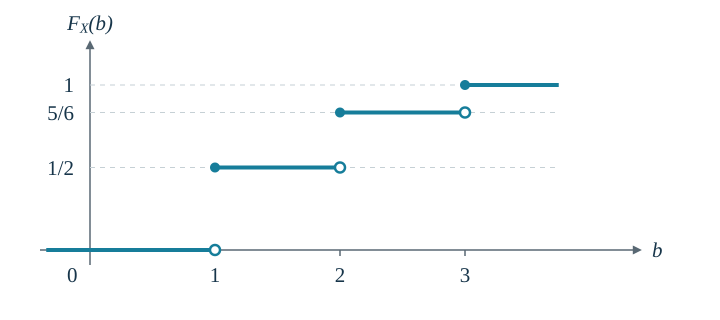

## 2.1 随机变量

### 定义

随机变量是定义在样本空间上的实值函数：

$$
X:\Omega\longrightarrow\mathbb{R},\qquad \omega\longmapsto X(\omega).
$$

试验前，不确定的是将发生哪个样本结果 $\omega$；一旦结果确定，$X(\omega)$ 就随之确定。例如掷两枚骰子，$\omega=(i,j)$，若关心点数和，则 $X(i,j)=i+j$。于是

$$
\{X=7\}=\{(1,6),(2,5),(3,4),(4,3),(5,2),(6,1)\}.
$$

两枚骰子独立且均匀时，$\mathbb{P}(X=7)=6/36=1/6$。这里 $\{X=7\}$ 是样本空间中的**事件**，所以可以对它取概率。

### 示性随机变量

对事件 $E$，定义

$$
I_E(\omega)=\begin{cases}1,&\omega\in E,\\0,&\omega\notin E.\end{cases}
  \qquad \mathbb{P}(I_E=1)=\mathbb{P}(E),\quad \mathbb{P}(I_E=0)=1-\mathbb{P}(E).
$$

它只记录事件是否发生。若 $\mathbb{P}(E)=p$，则 $I_E$ 服从参数为 $p$ 的伯努利分布。

### 离散与连续

- **离散型：**全部概率集中在有限个或可数个点上。

- **连续型：**存在概率密度 $f$，使 $\mathbb{P}(X\in B)=\int_B f(x)\,dx$。

## 2.2 离散随机变量

### 分布函数 CDF

> [!important]
> **适用于任意实值随机变量**
>$$
> F_X(b)=\mathbb{P}(X\le b),\qquad b\in\mathbb{R}.
> $$
> 
>它记录“随机变量不超过 $b$”的概率。

分布函数单调不减，且 $\lim_{b\to+\infty}F(b)=1$、$\lim_{b\to-\infty}F(b)=0$。

**分布函数还具有右连续性。**若 $b_n\downarrow b$，则事件 $\{X\le b_n\}$ 递减到 $\{X\le b\}$，故 $F(b_n)\to F(b)$。定义左极限

$$
F(b^-)=\lim_{x\uparrow b}F(x)=\mathbb{P}(X<b).
$$

因此，处理端点时应使用

$$
\begin{aligned}
\mathbb{P}(a<X\le b)    & =F(b)-F(a),   \\
  \mathbb{P}(X=b)         & =F(b)-F(b^-), \\
  \mathbb{P}(a\le X\le b) & =F(b)-F(a^-).
\end{aligned}
$$

### 离散型的 PMF

令 $p_X(x)=\mathbb{P}(X=x)$，取值点为 $x_1,x_2,\ldots$，则

$$
p_X(x_i)\ge0,\qquad \sum_i p_X(x_i)=1,
  \qquad \boxed{F_X(b)=\sum_{x_i\le b}p_X(x_i)}.
$$

**PMF 给出单点概率，CDF 给出累计概率；CDF 的跳跃高度就是该点的概率。**

**如图**  $p_X(1)=1/2,\ p_X(2)=1/3,\ p_X(3)=1/6$。

例如 $\mathbb{P}(1<X\le2)=F(2)-F(1)=5/6-1/2=1/3$。

### 2.2.1 伯努利随机变量

设一次试验只有成功和失败两类结果，成功概率为 $p$。用 $X=1$ 表示成功，$X=0$ 表示失败，记为 $X\sim\operatorname{Bernoulli}(p)$，其中 $0\le p\le1$。

$$
\mathbb{P}(X=0)=1-p,\qquad \mathbb{P}(X=1)=p.
$$

### 2.2.2 二项随机变量

进行 $n$ 次**相互独立**的伯努利试验，且每次成功概率**相同**，均为 $p$。令 $I_j$ 表示第 $j$ 次是否成功，则

$$
X=I_1+I_2+\cdots+I_n\sim\operatorname{Bin}(n,p).
$$

> [!important]
> **概率质量函数**
>
> $$
> \mathbb{P}(X=i)=\binom ni p^i(1-p)^{n-i},\qquad i=0,1,\ldots,n.
> $$
>
> 其中 $\displaystyle\binom ni=\frac{n!}{i!(n-i)!}$。$p=0$ 或 $p=1$ 时分别退化为恒取 $0$ 或 $n$。

**归一化验证：**由二项式定理，

$$
\sum_{i=0}^n\binom ni p^i(1-p)^{n-i}=(p+1-p)^n=1.
$$

### 2.2.3 几何随机变量

连续进行相互独立、成功概率恒为 $p$ 的试验，直到首次成功。令 $X$ 为**包含成功那一次在内的总试验次数**，则

$$
X\sim\operatorname{Geom}(p),\qquad 0<p\le1,\qquad X\in\{1,2,3,\ldots\}.
$$

> [!important]
> **概率质量函数**
>
> $$
> \{X=k\}=\{\underbrace{\mathrm F\cdots\mathrm F}_{k-1\text{ 次失败}}\mathrm S\},
>     \qquad \mathbb{P}(X=k)=(1-p)^{k-1}p.
> $$
>
> 前 $k-1$ 次都失败，第 $k$ 次成功；独立性使概率可以相乘。

**归一化验证：**
当 $0<p\le1$ 时，由几何级数，

$$
\sum_{k=1}^{\infty}\mathbb{P}(X=k)
  =p\sum_{k=1}^{\infty}(1-p)^{k-1}
  =\frac{p}{1-(1-p)}=1.
$$

对整数 $m\ge0$，“首次成功晚于第 $m$ 次”等价于“前 $m$ 次全失败”：

$$
\boxed{\mathbb{P}(X>m)=(1-p)^m},\qquad
  \boxed{\mathbb{P}(X\le m)=1-(1-p)^m}.
$$

对任意实数 $b$，分布函数可以写为

$$
F_X(b)=\begin{cases}
    0,                          & b<1,   \\
    1-(1-p)^{\lfloor b\rfloor}, & b\ge1.
  \end{cases}
$$

### 2.2.4 泊松随机变量

若 $X$ 取非负整数值，且对于某个 $\lambda>0$，有

> [!important]
> **概率质量函数**
>
> $$
> X\sim\operatorname{Pois}(\lambda),\qquad
>     \mathbb{P}(X=i)=e^{-\lambda}\frac{\lambda^i}{i!},\quad i=0,1,2,\ldots.
> $$

它常用于给定时间、面积、体积等范围内的事件计数，例如一页中的印刷错误数、一日中的事故数。$\lambda$ 对应**当前观察范围**的平均计数。

**参数 $\lambda$ 等于均值。**直接由 PMF 计算，

$$
\begin{aligned}
\mathbb E[X]
   & =\sum_{i=1}^{\infty} i\,e^{-\lambda}\frac{\lambda^i}{i!}
  =\lambda e^{-\lambda}\sum_{j=0}^{\infty}\frac{\lambda^j}{j!}
  =\lambda.
\end{aligned}
$$

**归一化验证：**
因为 $e^{\lambda}=\sum_{i=0}^{\infty}\lambda^i/i!$，所以

$$
\sum_{i=0}^{\infty}\mathbb{P}(X=i)
  =e^{-\lambda}\sum_{i=0}^{\infty}\frac{\lambda^i}{i!}
  =e^{-\lambda}e^{\lambda}=1.
$$

对 $b\ge0$，分布函数为 $F_X(b)=e^{-\lambda}\sum_{i=0}^{\lfloor b\rfloor}\lambda^i/i!$；对 $b<0$，有 $F_X(b)=0$。

固定 $\lambda>0$，令 $p_n=\lambda/n$，并设 $X_n\sim\operatorname{Bin}(n,p_n)$。取足够大的整数 $n$ 使 $p_n\le1$。当 $n\to\infty$ 时，$p_n\to0$，但 $np_n=\lambda$ 保持不变。对每个**固定**的非负整数 $i$，我们考查 $\mathbb{P}(X_n=i)$。

当 $n\ge i$ 且 $n>\lambda$ 时，

$$
\begin{aligned}
\mathbb{P}(X_n=i)
   & =\binom ni\left(\frac{\lambda}{n}\right)^i
  \left(1-\frac{\lambda}{n}\right)^{n-i}        \\[3pt]
   & =\frac{\lambda^i}{i!}
  \underbrace{\frac{n(n-1)\cdots(n-i+1)}{n^i}}_{A_n}
  \underbrace{\left(1-\frac{\lambda}{n}\right)^n}_{B_n}
  \underbrace{\left(1-\frac{\lambda}{n}\right)^{-i}}_{C_n}.
\end{aligned}
$$

1.

$$
   A_n=\prod_{j=0}^{i-1}\left(1-\frac{j}{n}\right)
             \longrightarrow 1.
$$

2.

$$
   \log B_n
             =n\log\left(1-\frac{\lambda}{n}\right)
             =-\lambda\,
             \frac{\log(1-\lambda/n)}{-\lambda/n}
             \longrightarrow -\lambda.
$$

3.

$$
   C_n\longrightarrow 1.
$$

因此

> [!important]
> **极限结论**
>
> $$
> \boxed{\lim_{n\to\infty}\mathbb{P}(X_n=i)=e^{-\lambda}\frac{\lambda^i}{i!}},
>     \qquad i=0,1,2,\ldots.
> $$
>
> 有限 $n$ 下是近似：$\mathbb{P}(X_n=i)\approx e^{-np_n}(np_n)^i/i!$。

## 2.3 连续随机变量

若存在非负函数 $f_X$，使得对任意可测集合 $B$，有

> [!important]
> **概率密度函数 PDF**
>
> $$
> \mathbb{P}(X\in B)=\int_B f_X(x)\,dx,\qquad
>     f_X(x)\ge0,\qquad \int_{-\infty}^{\infty}f_X(x)\,dx=1,
> $$
>
> 则称 $X$ 为连续随机变量，$f_X$ 为它的概率密度函数。

概率由密度在区间上的积分给出：

$$
\mathbb{P}(a\le X\le b)=\int_a^b f_X(x)\,dx,\qquad
  \mathbb{P}(X=a)=\int_a^a f_X(x)\,dx=0.
$$

因此，连续型随机变量取某个指定值的概率为 0，区间端点是否包含不影响概率。**密度值 $f_X(a)$ 不是单点概率 $\mathbb{P}(X=a)$**；密度可以大于 1，但在整个实数轴上的积分必须等于 1。

分布函数与密度的关系为

$$
F_X(a)=\mathbb{P}(X\le a)=\int_{-\infty}^a f_X(x)\,dx.
$$

若 $f_X$ 在 $a$ 处连续，则由微积分基本定理，$F_X'(a)=f_X(a)$；一般情况下，此等式几乎处处成立。在密度连续点附近，对较小的 $\varepsilon>0$，有

$$
\mathbb{P}\left(a-\frac{\varepsilon}{2}\le X\le a+\frac{\varepsilon}{2}\right)
  =\int_{a-\varepsilon/2}^{a+\varepsilon/2}f_X(x)\,dx
  \approx\varepsilon f_X(a).
$$

### 2.3.1 均匀随机变量

若 $\alpha<\beta$，且

$$
X\sim\operatorname{Unif}(\alpha,\beta),\qquad
  f_X(x)=\begin{cases}
    \dfrac{1}{\beta-\alpha}, & \alpha<x<\beta, \\[3pt]
    0,                       & \text{其他},
  \end{cases}
$$

则称 $X$ 在 $(\alpha,\beta)$ 上均匀分布。其概率密度在区间内为常数，等长子区间具有相同概率。由积分可得

$$
F_X(a)=\begin{cases}
    0,                              & a\le\alpha,     \\[2pt]
    \dfrac{a-\alpha}{\beta-\alpha}, & \alpha<a<\beta, \\[5pt]
    1,                              & a\ge\beta.
  \end{cases}
$$

当 $\alpha\le a<b\le\beta$ 时，

$$
\mathbb{P}(a\le X\le b)=\frac{b-a}{\beta-\alpha}.
$$

即子区间概率等于其长度占总区间长度的比例。

### 2.3.2 指数随机变量

对于 $\lambda>0$，若 $X$ 的密度为

> [!important]
> **指数分布**
>
> $$
> X\sim\operatorname{Exp}(\lambda),\qquad
>     f_X(x)=\begin{cases}
>       \lambda e^{-\lambda x}, & x\ge0, \\
>       0,                      & x<0,
>     \end{cases}
> $$
>
> 这里 $\lambda$ 是率参数。

对 $a\ge0$，积分得到

$$
F_X(a)=\int_0^a\lambda e^{-\lambda x}\,dx
  =\left[-e^{-\lambda x}\right]_0^a=1-e^{-\lambda a}.
$$

因此完整的分布函数和尾概率为

$$
F_X(a)=\begin{cases}0,&a<0,\\1-e^{-\lambda a},&a\ge0,\end{cases}
  \qquad \mathbb{P}(X>a)=e^{-\lambda a}\quad(a\ge0).
$$

令 $a\to\infty$，有 $F_X(a)\to1$，也验证了密度的归一化。

### 2.3.3 伽马随机变量

对于形状参数 $\alpha>0$、率参数 $\lambda>0$，定义

> [!important]
> **伽马分布**
>
> $$
> X\sim\operatorname{Gamma}(\alpha,\lambda),\qquad
>     f_X(x)=\begin{cases}
>       \dfrac{\lambda e^{-\lambda x}(\lambda x)^{\alpha-1}}{\Gamma(\alpha)}, & x>0,   \\[6pt]
>       0,                                                                    & x\le0.
>     \end{cases}
> $$
>
> 同一密度也可写为 $\lambda^\alpha x^{\alpha-1}e^{-\lambda x}/\Gamma(\alpha)$，$x>0$。

伽马函数定义为

$$
\Gamma(\alpha)=\int_0^\infty e^{-u}u^{\alpha-1}\,du,\qquad\alpha>0.
$$

令 $u=\lambda x$，则

$$
\int_0^\infty f_X(x)\,dx
  =\frac{1}{\Gamma(\alpha)}\int_0^\infty e^{-u}u^{\alpha-1}\,du=1.
$$

分部积分可得 $\Gamma(\alpha+1)=\alpha\Gamma(\alpha)$。又因 $\Gamma(1)=1$，对正整数 $n$ 有

$$
\Gamma(n)=(n-1)!.
$$

当 $\alpha=1$ 时，伽马密度退化为指数密度，即 $\operatorname{Gamma}(1,\lambda)=\operatorname{Exp}(\lambda)$。密度在单个点 $x=0$ 的取值不影响分布；不同资料也可能使用尺度参数 $\theta=1/\lambda$，使用公式时应确认参数约定。

### 2.3.4 正态随机变量

若 $\mu\in\mathbb{R}$、$\sigma>0$，且 $X$ 的密度为

> [!important]
> **正态分布**
>
> $$
> X\sim\mathcal N(\mu,\sigma^2),\qquad
>     f_X(x)=\frac{1}{\sqrt{2\pi}\,\sigma}
>     \exp\left(-\frac{(x-\mu)^2}{2\sigma^2}\right),\quad x\in\mathbb{R},
> $$
>
> 则称 $X$ 服从参数为 $\mu$ 和 $\sigma^2$ 的正态分布。其密度呈钟形，关于 $x=\mu$ 对称。

**线性变换。**设 $Y=aX+b$，其中 $a\ne0$，则

$$
\boxed{Y\sim\mathcal N(a\mu+b,a^2\sigma^2)}.
$$

先设 $a>0$。由不等式变换，

$$
F_Y(y)=\mathbb{P}(aX+b\le y)
  =F_X\left(\frac{y-b}{a}\right).
$$

对 $y$ 求导，得到

$$
\begin{aligned}
f_Y(y)
   & =\frac1a f_X\left(\frac{y-b}{a}\right)                            \\
   & =\frac{1}{\sqrt{2\pi}\,a\sigma}
  \exp\left[-\frac{\left(\frac{y-b}{a}-\mu\right)^2}{2\sigma^2}\right] \\
   & =\frac{1}{\sqrt{2\pi}\,a\sigma}
  \exp\left[-\frac{(y-(a\mu+b))^2}{2a^2\sigma^2}\right].
\end{aligned}
$$

这正是参数为 $a\mu+b$ 和 $a^2\sigma^2$ 的正态密度。

若 $a<0$，不等号方向改变，且由连续性有

$$
F_Y(y)=\mathbb{P}\left(X\ge\frac{y-b}{a}\right)
  =1-F_X\left(\frac{y-b}{a}\right).
$$

求导后，两种情况可统一写为

$$
f_Y(y)=\frac1{|a|}f_X\left(\frac{y-b}{a}\right)
  =\frac{1}{\sqrt{2\pi}\,|a|\sigma}
  \exp\left[-\frac{(y-(a\mu+b))^2}{2a^2\sigma^2}\right].
$$

当 $a=0$ 时，$Y=b$ 为常量，属于退化分布。

**标准化。**取 $a=1/\sigma$、$b=-\mu/\sigma$，则

$$
Z=\frac{X-\mu}{\sigma}\sim\mathcal N(0,1),\qquad
  \varphi(z)=\frac{1}{\sqrt{2\pi}}e^{-z^2/2}.
$$

$Z$ 称为标准正态随机变量。记其分布函数为 $\Phi$，则

$$
\mathbb{P}(c\le X\le d)
  =\Phi\left(\frac{d-\mu}{\sigma}\right)
  -\Phi\left(\frac{c-\mu}{\sigma}\right).
$$

## 2.4 随机变量的期望

### 2.4.1 离散情形

若 $X$ 为离散随机变量，概率质量函数为 $p_X$，则

> [!important]
> **期望：按概率加权的平均值**
>
> $$
> \mathbb E[X]=\sum_{x:p_X(x)>0}x\,p_X(x).
> $$
>
> 有限期望要求 $\sum_x|x|p_X(x)<\infty$；期望不一定是 $X$ 的某个可能取值。

**伯努利分布。**若 $X\sim\operatorname{Bernoulli}(p)$，则

$$
\mathbb E[X]=0\cdot(1-p)+1\cdot p=p.
$$

**二项分布。**若 $X\sim\operatorname{Bin}(n,p)$，当 $0<p<1$ 时，利用 $i\binom ni=n\binom{n-1}{i-1}$，有

$$
\begin{aligned}
\mathbb E[X]
   & =\sum_{i=1}^n i\binom ni p^i(1-p)^{n-i}           \\
   & =np\sum_{i=1}^n\binom{n-1}{i-1}p^{i-1}(1-p)^{n-i} \\
   & =np\sum_{k=0}^{n-1}\binom{n-1}{k}p^k(1-p)^{n-1-k}
  =np.
\end{aligned}
$$

其中令 $k=i-1$，最后的和由二项式定理等于 1。$p=0,1$ 时直接计算，结论仍为 $\mathbb E[X]=np$。

**几何分布。**若 $X\sim\operatorname{Geom}(p)$，先设 $0<p<1$，令 $q=1-p$。由幂级数在 $|q|<1$ 内可逐项求导，

$$
\begin{aligned}
\mathbb E[X]
   & =\sum_{k=1}^\infty k p q^{k-1}
  =p\frac{d}{dq}\sum_{k=1}^\infty q^k         \\
   & =p\frac{d}{dq}\left(\frac{q}{1-q}\right)
  =\frac{p}{(1-q)^2}=\frac1p.
\end{aligned}
$$

当 $p=1$ 时，$X=1$，结论同样成立。因此，首次成功所需总试验次数的期望为成功概率的倒数。

**泊松分布。**若 $X\sim\operatorname{Pois}(\lambda)$，则

$$
\begin{aligned}
\mathbb E[X]
   & =e^{-\lambda}\sum_{i=1}^\infty\frac{i\lambda^i}{i!}
  =\lambda e^{-\lambda}\sum_{i=1}^\infty\frac{\lambda^{i-1}}{(i-1)!} \\
   & =\lambda e^{-\lambda}\sum_{j=0}^\infty\frac{\lambda^j}{j!}
  =\lambda.
\end{aligned}
$$

### 2.4.2 连续情形

若 $X$ 是具有概率密度 $f_X$ 的连续随机变量，则

> [!important]
> **连续随机变量的期望**
>
> $$
> \mathbb E[X]=\int_{-\infty}^{\infty}x f_X(x)\,dx.
> $$
>
> 有限期望要求 $\int_{-\infty}^{\infty}|x|f_X(x)\,dx<\infty$。这是离散加权求和在连续情形下的对应形式。

**均匀分布。**若 $X\sim\operatorname{Unif}(\alpha,\beta)$，则

$$
\begin{aligned}
\mathbb E[X]
   & =\int_\alpha^\beta\frac{x}{\beta-\alpha}\,dx
  =\frac{\beta^2-\alpha^2}{2(\beta-\alpha)}
  =\frac{\alpha+\beta}{2}.
\end{aligned}
$$

期望恰为区间中点。

**指数分布。**若 $X\sim\operatorname{Exp}(\lambda)$，分部积分得到

$$
\begin{aligned}
\mathbb E[X]
   & =\int_0^\infty x\lambda e^{-\lambda x}\,dx             \\
   & =\left[-xe^{-\lambda x}\right]_0^\infty
  +\int_0^\infty e^{-\lambda x}\,dx                         \\
   & =0+\left[-\frac1\lambda e^{-\lambda x}\right]_0^\infty
  =\frac1\lambda.
\end{aligned}
$$

其中 $xe^{-\lambda x}\to0$（$x\to\infty$）。这里的 $\lambda$ 是率参数，所以期望为其倒数。

**正态分布。**若 $X\sim\mathcal N(\mu,\sigma^2)$，将 $x$ 拆成 $(x-\mu)+\mu$：

$$
\begin{aligned}
\mathbb E[X]
   & =\frac{1}{\sqrt{2\pi}\,\sigma}
  \int_{-\infty}^{\infty}x e^{-(x-\mu)^2/(2\sigma^2)}\,dx \\
   & =\frac{1}{\sqrt{2\pi}\,\sigma}
  \int_{-\infty}^{\infty}(x-\mu)e^{-(x-\mu)^2/(2\sigma^2)}\,dx
  +\mu\int_{-\infty}^{\infty}f_X(x)\,dx.
\end{aligned}
$$

在第一项中令 $y=x-\mu$，则被积函数 $y e^{-y^2/(2\sigma^2)}$ 为奇函数，且绝对可积，所以该积分为 0。第二项利用密度归一化，有

$$
\mathbb E[X]=0+\mu=\mu.
$$

### 2.4.3 随机变量的函数的期望

设 $g$ 为实值可测函数。计算 $\mathbb E[g(X)]$ 时，可以直接按 $X$ 的分布加权，无须先求 $g(X)$ 的分布：

> [!important]
> **函数的期望**
>
> $$
> \mathbb E[g(X)]=\begin{cases}
>       \displaystyle\sum_{x:p_X(x)>0}g(x)p_X(x),           & X\text{ 为离散型}, \\[8pt]
>       \displaystyle\int_{-\infty}^{\infty}g(x)f_X(x)\,dx, & X\text{ 为连续型}.
>     \end{cases}
> $$
>
> 有限期望的条件为 $\mathbb E[|g(X)|]<\infty$。

例如，若 $p_X(0)=0.2$、$p_X(1)=0.5$、$p_X(2)=0.3$，则

$$
\mathbb E[X^2]=0^2\cdot0.2+1^2\cdot0.5+2^2\cdot0.3=1.7,
$$

而 $(\mathbb E[X])^2=(0\cdot0.2+1\cdot0.5+2\cdot0.3)^2=1.21$。因此，**一般不能把函数与期望交换顺序**。

**仿射函数。**若 $a,b$ 为常数，且 $\mathbb E[|X|]<\infty$，则

$$
\boxed{\mathbb E[aX+b]=a\mathbb E[X]+b}.
$$

以连续情形为例，

$$
\begin{aligned}
\mathbb E[aX+b]
   & =\int_{-\infty}^{\infty}(ax+b)f_X(x)\,dx \\
   & =a\int_{-\infty}^{\infty}x f_X(x)\,dx
  +b\int_{-\infty}^{\infty}f_X(x)\,dx
  =a\mathbb E[X]+b.
\end{aligned}
$$

离散情形将积分换成求和，证明相同。

**矩。**期望 $\mathbb E[X]$ 也称均值或一阶矩。对正整数 $n$，$\mathbb E[X^n]$ 称为 $n$ 阶矩：

$$
\mathbb E[X^n]=\begin{cases}
    \displaystyle\sum_x x^n p_X(x),                     & X\text{ 为离散型}, \\[8pt]
    \displaystyle\int_{-\infty}^{\infty}x^n f_X(x)\,dx, & X\text{ 为连续型}.
  \end{cases}
$$

一阶矩反映平均位置；要描述随机变量在均值附近的离散程度，需要考察偏离均值的平方。

**方差。**当 $\mathbb E[X^2]<\infty$ 时，记 $\mu=\mathbb E[X]$，定义

> [!important]
> **方差与二阶矩**
>
> $$
> \operatorname{Var}(X)=\mathbb E\bigl[(X-\mathbb E[X])^2\bigr]
>     =\mathbb E[(X-\mu)^2].
> $$
>
> 方差是偏离均值的平方的期望，因此 $\operatorname{Var}(X)\ge0$。

展开平方，并利用期望的线性性质，得到

$$
\begin{aligned}
\operatorname{Var}(X)
   & =\mathbb E[X^2-2\mu X+\mu^2]           \\
   & =\mathbb E[X^2]-2\mu\mathbb E[X]+\mu^2 \\
   & =\mathbb E[X^2]-\mu^2.
\end{aligned}
$$

于是

$$
\boxed{\operatorname{Var}(X)=\mathbb E[X^2]-(\mathbb E[X])^2}.
$$

计算时既可以直接使用定义，也可以先求一阶、二阶矩，再相减。

**正态分布的方差。**设 $X\sim\mathcal N(\mu,\sigma^2)$，由 $\mathbb E[X]=\mu$，有

$$
\operatorname{Var}(X)
  =\frac{1}{\sqrt{2\pi}\,\sigma}
  \int_{-\infty}^{\infty}(x-\mu)^2 e^{-(x-\mu)^2/(2\sigma^2)}\,dx.
$$

作标准化代换 $y=(x-\mu)/\sigma$，则 $dx=\sigma\,dy$，从而

$$
\operatorname{Var}(X)
  =\frac{\sigma^2}{\sqrt{2\pi}}
  \int_{-\infty}^{\infty}y^2 e^{-y^2/2}\,dy.
$$

对最后的积分分部积分，取 $u=y$、$dv=y e^{-y^2/2}\,dy$，则 $v=-e^{-y^2/2}$，所以

$$
\begin{aligned}
\int_{-\infty}^{\infty}y^2e^{-y^2/2}\,dy
   & =\left[-y e^{-y^2/2}\right]_{-\infty}^{\infty}
  +\int_{-\infty}^{\infty}e^{-y^2/2}\,dy            \\
   & =0+\sqrt{2\pi}.
\end{aligned}
$$

边界项为 0，而剩余积分由标准正态密度的归一化得到。因此

$$
\boxed{X\sim\mathcal N(\mu,\sigma^2)
    \quad\Longrightarrow\quad\mathbb E[X]=\mu,\quad\operatorname{Var}(X)=\sigma^2}.
$$

这也说明正态分布的两个参数分别表示均值与方差。

## 2.5 联合分布的随机变量

### 2.5.1 联合分布函数

同时研究 $X$ 和 $Y$ 时，除了各自的分布，还需要知道它们如何共同取值。定义联合累积分布函数

> [!important]
> **联合 CDF 与边缘 CDF**
>
> $$
> F_{X,Y}(a,b)=\mathbb{P}(X\le a,\ Y\le b).
> $$
>
> $$
> F_X(a)=\lim_{b\to\infty}F_{X,Y}(a,b),\qquad
>     F_Y(b)=\lim_{a\to\infty}F_{X,Y}(a,b).
> $$
>
> 两个边缘分布描述各个变量，联合分布还包含变量之间的依赖关系。

当不致混淆时，记 $F_{X,Y}$ 为 $F$，并把上述两个极限简写为 $F(a,\infty)$ 和 $F(\infty,b)$。对 $a_1<a_2$、$b_1<b_2$，有

$$
\begin{aligned}
& \mathbb{P}(a_1<X\le a_2,\ b_1<Y\le b_2)                    \\
   & \qquad=F(a_2,b_2)-F(a_1,b_2)-F(a_2,b_1)+F(a_1,b_1).
\end{aligned}
$$

**离散情形。**若 $(X,Y)$ 的概率集中在有限个或可数个点上，定义联合概率质量函数

$$
p_{X,Y}(x,y)=\mathbb{P}(X=x,\ Y=y),\qquad
  p_{X,Y}(x,y)\ge0,\quad\sum_x\sum_y p_{X,Y}(x,y)=1.
$$

边缘概率质量函数通过对另一个变量的所有可能值求和得到：

$$
\boxed{p_X(x)=\sum_y p_{X,Y}(x,y)},\qquad
  \boxed{p_Y(y)=\sum_x p_{X,Y}(x,y)}.
$$

因此

$$
F_{X,Y}(a,b)=\sum_{x\le a}\sum_{y\le b}p_{X,Y}(x,y).
$$

更一般地，对平面上的集合 $D$，

$$
\mathbb{P}\bigl((X,Y)\in D\bigr)=\sum_{(x,y)\in D}p_{X,Y}(x,y).
$$

**从联合分布可以得到边缘分布，但仅凭两个边缘分布一般不能恢复联合分布。**

**联合连续情形。**若存在非负函数 $f_{X,Y}$，使得

> [!important]
> **联合概率密度与边缘密度**
>
> $$
> \mathbb{P}\bigl((X,Y)\in D\bigr)=\iint_D f_{X,Y}(x,y)\,dx\,dy,
>     \qquad \iint_{\mathbb{R}^2}f_{X,Y}(x,y)\,dx\,dy=1,
> $$
>
> 则 $f_{X,Y}$ 称为联合概率密度。对另一个变量积分，可得边缘密度：
>
> $$
> f_X(x)=\int_{-\infty}^{\infty}f_{X,Y}(x,y)\,dy,\qquad
>     f_Y(y)=\int_{-\infty}^{\infty}f_{X,Y}(x,y)\,dx.
> $$

例如，对集合 $A,B$，有

$$
\mathbb{P}(X\in A,\ Y\in B)=\int_B\int_A f_{X,Y}(x,y)\,dx\,dy,
$$

于是

$$
F_{X,Y}(a,b)=\int_{-\infty}^b\int_{-\infty}^a
  f_{X,Y}(x,y)\,dx\,dy.
$$

**两个变量的函数的期望。**当 $\mathbb E[|g(X,Y)|]<\infty$ 时，

$$
\mathbb E[g(X,Y)]=\begin{cases}
    \displaystyle\sum_x\sum_y g(x,y)p_{X,Y}(x,y), & \text{离散情形},   \\[8pt]
    \displaystyle\int_{-\infty}^{\infty}\int_{-\infty}^{\infty}
    g(x,y)f_{X,Y}(x,y)\,dx\,dy,                   & \text{联合连续情形}.
  \end{cases}
$$

**期望的线性性质。**若各个期望有限，则

$$
\boxed{\mathbb E[aX+bY]=a\mathbb E[X]+b\mathbb E[Y]},\qquad
  \mathbb E\left[\sum_{i=1}^n a_iX_i\right]
  =\sum_{i=1}^n a_i\mathbb E[X_i].
$$

这一性质**不要求独立**。例如在离散情形，将 $g(x,y)=ax+by$ 代入，再利用边缘概率质量函数，得到

$$
\sum_x\sum_y(ax+by)p_{X,Y}(x,y)
  =a\sum_x x p_X(x)+b\sum_y y p_Y(y).
$$

### 2.5.2 独立随机变量

若对任意实数 $a,b$ 都有

> [!important]
> **独立性的分布函数**
>
> $$
> \mathbb{P}(X\le a,\ Y\le b)=\mathbb{P}(X\le a)\mathbb{P}(Y\le b),
> $$
>
> 即
>
> $$
> F_{X,Y}(a,b)=F_X(a)F_Y(b),
> $$
>
> 则称 $X$ 和 $Y$ 独立。它等价于对任意可测集合 $A,B$，有
>
> $$
> \mathbb{P}(X\in A,\ Y\in B)=\mathbb{P}(X\in A)\mathbb{P}(Y\in B).
> $$

**离散情形。**独立当且仅当对所有 $x,y$，

$$
p_{X,Y}(x,y)=p_X(x)p_Y(y).
$$

**联合连续情形。**独立当且仅当联合密度几乎处处满足

$$
f_{X,Y}(x,y)=f_X(x)f_Y(y).
$$

这里“几乎处处”表示忽略平面上面积为 0 的集合。

**独立变量的函数的乘积期望。**若 $X,Y$ 独立，且 $g(X),h(Y)$ 均可积，则

$$
\boxed{\mathbb E[g(X)h(Y)]=\mathbb E[g(X)]\mathbb E[h(Y)]}.
$$

以联合连续情形为例，利用联合密度的分解，

$$
\begin{aligned}
\mathbb E[g(X)h(Y)]
   & =\int_{-\infty}^{\infty}\int_{-\infty}^{\infty}
  g(x)h(y)f_X(x)f_Y(y)\,dx\,dy                           \\
   & =\left(\int_{-\infty}^{\infty}g(x)f_X(x)\,dx\right)
  \left(\int_{-\infty}^{\infty}h(y)f_Y(y)\,dy\right).
\end{aligned}
$$

特别地，取 $g(x)=x$、$h(y)=y$，得到 $\mathbb E[XY]=\mathbb E[X]\mathbb E[Y]$。**期望的线性性质总可用于可积变量；乘积期望的这种分解则需要相应条件，独立性是充分条件。**

对 $X_1,\ldots,X_n$，相互独立要求对所有阈值 $a_1,\ldots,a_n$，

$$
\mathbb{P}(X_1\le a_1,\ldots,X_n\le a_n)
  =\prod_{i=1}^n F_{X_i}(a_i).
$$

当 $n\ge3$ 时，仅仅两两独立一般不足以推出相互独立。“独立同分布”（i.i.d.）表示变量相互独立，且各自具有相同分布。

### 2.5.3 协方差与随机变量和的方差

以下均假设所涉及的随机变量具有有限二阶矩。记 $\mu_X=\mathbb E[X]$、$\mu_Y=\mathbb E[Y]$，定义

> [!important]
> **协方差**
>
> $$
> \operatorname{Cov}(X,Y)=\mathbb E[(X-\mu_X)(Y-\mu_Y)]
>     =\mathbb E[XY]-\mathbb E[X]\mathbb E[Y].
> $$
>
> 若 $\operatorname{Cov}(X,Y)=0$，则称 $X,Y$ 不相关。

第二个等式由展开乘积得到：

$$
\begin{aligned}
\mathbb E[(X-\mu_X)(Y-\mu_Y)]
   & =\mathbb E[XY]-\mu_X\mathbb E[Y]-\mu_Y\mathbb E[X]+\mu_X\mu_Y \\
   & =\mathbb E[XY]-\mu_X\mu_Y.
\end{aligned}
$$

一般地，可以证明 $\operatorname{Cov}(X,Y)$ 取正值是表明在 $X$ 增加时，$Y$ 倾向于增加，而负值表明在 $X$ 增加时，$Y$ 倾向于减少。

**基本性质。**对常数 $a,b,c,d$，有

$$
\begin{aligned}
\operatorname{Cov}(X,X)       & =\operatorname{Var}(X),                           \\
  \operatorname{Cov}(X,Y)       & =\operatorname{Cov}(Y,X),                         \\
  \operatorname{Cov}(aX+b,cY+d) & =ac\operatorname{Cov}(X,Y),                       \\
  \operatorname{Cov}\left(\sum_i a_iX_i,\sum_j b_jY_j\right)
                                & =\sum_i\sum_j a_i b_j\operatorname{Cov}(X_i,Y_j).
\end{aligned}
$$

独立时 $\mathbb E[XY]=\mathbb E[X]\mathbb E[Y]$，所以协方差为 0。但若 $X\sim\operatorname{Unif}(-1,1)$，并令 $Y=X^2$，则

$$
\mathbb E[X]=0,\qquad\mathbb E[XY]=\mathbb E[X^3]=0,
  \qquad\operatorname{Cov}(X,Y)=0.
$$

它们仍不独立。例如 $A=\{|X|\le1/2\}$、$B=\{Y\le1/4\}$ 实际是同一个事件，而

$$
\mathbb{P}(A\cap B)=\frac12\ne\frac14=\mathbb{P}(A)\mathbb{P}(B).
$$

**随机变量和的方差。**利用 $\operatorname{Var}(S)=\operatorname{Cov}(S,S)$，得到

$$
\begin{aligned}
\operatorname{Var}\left(\sum_{i=1}^n X_i\right)
   & =\sum_{i=1}^n\sum_{j=1}^n\operatorname{Cov}(X_i,X_j) \\
   & =\sum_{i=1}^n\operatorname{Var}(X_i)
  +2\sum_{1\le i<j\le n}\operatorname{Cov}(X_i,X_j).
\end{aligned}
$$

更一般地，

$$
\operatorname{Var}\left(\sum_{i=1}^n a_iX_i\right)
  =\sum_{i=1}^n a_i^2\operatorname{Var}(X_i)
  +2\sum_{1\le i<j\le n}a_i a_j\operatorname{Cov}(X_i,X_j).
$$

若变量两两不相关，则交叉项为 0。因此，对相互独立的变量有

$$
\boxed{\operatorname{Var}\left(\sum_{i=1}^n X_i\right)
    =\sum_{i=1}^n\operatorname{Var}(X_i)}.
$$

**样本均值。**设 $X_1,\ldots,X_n$ 独立同分布，且 $\mathbb E[X_i]=\mu$、$\operatorname{Var}(X_i)=\sigma^2$。定义

$$
\overline X=\frac1n\sum_{i=1}^n X_i.
$$

由期望的线性性质及独立变量和的方差公式，

$$
\boxed{\mathbb E[\overline X]=\mu},\qquad
  \boxed{\operatorname{Var}(\overline X)=\frac{\sigma^2}{n}}.
$$

对任意 $i$，有

$$
\operatorname{Cov}(\overline X,X_i)
  =\frac1n\sum_{j=1}^n\operatorname{Cov}(X_j,X_i)
  =\frac{\sigma^2}{n}.
$$

所以样本均值与每个残差不相关：

$$
\operatorname{Cov}(\overline X,X_i-\overline X)
  =\operatorname{Cov}(\overline X,X_i)-\operatorname{Var}(\overline X)=0.
$$

**二项分布的方差。**若 $X\sim\operatorname{Bin}(n,p)$，可写成 $n$ 个独立伯努利变量之和 $X=\sum_{i=1}^n I_i$。由 $I_i^2=I_i$，有

$$
\operatorname{Var}(I_i)=\mathbb E[I_i^2]-(\mathbb E[I_i])^2
  =p-p^2=p(1-p).
$$

从而

$$
\boxed{\operatorname{Var}(X)=np(1-p)}.
$$

### 2.5.4 随机变量函数的联合概率分布

**和的分布与卷积。**先设 $(X,Y)$ 具有联合密度 $f_{X,Y}$，令 $S=X+Y$。从事件对应的平面区域出发，

$$
\begin{aligned}
F_S(s)
   & =\mathbb{P}(X+Y\le s)                               \\
   & =\int_{-\infty}^{\infty}\int_{-\infty}^{s-y}
  f_{X,Y}(x,y)\,dx\,dy.
\end{aligned}
$$

对 $s$ 求导，可得 $S$ 的密度（几乎处处）

$$
f_S(s)=\int_{-\infty}^{\infty}f_{X,Y}(s-y,y)\,dy.
$$

若 $X,Y$ 独立，联合密度分解为 $f_X(x)f_Y(y)$，所以

> [!important]
> **独立连续随机变量之和的卷积公式**
>
> $$
> F_{X+Y}(s)=\int_{-\infty}^{\infty}F_X(s-y)f_Y(y)\,dy,
> $$
>
> $$
> \boxed{f_{X+Y}(s)=\int_{-\infty}^{\infty}f_X(s-y)f_Y(y)\,dy}
>     =\int_{-\infty}^{\infty}f_X(x)f_Y(s-x)\,dx.
> $$

对独立的整数值离散随机变量，同样有

$$
p_{X+Y}(k)=\sum_j p_X(j)p_Y(k-j).
$$

**二维变量变换。**设 $(X_1,X_2)$ 具有联合密度，且

$$
Y_1=g_1(X_1,X_2),\qquad Y_2=g_2(X_1,X_2).
$$

在原变量的支持区域 $D$ 上，假设变换一一对应到像区域 $G$，正向变换与逆变换连续可微，并且雅可比行列式不为 0：

$$
J(x_1,x_2)=\det\begin{pmatrix}
    \dfrac{\partial g_1}{\partial x_1} & \dfrac{\partial g_1}{\partial x_2} \\[7pt]
    \dfrac{\partial g_2}{\partial x_1} & \dfrac{\partial g_2}{\partial x_2}
  \end{pmatrix}\ne0.
$$

记逆变换为 $x_1=h_1(y_1,y_2)$、$x_2=h_2(y_1,y_2)$，则

> [!important]
> **联合密度的变量变换公式**
>
> $$
> f_{Y_1,Y_2}(y_1,y_2)
>     =\frac{f_{X_1,X_2}(h_1(y_1,y_2),h_2(y_1,y_2))}
>     {|J(h_1(y_1,y_2),h_2(y_1,y_2))|},\qquad(y_1,y_2)\in G.
> $$

原因是概率在对应区域内保持不变，而面积元满足

$$
dx_1\,dx_2
  =\left|\det\frac{\partial(x_1,x_2)}{\partial(y_1,y_2)}\right|dy_1\,dy_2
  =\frac{dy_1\,dy_2}{|J(x_1,x_2)|}.
$$

**例：和与差。**令 $Y_1=X_1+X_2$、$Y_2=X_1-X_2$，则

$$
J=\det\begin{pmatrix}1&1\\1&-1\end{pmatrix}=-2,\qquad
  x_1=\frac{y_1+y_2}{2},\quad x_2=\frac{y_1-y_2}{2},
$$

所以在变换后的支持区域内，

$$
f_{Y_1,Y_2}(y_1,y_2)
  =\frac12 f_{X_1,X_2}\left(\frac{y_1+y_2}{2},\frac{y_1-y_2}{2}\right).
$$

**多维情形。**若 $\boldsymbol Y=g(\boldsymbol X)$ 是 $n$ 维一一可微变换，逆变换为 $\boldsymbol X=h(\boldsymbol Y)$，且 $J_g=\det Dg\ne0$，则

$$
f_{\boldsymbol Y}(\boldsymbol y)
  =f_{\boldsymbol X}(h(\boldsymbol y))\,|\det Dh(\boldsymbol y)|
  =\frac{f_{\boldsymbol X}(h(\boldsymbol y))}{|J_g(h(\boldsymbol y))|}.
$$

