# 推测解码与MTP

在自回归 LLM 中，模型要先生成第一个 token，才能确定预测第二个 token 时应当读入什么。如果先给它一段候选文本，情况就变了：各位置的候选前缀都已知，大模型一次前向就能给出每个位置的条件分布。推测解码（Speculative Decoding）利用这个性质，把逐词生成中的一部分工作转化为并行验证。推测级联进一步改变验证时采用的目标分布。多 token 预测（Multi-Token Prediction，MTP）则从训练入手，让同一段前文为多个未来位置提供预测，其中的辅助预测可以用来起草。 [〔1〕](#ref-1) [〔2〕](#ref-2)

## 一、自回归解码与推测解码

记已经确认的前缀为 $h$，目标模型为 $p$，草稿模型为 $q$，词表为 $V$，一轮最多起草 $\gamma$ 个 token。本文中 $p(v\mid h)$ 和 $q(v\mid h)$ 都指实际参与解码的归一化概率。使用温度或 top-p 采样时，应按各自的采样设置处理 logits，再计算这些概率。

| 方法 | 谁提出候选 | 哪个分布决定最终输出 | 一次前向的作用 |
|---|---|---|---|
| 自回归解码 | 目标模型 | $p$ | 从已确认前缀预测下一个 token |
| 标准推测解码 | 小模型或辅助预测头 | 严格验证时为 $p$ | 目标模型给多个候选前缀打分 |
| 推测级联 | 小模型 | 路由规则定义的 $\pi$ | 在多个位置同时取得大小模型分布，据此选择和验证 |
| MTP | 主干之上的多个预测头或串联模块 | 取决于推理时使用的验证策略 | 训练时一个主干位置对应多个未来标签，推理时可提供候选 |

### 1. 草稿 ABC 是怎样得到的

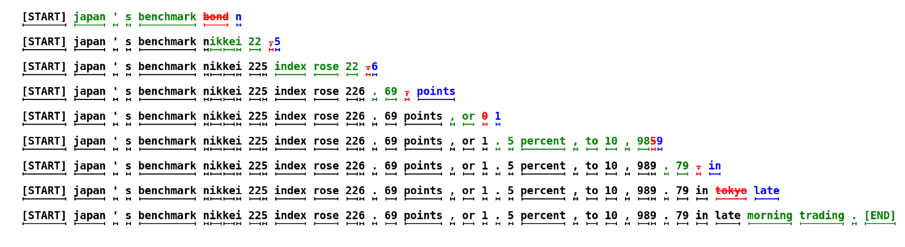

*Leviathan 等，原论文图 1。每一行对应一次推测解码迭代，行内多个词可以在同一次目标模型调用后得到确认。* [〔5〕](#ref-5)

- **普通解码。** 要生成 $y_{1:n}$，目标模型依次使用条件分布 $p(y_i\mid h,y_{<i})$。预填充时整段提示已经给出，可以并行处理；生成时未来 token 尚未确定，通常一次只推进一个位置。
- **起草。** 设 $\gamma=3$。独立小模型先根据 $h$ 生成 $A$，把 $A$ 接回输入生成 $B$，再根据 $hAB$ 生成 $C$。整个草稿的概率为

$$
q(ABC\mid h)=q(A\mid h)\,q(B\mid hA)\,q(C\mid hAB).
$$

- **验证。** 目标模型沿候选序列做一次因果前向，结合已缓存的前缀状态，得到下表所需的分布。若此前已经保存 $h$ 末位置的 logits，可以直接复用第一行。表中 $p(\cdot\mid hA)$ 是假设 $A$ 被保留时，模型对**下一个位置**的判断。

| 目标模型可见的前缀 | 读取的概率或预测 | 本轮用途 |
|---|---|---|
| $h$ | $p(\cdot\mid h)$ | 检查 $A$ |
| $hA$ | $p(\cdot\mid hA)$ | $A$ 通过后，检查 $B$ |
| $hAB$ | $p(\cdot\mid hAB)$ | $A,B$ 都通过后，检查 $C$ |
| $hABC$ | $p(\cdot\mid hABC)$ | 三个都通过时，再产生一个 token |

- **并行。** 四行对应的前缀互相嵌套。因果掩码允许验证位置读取左边的草稿，禁止该位置读取右边的词。因此可以像训练时的 teacher forcing 一样并行计算 logits。决定提交多长前缀时，仍从左向右检查。
- **缓存。** 若 $A,B$ 通过而 $C$ 失败，输出已确认的 $A,B$ 和一个修正词 $C'$。舍弃依赖 $C$ 的后续分数及相应 KV。下一轮的条件是 $hABC'$，草稿器和验证器都要从这个前缀继续。

### 2. 贪婪验证与严格采样

**贪婪验证。** 在位置 $j$，设 $h_j$ 为原前缀加上之前已通过的草稿，$d_j$ 为候选。若 $d_j=\arg\max_v p(v\mid h_j)$，就接受并继续；首次不一致时提交目标模型的 argmax，结束本轮。只要并列分数的处理规则相同，每一步提交的都是目标模型在同一前缀上的贪婪结果。

**随机采样。** 若目标是从 $p$ 采样，同一前缀可以有多个合法结果。Chen 等给出的算法先从 $q$ 采样，再根据两个分布的概率质量决定是否接受。

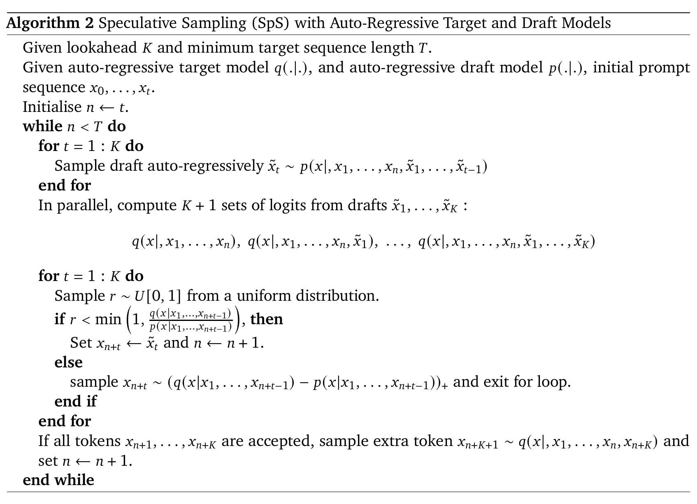

*Chen 等，原论文算法 2。注意拒绝分支重新采样使用的分布，以及全块接受时多采一个 token 的分支。* [〔6〕](#ref-6)

固定一个位置，省略条件 $h_j$。设 $d\sim q$，独立采样 $u\sim U(0,1)$。在 $q(d)>0$ 的候选上，接受条件为

$$
u\le a(d),\qquad a(d)=\min\left(1,\frac{p(d)}{q(d)}\right).
$$

- 若 $p(d)\ge q(d)$，草稿分给 $d$ 的质量全部可以保留。若 $p(d)<q(d)$，按比例 $p(d)/q(d)$ 保留。
- 从所有可能的草稿求和，直接接受 $v$ 的概率为 $q(v)a(v)=\min(p(v),q(v))$。剩余总质量即拒绝率

$$
R=1-\sum_{v\in V}\min(p(v),q(v))
=\tfrac12\sum_v|p(v)-q(v)|=\mathrm{TV}(p,q).
$$

- 当 $R>0$，从 $r(v)=[p(v)-q(v)]_+/R$ 采一个修正词。两条路径相加，

$$
\Pr(\text{输出 }v)=\min(p(v),q(v))+Rr(v)=p(v).
$$

  当 $R=0$，两个分布一致，所有草稿都能通过。将上述等式逐个应用到已经确认的前缀，便得到整条序列的目标分布。不同运行仍可能采到不同文本。

- **“置信度验证”有几种含义。** 贪婪匹配看候选是否排第一；严格采样看同一候选的概率比和随机数；宽松验证可以看候选是否落在目标模型的 top-$k$ 集合。后者通常比 top-1 匹配接受更多候选。

## 二、草稿

### 3. SpecDec 与 DistillSpec

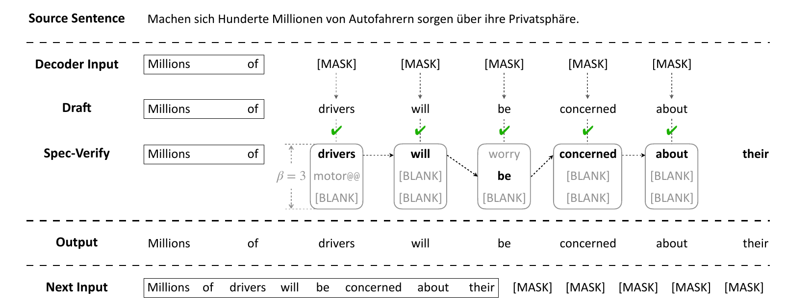

*SpecDec 原论文图 4。同一处候选在严格匹配下会产生分歧，放宽排名和对数概率差要求后，可以继续验证后续位置。* [〔7〕](#ref-7)

- **SpecDec。** 在序列到序列任务中，使用独立的 Spec-Drafter，根据源输入和目标前缀并行预测一个块。作者把较多容量分配给只需编码一次的源端，减少反复运行的解码端开销，用序列级蒸馏训练草稿器。
- **Spec-Verification。** 记目标分布为 $p_j$。候选须进入前 $\beta$ 名，同时与最优词的对数概率差 $\log\max_v p_j(v)-\log p_j(d_j)$ 落入容许范围。这两个条件分别控制排名和分数差距。即使候选排第二，它也可能与第一名相差很远。
- **与严格采样的区别。** 此处允许提交一个满足阈值的次优词，衡量的是翻译或摘要等任务的质量。前节的概率比和残差修正则给出对指定分布的严格保证。

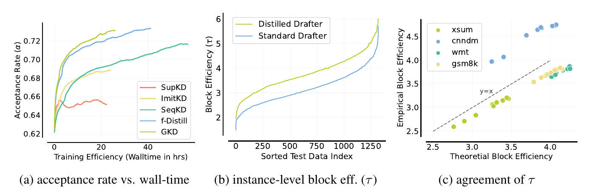

*DistillSpec 原论文图 3 是机制消融图。左图比较不同蒸馏策略的接受率，中图比较蒸馏前后的块效率，右图对照理论块效率和实测值。* [〔8〕](#ref-8)

- **DistillSpec。** 保留独立的小型自回归草稿器，改变其训练目标。让学生在自己的轨迹上生成前缀，再让教师给这些位置提供完整的下一词分布。用 $d_q$ 表示草稿器实际访问的前缀分布，目标可概括为

$$
\min_\theta\ \mathbb E_{h\sim d_{q_\theta}}
\big[D\big(p(\cdot\mid h),q_\theta(\cdot\mid h)\big)\big].
$$

  散度 $D$ 按任务和解码方式选择。训练时接触过自己容易走偏的前缀，学生才有机会在这些位置学到教师的分布。
- **与 SpecDec 的区别。** SpecDec 设计并行块预测器，并研究放宽验证。DistillSpec 的主要改动在起草前的蒸馏；它可以继续使用严格验证，在保持目标分布的条件下提高平均接受长度。

### 4. Draft & Verify 与 Predictive Pipelined Decoding

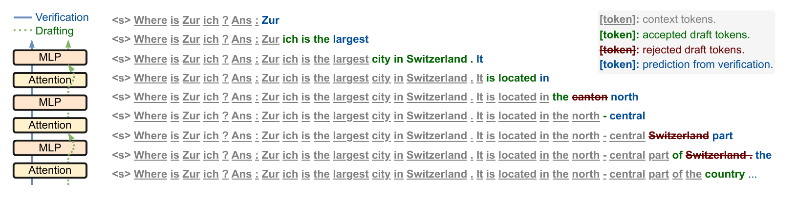

*Draft & Verify 原论文图 1。起草使用跳层的网络，验证使用完整网络。* [〔9〕](#ref-9)

- **跳层。** 同一组模型参数按两种方式执行。起草时跳过选定的注意力或前馈子层，以较低成本生成多个词；验证时走完整的目标模型。跳过哪些子层会同时影响草稿速度和准确性，论文在样本上搜索跳层策略。
- **自适应停止。** 当下一个草稿词的置信度过低时，可以提前结束起草，把已有候选交给完整网络。这里的置信度控制草稿长度，最终能否提交仍由验证结果决定。

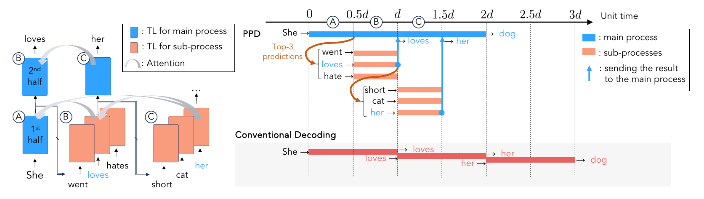

*Predictive Pipelined Decoding 原论文图 1。右侧沿时间轴排列多个前向过程，错误候选对应的后续分支会终止。* [〔10〕](#ref-10)

- **提前启动下一步。** 当前 token 的完整前向仍在进行时，用中间层表示预测它可能取的值。分配额外计算资源，以候选词作为输入，提前启动下一个位置的前向。等深层结果可用后，保留与完整模型一致的分支。
- **与跳层的区别。** 跳层先廉价地写一块草稿，再让完整网络读一遍；流水线让相邻 token 的计算在时间上重叠。早期预测命中才有可复用的工作，分支越多，占用的并行计算资源越多。

### 5. Jacobi 并行解码与 Lookahead Decoding

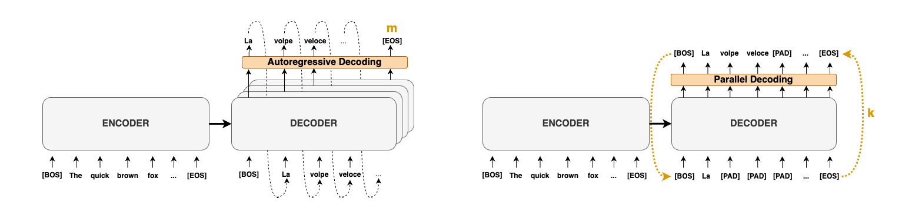

*Santilli 等原论文图 1。左侧为自回归翻译，右侧用初始猜测填满多个目标位置，在一次迭代里同时更新。* [〔11〕](#ref-11)

- **Jacobi 更新。** 给定源句 $x$ 和固定长度的目标位置，贪婪解码的结果满足 $y_i=\arg\max_v p(v\mid x,y_{<i})$。先用占位 token 等方式初始化猜测，在第 $s+1$ 轮同时计算

$$
y_i^{(s+1)}=\arg\max_v p(v\mid x,y_{<i}^{(s)}).
$$

  同一轮的各位置都读上一轮的猜测。每轮至少可使正确前缀再向前延伸一个位置，猜对的远端位置还可能提前稳定。论文还研究按块处理和随后切回自回归的方式。总收益取决于迭代次数及每轮成本。

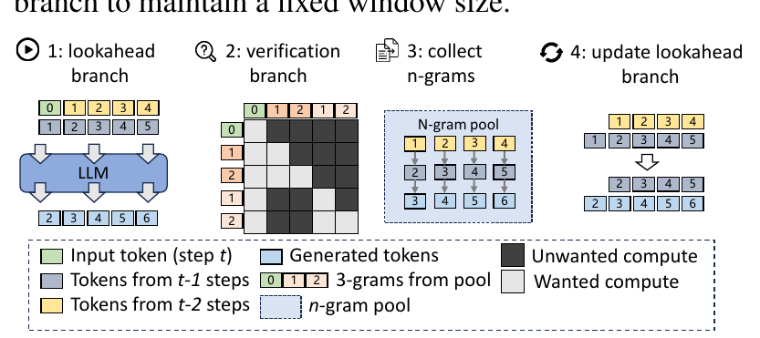

*Lookahead Decoding 原论文图 1。左侧分支形成候选 n-gram，验证分支读取与当前前缀相接的候选。* [〔12〕](#ref-12)

- **收集候选。** 保留多个位置在连续 Jacobi 迭代中的预测轨迹，抽取沿轨迹形成的 n-gram，写入候选池。一个局部片段即使当时位于错误前缀后面，也可能在稍后的正确前缀上派上用场。
- **取出并验证。** 根据当前已确认的末词从池中选出若干续段，使用目标模型并行验证。前瞻分支生成新片段，验证分支提交可接受前缀，两者可以合到一次带掩码的前向里。
- **与 Jacobi 的区别。** Jacobi 通过迭代求整段或一块的固定点；Lookahead 把中间轨迹当成草稿来源，依靠显式验证推进已确认前缀。它的草稿池可以在解码过程中建立。

### 6. SpecInfer 与 Medusa

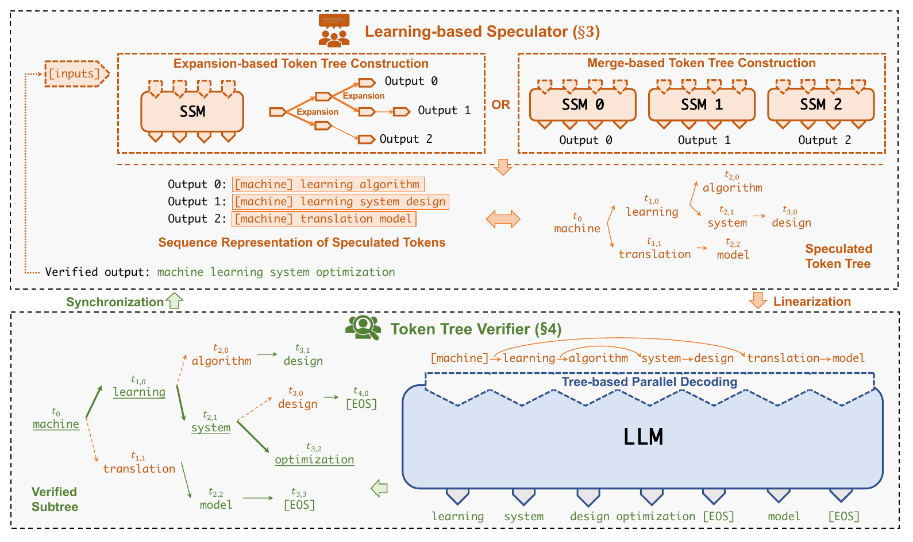

*SpecInfer 原论文图 2。上半部把多个候选组织成树，下半部在目标模型中验证各条可行路径。* [〔13〕](#ref-13)

- **从链到树。** 若多个草稿共享首词，将共同前缀存成同一节点，随后才分叉。对树中节点 $u$，目标模型应给出 $p(\cdot\mid h,\operatorname{path}(u))$。比较候选节点自身时，要读取其**父节点**对应的预测。
- **树注意力。** 每个候选位置可以关注公共前缀、自己的祖先及自身，屏蔽兄弟节点。并行处理一棵树就能得到多条路径上的条件分布。提交选中的路径后，只保留这条路径所需的缓存。树增宽可以覆盖更多候选，也会消耗更多验证位置。

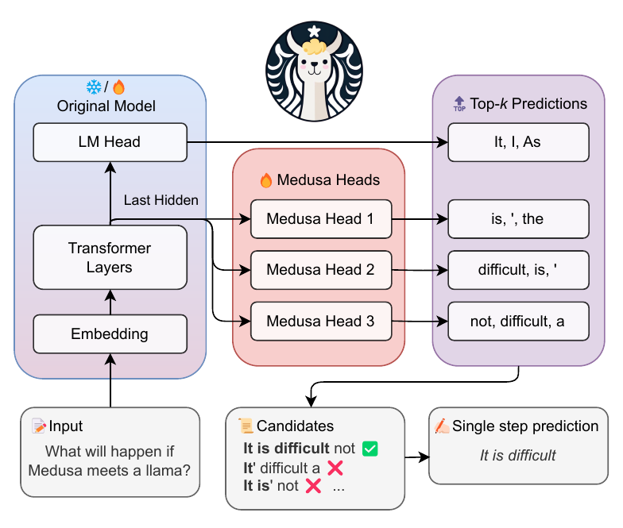

*Medusa 原论文图 1。左侧为共享主干，中间的附加头预测不同偏移量，右侧各头的高分候选按偏移量排列，下方展示从中选择并验证的续段。* [〔14〕](#ref-14)

- **多头起草。** 设 $h_t$ 为主干顶层状态。原始头预测 $x_{t+1}$，第 $k$ 个附加头从同一 $h_t$ 预测 $x_{t+k+1}$。每个头可以保留多个高分词，按预设树结构选择部分组合，再用树注意力验证。
- **训练和接受。** Medusa-1 冻结主干、训练附加头；Medusa-2 联合微调。采用贪婪一致性验证时，结果对齐所用目标模型的贪婪输出。论文也讨论 typical acceptance，即根据目标概率和熵放宽接受条件，此时应同时测量生成质量。
- **与 SpecInfer 的区别。** SpecInfer 把外部草稿模型产生的多个候选合并成树；Medusa 在目标模型主干上训练未来位置的预测头。两者共享树形验证思路，草稿的生成成本和新增参数不同。

## 三、推测级联

### 7. 从顺序级联到 Speculative Cascades

普通级联先运行小模型，再决定是否转交大模型。路由可以发生在整条请求上，也可以发生在每个 token 上。以 token 级联为例，在前缀 $h$ 处，记 $\delta(h)\in\{0,1\}$，取 1 表示转交。最终使用的分布为

$$
\pi_h(v)=(1-\delta(h))q(v\mid h)+\delta(h)p(v\mid h).
$$

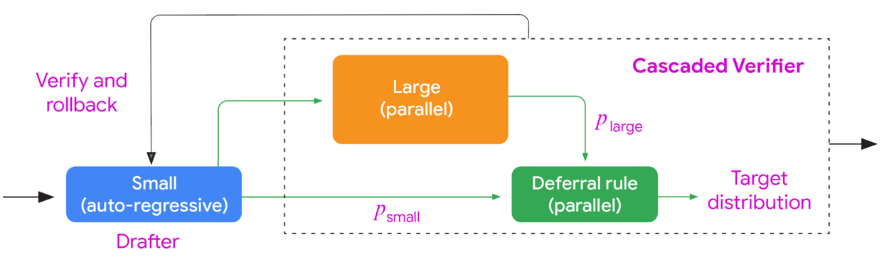

*Google Research 的作者说明图。草稿器先提出一块候选，验证端根据大小模型在各前缀上的输出构造目标分布，再决定本轮提交的词。* [〔4〕](#ref-4)

- **顺序级联。** 若路由只看小模型置信度，小模型有把握时可以直接作答；需要转交时才支付大模型的计算成本。若规则还要比较两个模型的置信度，就必须先得到同一前缀上的两份分数。
- **推测级联。** 先让 $q$ 自回归写出一块草稿，再让 $p$ 在各候选前缀上并行打分。此时每个位置都有 $q_j,p_j$，可以计算 $\delta_j$ 和 $\pi_j$。把严格采样公式里的目标从 $p_j$ 换成 $\pi_j$ 即可：

$$
a_j(d_j)=\min\left(1,\frac{\pi_j(d_j)}{q_j(d_j)}\right),\qquad
r_j(v)\propto[\pi_j(v)-q_j(v)]_+.
$$

- $\delta_j=0$ 时，$\pi_j=q_j$，该候选必然通过。$\delta_j=1$ 时，$\pi_j=p_j$，按标准推测采样验证；转交给大模型后，草稿仍然可能通过。整块接受时，额外的一个词也应从末位置的级联目标分布采样。
- **与标准推测解码的区别。** 标准算法每一步都以 $p$ 为目标。推测级联可以有意保留小模型的措辞，其严格采样保证针对 $\pi$。它仍要为一块候选运行大模型；节省时间的机会来自更长的提交前缀。

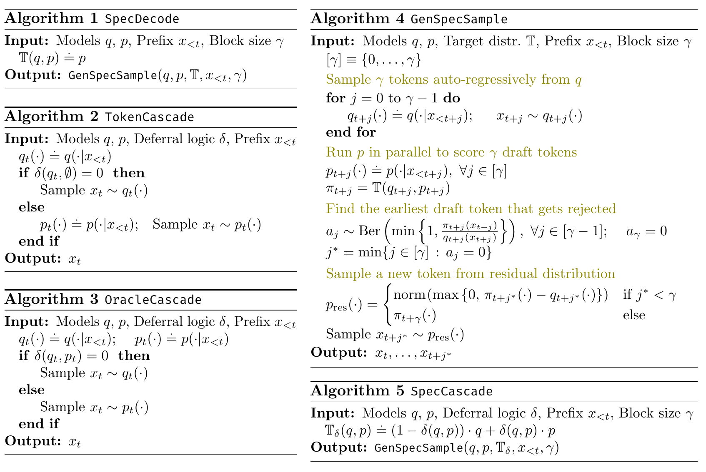

*《Faster Cascades via Speculative Decoding》原论文算法 1–5。左栏比较不同路由方式，右栏算法 4 是通用采样器，算法 5 把级联目标传入该采样器。* [〔15〕](#ref-15)

### 8. 转交规则

记 $c_q=\max_v q(v\mid h)$，$c_p=\max_v p(v\mid h)$。用 $\alpha\ge 0$ 调节转交成本，论文比较了以下几种规则。

| 规则 | 转交大模型的条件 | 规则使用的信息 |
|---|---|---|
| Chow | $c_q<1-\alpha$ | 小模型自身的最高概率 |
| Diff | $c_p-c_q>\alpha$ | 大模型相对小模型的置信度增益 |
| OPT 的可计算近似 | $c_p-c_q>\alpha\,\mathrm{TV}(p,q)$ | 置信度增益和两个分布的差异 |

- **OPT 中的 $\mathrm{TV}$。** 固定前缀，设两个模型对真实下一词的期望任务损失为 $\ell_q,\ell_p$。使用小模型时，路由目标与草稿分布相同。转交时，严格验证导致拒绝的概率为 $\mathrm{TV}(p,q)$。把拒绝带来的额外代价折成损失单位，两个动作的目标值为

$$
J(0)=\ell_q,\qquad J(1)=\ell_p+\alpha\,\mathrm{TV}(p,q).
$$

  当 $\ell_q-\ell_p>\alpha\,\mathrm{TV}(p,q)$ 时转交。真实标签在推理时未知，论文在 0–1 损失下用 $1-c_q$ 与 $1-c_p$ 近似两端风险，得到表中最后一行。模型的置信度校准会影响这项近似。

- 两个模型都可能对各自的首选词很有把握，但草稿实际采到的是另一个词。令 $r_h(v)\in\{0,1\}$ 判断词 $v$ 是否需要转交。例如，当 $p(v\mid h)$ 相对 $c_p$ 过低时取 1。此时路由随 $v$ 变化，论文式（11）把被转交的总质量重新分配给大模型：

$$
\eta=\sum_{v\in V}q(v\mid h)r_h(v),\qquad
\pi_h(v)=q(v\mid h)(1-r_h(v))+\eta\,p(v\mid h).
$$

  求和可得 $\sum_v\pi_h(v)=(1-\eta)+\eta=1$。有了这个分布，再用前节的通用采样器验证。“这批候选中哪些词值得保留”和“最后按照哪个分布采样”是两个连续的计算步骤。

## 四、MTP

### 9. Blockwise Parallel Decoding

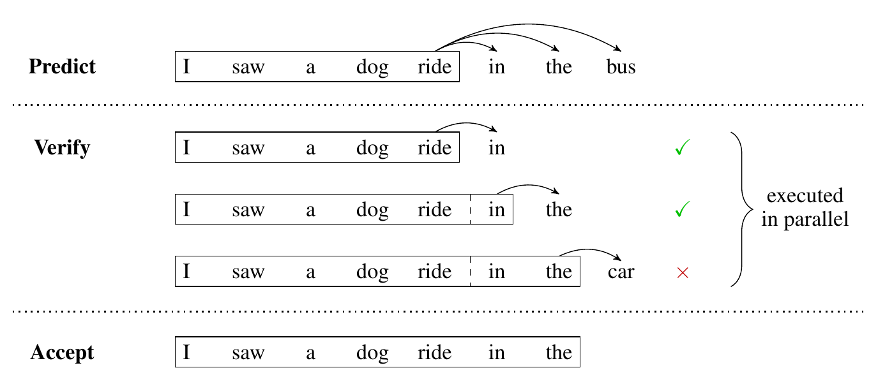

*Stern 等原论文图 1。自上而下依次是提出整块、验证候选前缀和接受最长匹配前缀。* [〔16〕](#ref-16)

- **多头预测。** 给定 $h=x_{\le t}$，主干得到隐藏向量 $z_t\in\mathbb R^d$。多个输出分支分别预测偏移 $1,\ldots,k$。论文的 Transformer 实现在解码器顶层加入有残差连接的多输出前馈层，再对各分支使用原有的词表投影。$z_t$ 是隐藏向量，经过词表投影后才得到 $|V|$ 维 logits。
- **并行。** 令 $\hat x_{t+j}=\arg\max_v q_j(v\mid h)$。第二个头和第一个头读取相同前缀，因此第二个头输出的是对未来第二个词的直接预测。验证时，主头会读取已经提出的第一个词，重新判断第二个位置：

$$
\ell=\max\{s\le k:\ \forall j\le s,\
\hat x_{t+j}=\arg\max_v p(v\mid h,\hat x_{t+1:t+j-1})\}.
$$

- 严格贪婪版本中，第一个候选取自主模型的一步预测。后续只保留连续匹配部分，即使较远的某个头单独猜对了，也不能跨过中间的错误直接提交。

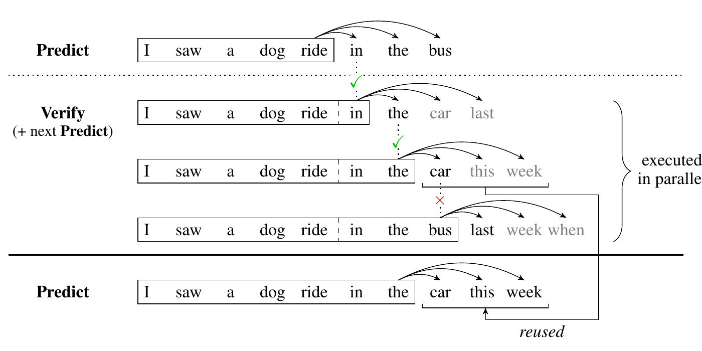

*同一论文图 2。右侧的 reused 表示复用与已接受前缀对应的下一块候选。*

- **重叠两轮。** 在候选前缀的各位置上运行多头模型，第一头为本轮验证提供分数，其余头为可能的下一轮提前提出候选。确定接受长度后，复用正确前缀所在位置的结果。若每次都前进 $k$ 步，长为 $m$ 的生成约需 $m/k$ 轮，实际时间还取决于多头和验证的成本。
- **与独立小模型的区别。** ABC 草稿里的 $C$ 以已起草的 $AB$ 为条件；Blockwise 的远端头在第一次提案时还看不到近端头选中的词。两者都可以做最长前缀验证，草稿内部的条件依赖不同。

### 10. Meta MTP

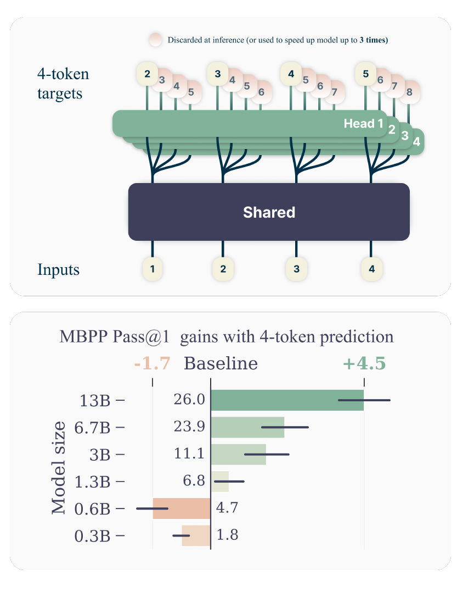

*Gloeckle 等原论文图 1。上半部的多个预测头读取同一份主干表示，下半部报告作者在代码任务中的结果。* [〔17〕](#ref-17)

- **网络结构。** 共享因果主干产生 $z_{\le t}=F(x_{\le t})$。第 $j$ 个头各有自己的 Transformer 层 $f_j$，最后共享词表投影 $W_U$：

$$
q_j(\cdot\mid x_{\le t})
=\operatorname{softmax}\!\left(W_U[f_j(z_{\le t})]_t\right),
\qquad \text{标签为 }x_{t+j}.
$$

- **训练。** 数据中所有未来标签都已知，令 $\mathcal I_j$ 为第 $j$ 个标签仍在窗口内的位置集合。忽略统一的损失缩放，多头交叉熵可写为

$$
\mathcal L_{\rm multi}=-\sum_{j=1}^n\sum_{t\in\mathcal I_j}
\log q_j(x_{t+j}\mid x_{\le t}).
$$

  $z_t$ 同时收到多个未来位置的梯度。当一个前缀中的关键信息会影响后续若干词时，预测这些词都能为主干提供监督。训练时可以逐头计算词表投影、损失及反向传播，累积主干梯度，减少同时保留多份大词表张量造成的显存峰值。

- **推理。** 单独使用第一头即可普通生成；也可以使用远端头并行起草，再用第一头验证。四个头输出四份分布，不保证四个候选连在一起就构成第一头会逐步生成的序列。
- **与 Blockwise 的区别。** Blockwise 的重点是用额外的前馈预测分支减少解码轮数；Meta 将多位置预测用于预训练，各偏移量采用独立的 Transformer 头。这里的 Transformer 层已经包含注意力和前馈子层。与 Medusa 相比，Meta 重点考察多标签监督能给共享主干带来多少训练收益。

### 11. DeepSeek-V3 MTP

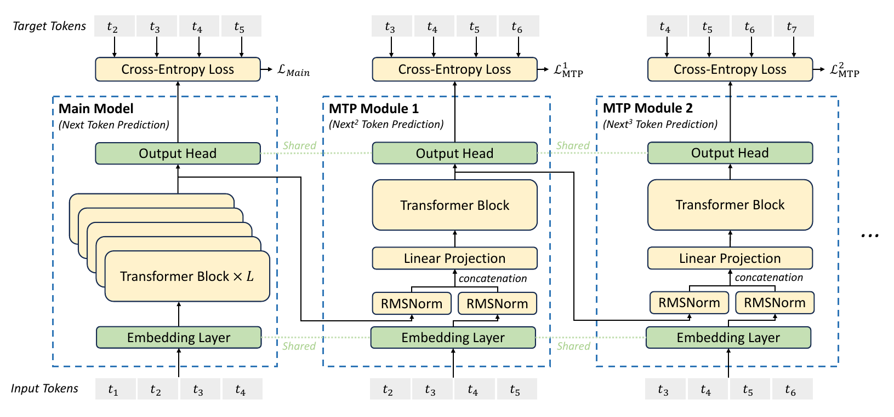

*DeepSeek-V3 技术报告图 3。先沿水平方向看不同预测深度之间传递的隐藏状态，再沿每列看移位后的 token embedding 和上方的预测标签。* [〔18〕](#ref-18)

**输入和标签的错位。** 设主模型输入为 $t_1,\dots,t_T$，训练窗口另有最后一个标签 $t_{T+1}$。以 $j$ 表示主模型位置，以 $k$ 表示额外预测深度。 [〔3〕](#ref-3)主模型顶层状态记为 $h_j^0$。

| 预测位置 | 来自前一深度的状态 | 额外读入的 token | 要预测的标签 |
|---|---|---|---|
| 主模型 | 主干处理 $t_{\le j}$ 得到 $h_j^0$ | — | $t_{j+1}$ |
| MTP 1 | $h_j^0$ | $t_{j+1}$ | $t_{j+2}$ |
| MTP 2（一般形式） | $h_j^1$ | $t_{j+2}$ | $t_{j+3}$ |
| MTP $k$ | $h_j^{k-1}$ | $t_{j+k}$ | $t_{j+k+1}$ |

- **融合。** 在第 $k$ 个模块，分别归一化上一深度的状态与当前移位 token 的 embedding，拼成 $2d$ 维，再投影回 $d$ 维。报告式（21）写为

$$
u_j^k=M_k
\begin{bmatrix}\mathrm{RMSNorm}(h_j^{k-1})\\
\mathrm{RMSNorm}(E(t_{j+k}))\end{bmatrix},
\qquad M_k\in\mathbb R^{d\times 2d}.
$$

- **位置间计算。** 将同一深度上的 $u_j^k$ 沿序列维排列，交给该模块自己的因果 Transformer 块。随后用共享输出头得到词表分布。报告式（22）和（23）为

$$
h^k_{1:T-k}=\mathrm{TRM}_k(u^k_{1:T-k}),\qquad
P^k_{j+k+1}=\mathrm{OutHead}(h_j^k).
$$

  embedding 和输出头与主模型共享，投影 $M_k$ 和 Transformer 块按深度区分。$k$ 计数的是主模型之后的 MTP 模块；$h_j^0$ 已经是主干顶层的输出。

将标签索引代入交叉熵，报告的归一化约定是

$$
\mathcal L_{\rm MTP}^k
=-\frac1T\sum_{i=k+2}^{T+1}\log P_i^k[t_i],
\qquad
\mathcal L_{\rm total}
=\mathcal L_{\rm next}+\frac{\lambda}{D}\sum_{k=1}^{D}\mathcal L_{\rm MTP}^k.
$$

- $P_i^k$ 是词表上的向量，$P_i^k[t_i]$ 取出真实词所在分量。第 $k$ 个模块有 $T-k$ 个有效标签，报告式（24）仍除以 $T$。若擅自改成有效项数，各深度的相对权重也会改变。
- 取 $T=4$，窗口为 A、B、C、D、E。主模型的四个标签是 B、C、D、E。第一辅助模块的三个标签是 C、D、E。若保持第四个主干位置也训练 MTP 1，就需要第六个词作标签，它已超出这个窗口。
- **推理时，额外读入的词从哪里来。** 当前前缀截止 $t_T$，主模型先产生 $\hat t_{T+1}$。MTP 1 读取 $h_T^0$ 和 $E(\hat t_{T+1})$，起草 $\hat t_{T+2}$。若还有第二个模块，它读取 $h_T^1$ 和 $E(\hat t_{T+2})$。推理可以从位置 $T$ 开始，因为无需真实未来标签计算交叉熵。用于加速时，辅助候选仍由主模型验证。
- **与 Meta MTP 的区别。** Meta 的多个头直接读取共享主干表示，远端头在起草时还不知道近端头选了哪个词。DeepSeek 的后一个模块显式接收前一深度的状态和刚选出的 token，使较远预测具有逐步延伸的条件前缀。训练时这些移位 token 来自数据，推理时来自模型。
- **V3 的实际配置。** 技术报告给出 $D=1$，即主模型预测一个词，辅助模块再预测一个词。作者在其评估中报告，第二个词的接受率随生成主题约为 85%–90%，结合推测解码约达基线的 1.8 倍 TPS。图中画出多个模块是为了说明可扩展结构。

## 五、加速比

设一轮提交的 token 数为 $N$。在严格单链采样中，拒绝时提交一个修正词，全通过时额外提交一个词。暂忽略 EOS 和长度上限，一轮的提交数就是“连续接受的草稿数加一”。记 $A_j$ 为第 $j$ 个草稿通过，则

$$
\mathbb E[N]=1+\sum_{j=1}^\gamma
\Pr(A_1\cap\cdots\cap A_j).
$$

- **连续前缀。** 第三个词即使常常猜对，只要第一个词频繁被拒绝，第三个词就很少有机会提交。若每一位置在此前均通过的条件下，接受概率都近似为 $a$，上式化为 $1+a+\cdots+a^\gamma$，当 $a=1$ 时为 $\gamma+1$。
- **一轮耗时。** 设目标模型普通单步耗时为 $t_p$，起草、验证和调度的单轮总耗时分别为 $T_d,T_v,T_o$，在相同硬件、批量与解码设置下，可估计稳态加速比

$$
S\approx\frac{\mathbb E[N]\,t_p}{\mathbb E[T_d+T_v+T_o]}.
$$

  当小批量解码主要受权重读取带宽限制时，一次让目标模型验证几个位置可以复用已读入的权重。增大草稿长度或树宽也会增加计算、激活与 KV 开销。若 GPU 已被大批量请求充分利用，$T_v$ 与普通单步耗时的差距可能变大。

- **对齐评测口径。** 对严格贪婪解码，应比较同一目标模型的输出序列；严格随机采样对应的是输出分布；对宽松验证和推测级联，要在同一任务质量附近比较延迟。报告草稿长度、平均提交长度、每秒输出 token 数，并区分首 token 延迟与后续生成延迟，才能判断收益来自哪里。

## 参考文献

〔1〕 Heming Xia 等．[Unlocking Efficiency in Large Language Model Inference: A Comprehensive Survey of Speculative Decoding](https://arxiv.org/abs/2401.07851v3)。[↩ 返回正文](#cite-1)

〔2〕 hemingkx．[LLM推理加速新范式！推测解码（Speculative Decoding）最新综述](https://zhuanlan.zhihu.com/p/678404136)。[↩ 返回正文](#cite-2)

〔3〕 姜富春．[deepseek技术解读(2)-MTP（Multi-Token Prediction）的前世今生](https://zhuanlan.zhihu.com/p/18056041194)。[↩ 返回正文](#cite-3)

〔4〕 Hari Narasimhan、Aditya Menon．[Speculative cascades — A hybrid approach for smarter, faster LLM inference](https://research.google/blog/speculative-cascades-a-hybrid-approach-for-smarter-faster-llm-inference/)。[↩ 返回正文](#cite-4)

〔5〕 Yaniv Leviathan、Matan Kalman、Yossi Matias．[Fast Inference from Transformers via Speculative Decoding](https://arxiv.org/abs/2211.17192v2)。[↩ 返回正文](#cite-5)

〔6〕 Charlie Chen 等．[Accelerating Large Language Model Decoding with Speculative Sampling](https://arxiv.org/abs/2302.01318v1)。[↩ 返回正文](#cite-6)

〔7〕 Heming Xia 等．[Speculative Decoding: Exploiting Speculative Execution for Accelerating Seq2seq Generation](https://arxiv.org/abs/2203.16487v6)。[↩ 返回正文](#cite-7)

〔8〕 Yongchao Zhou 等．[DistillSpec: Improving Speculative Decoding via Knowledge Distillation](https://arxiv.org/abs/2310.08461v2)。[↩ 返回正文](#cite-8)

〔9〕 Jun Zhang 等．[Draft & Verify: Lossless Large Language Model Acceleration via Self-Speculative Decoding](https://arxiv.org/abs/2309.08168v2)。[↩ 返回正文](#cite-9)

〔10〕 Seongjun Yang 等．[Predictive Pipelined Decoding: A Compute-Latency Trade-off for Exact LLM Decoding](https://arxiv.org/abs/2307.05908v2)。[↩ 返回正文](#cite-10)

〔11〕 Andrea Santilli 等．[Accelerating Transformer Inference for Translation via Parallel Decoding](https://arxiv.org/abs/2305.10427v1)。[↩ 返回正文](#cite-11)

〔12〕 Yichao Fu 等．[Break the Sequential Dependency of LLM Inference Using Lookahead Decoding](https://arxiv.org/abs/2402.02057v1)。[↩ 返回正文](#cite-12)

〔13〕 Xupeng Miao 等．[SpecInfer: Accelerating Large Language Model Serving with Tree-based Speculative Inference and Verification](https://arxiv.org/abs/2305.09781v4)。[↩ 返回正文](#cite-13)

〔14〕 Tianle Cai 等．[Medusa: Simple LLM Inference Acceleration Framework with Multiple Decoding Heads](https://arxiv.org/abs/2401.10774v3)。[↩ 返回正文](#cite-14)

〔15〕 Harikrishna Narasimhan 等．[Faster Cascades via Speculative Decoding](https://arxiv.org/abs/2405.19261v2)。[↩ 返回正文](#cite-15)

〔16〕 Mitchell Stern、Noam Shazeer、Jakob Uszkoreit．[Blockwise Parallel Decoding for Deep Autoregressive Models](https://arxiv.org/abs/1811.03115v1)。[↩ 返回正文](#cite-16)

〔17〕 Fabian Gloeckle 等．[Better & Faster Large Language Models via Multi-token Prediction](https://arxiv.org/abs/2404.19737v1)。[↩ 返回正文](#cite-17)

〔18〕 DeepSeek-AI．[DeepSeek-V3 Technical Report](https://arxiv.org/abs/2412.19437v2)。[↩ 返回正文](#cite-18)
